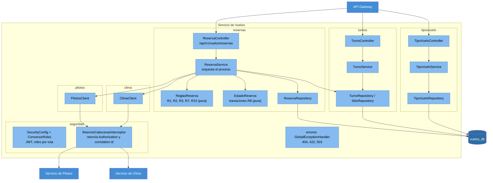

# C4 nivel 3: Componentes del Servicio de Vuelos

Paquetes en `vuelos-service/src/main/java/com/parapente/vuelos/`, organizados por funcionalidad.

- `ReservaService` es el único que decide el orden: reglas propias, piloto, clima. No usa `@Transactional` en `crear` a propósito, para que una reserva RECHAZADA quede guardada aunque se lance el 422 y para no sostener una conexión durante llamadas HTTP.
- `ReglasReserva` y `EstadoReserva` son puras (sin Spring ni base), por eso se prueban con tests unitarios simples.
- `PilotosClient` y `ClimaClient` traducen las fallas HTTP a excepciones propias: sin piloto = `PilotoNoDisponibleException` (regla), pilotos caído = `DependenciaNoDisponibleException` (503), clima caído = `ClimaNoDisponibleException` (no confirma).
