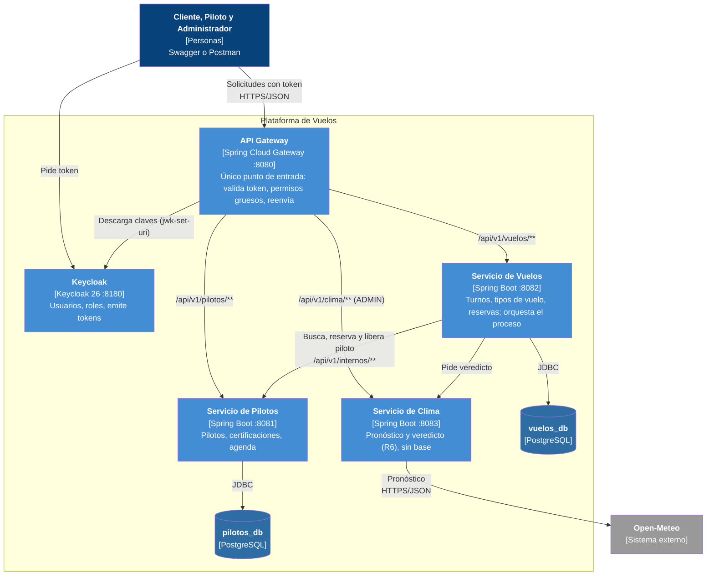

# C4 nivel 2: Contenedores

- Sólo el gateway y Keycloak publican puertos; los servicios y PostgreSQL quedan en la red interna de Docker.
- Cada servicio tiene su base (un solo PostgreSQL con dos bases) y nadie lee tablas ajenas.
- El gateway **no** enruta `/api/v1/internos/**`: esos endpoints de Pilotos sólo los llama Vuelos.
- Gateway y los tres servicios validan el JWT (todos con `jwk-set-uri` hacia Keycloak).
- Vuelos reenvía el `Authorization` del usuario a Pilotos y Clima.
