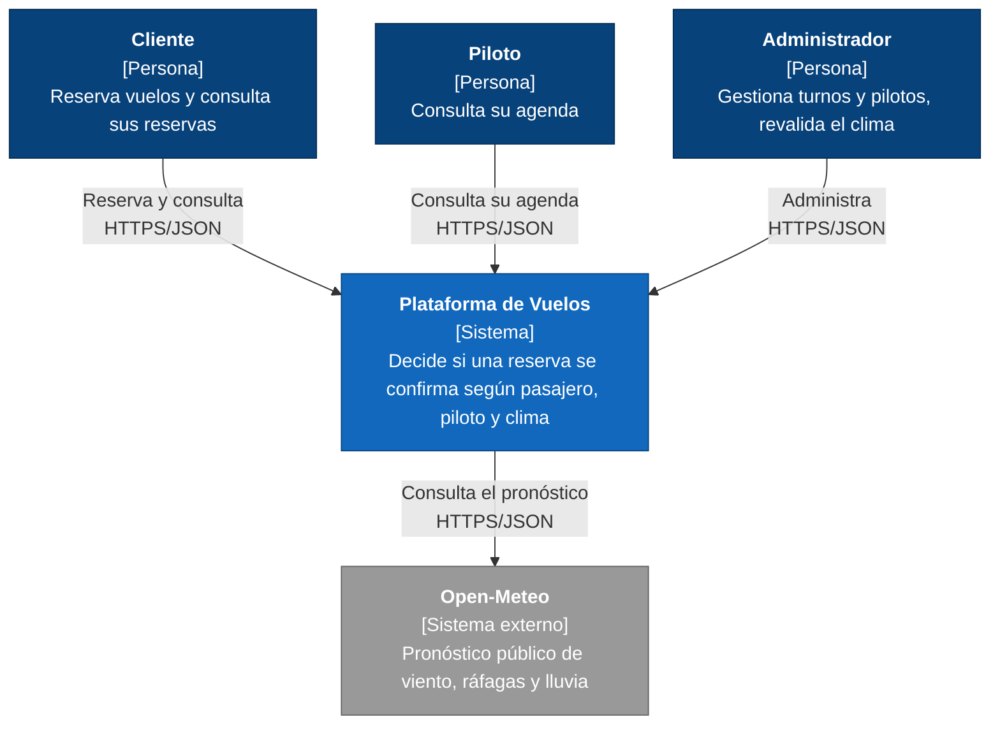

# C4 nivel 1: Contexto

Tres tipos de usuario usan la API (desde Swagger o Postman). La plataforma es el sistema que construimos y el único sistema externo del que depende es Open-Meteo. La autenticación (Keycloak) forma parte de lo que desplegamos y se ve en el nivel 2.
