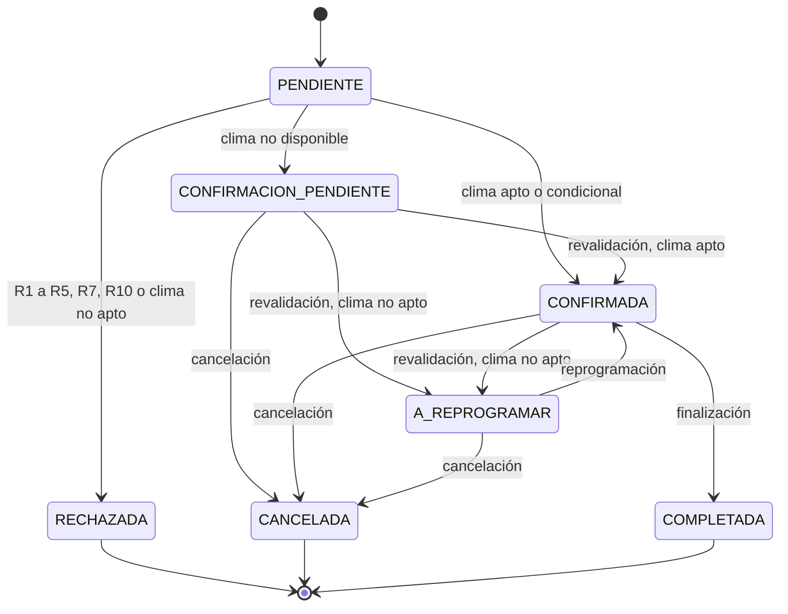

# Estados de la reserva (R8)

Implementado en `EstadoReserva` (`transicionesPermitidas` y `puedePasarA`); `Reserva.cambiarEstado` lanza `ReglaNegocioException` (422) ante una transición inválida.

- Estados **activos** (ocupan cupo y cuentan para R7): PENDIENTE, CONFIRMADA, CONFIRMACION_PENDIENTE y A_REPROGRAMAR (`EstadoReserva.ACTIVAS`).
- Diferencia con el diagrama del cuestionario: se agrega CONFIRMACION_PENDIENTE a CANCELADA (el contrato técnico lo permite para que una reserva en espera pueda cancelarse).
- Test: `EstadoReservaTest`.
