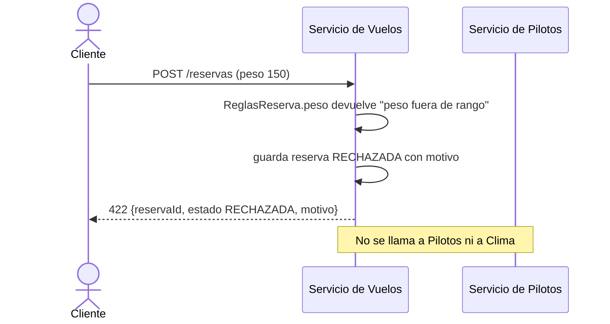
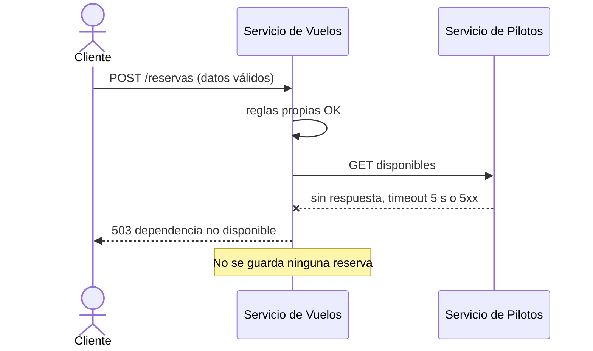
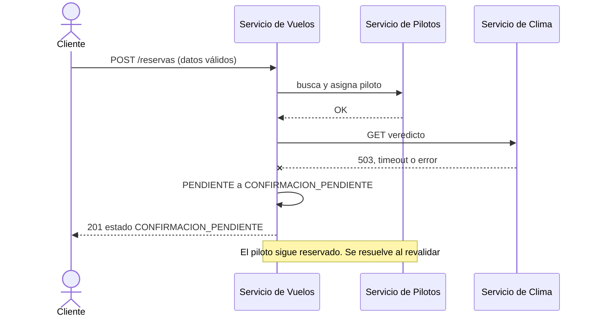

# Secuencias de error

## 1. Regla de negocio (ejemplo: peso fuera de rango, R1)

Lo mismo ocurre con R2, R3, R7 y R10. Sin piloto certificado o libre (R4, R5) pasa igual, pero después de consultar a Pilotos (que responde 404 con el motivo).

## 2. Servicio de Pilotos caído

Si Pilotos cae en el paso de `asignar` (con la reserva ya guardada), Vuelos borra la reserva y responde 503 (marcha atrás simple).

## 3. Servicio de Clima caído (o Open-Meteo caído)

Clima no disponible nunca confirma. Cualquier falla de `ClimaClient` (5xx, 4xx, timeout, respuesta vacía) cuenta como no disponible.

## 4. Clima no apto (R6)

Clima responde NO_APTO: Vuelos llama a `DELETE /api/v1/internos/asignaciones/{reservaId}`, libera al piloto, guarda la reserva RECHAZADA con "clima no apto: ..." y responde 422.
