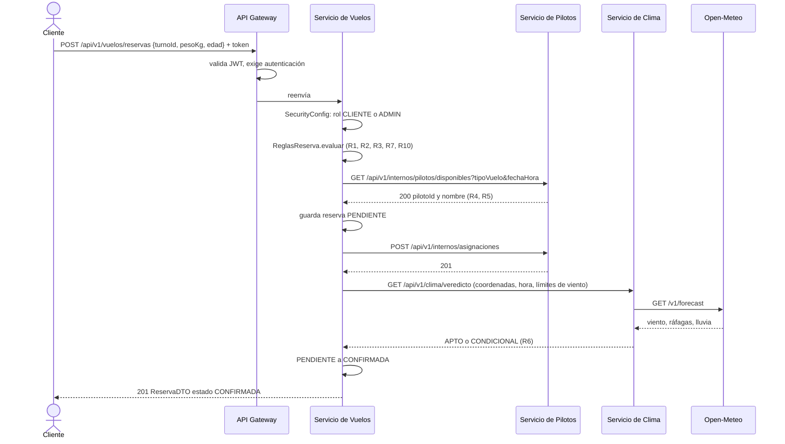

# Secuencia: reserva exitosa (`ReservaService.crear`)

Cada etapa puede cortar el proceso (ver `secuencia-errores.md`). Con CONDICIONAL la reserva también queda CONFIRMADA, con el motivo "viento cercano al límite".
