# Guía definitiva del TPI: reservas de vuelos en parapente y globo

Esta guía reemplaza a todas las anteriores (`guia-equipo`, `guion-exposicion`, `guia-defensa`, `guia-facil-por-partes` y `postman-explicado`). Está pensada como un mini curso: arranca por lo general, que tiene que saber todo el grupo, baja a lo particular de cada parte de la exposición, y termina con las herramientas (Postman, Docker, comandos).

## Cómo leerla

| Si sos... | Leé |
|---|---|
| **Cualquiera del grupo** | La Parte I completa, la Parte III (la posta) y de la Parte V las secciones 3 a 5 (reiniciar la base y apagar servicios) |
| **Quien expone una parte** | La Parte I, tu parte de la Parte II a fondo, y las otras por arriba |
| **Quien maneja Postman en la demo** | La Parte IV completa |
| **Quien tiene que levantarlo en su PC** | La Parte V |

Dentro de cada parte vas a ver tres niveles:

- **Imprescindible.** Lo que tenés que saber sí o sí. Si te preguntan esto y dudás, se nota.
- **Extra.** Para cuando se pongan quisquillosos. Si lo sabés, suma. Si no, no pasa nada.
- **Para proyectar.** Qué archivo abrir en pantalla, en qué línea, y qué señalar mientras hablás.

Las rutas de archivo van desde la raíz del repositorio. Los números de línea son de la versión actual del código; si alguien cambia el archivo, se corren unas líneas, pero el nombre de la función se encuentra igual con buscar (Ctrl+F o Cmd+F).

## Índice

- **Parte I. Lo general (lo sabe todo el grupo)**
  1. La consigna y qué se evalúa
  2. El dominio, sin tecnicismos
  3. El mapa del sistema
  4. Las piezas y sus puertos
  5. El molde que se repite en cada servicio
  6. La autenticación de punta a punta
  7. El recorrido de una reserva
  8. Los estados de una reserva
  9. Códigos de respuesta
  10. Los datos de prueba
  11. Decisiones y límites
- **Parte II. Las cinco partes de la exposición**
  - A. Autenticación, roles y gateway
  - B. El proceso de reserva
  - C. Reglas de negocio y pruebas
  - D. Pilotos y comunicación entre servicios
  - E. Clima, revalidación e infraestructura
- **Parte III. La posta: cómo pasarnos la palabra**
- **Parte IV. Postman: guía completa**
- **Parte V. Docker y comandos: levantar, reiniciar y salvedades**
- **Parte VI. Estado, pendientes y preguntas finales**

---
---

# PARTE I. LO GENERAL

## 1. La consigna y qué se evalúa

El trabajo es el TPI 2026 de Backend de Aplicaciones (UTN FRC): construir un **backend de microservicios** para una empresa que vende vuelos en parapente y globo.

**Lo que pidieron y cómo lo cubrimos.** La rúbrica tiene 12 criterios que suman 105 puntos:

| Criterio | Pts | Qué piden, en simple | Dónde lo cubrimos |
|---|---|---|---|
| Proceso de negocio de punta a punta | 15 | Que la reserva funcione completa, con sus casos felices y de falla | Partes B, C, D, E |
| Arquitectura | 12 | Que haya servicios separados, bien divididos | Parte I, secciones 3 a 5 |
| Integración entre servicios y externa | 12 | Que los servicios se hablen y se use una fuente externa | Partes D y E (Open-Meteo) |
| Reglas de negocio | 10 | Que las reglas estén claras y probadas | Parte C |
| Calidad técnica | 10 | Código ordenado, errores bien manejados, tests | Partes B y C |
| Persistencia y despliegue | 10 | Base de datos y que todo arranque con un comando | Parte E y Parte V |
| Seguridad | 8 | Login, roles, permisos | Parte A |
| Alcance comprometido | 8 | Que esté lo que prometimos en el cuestionario | Parte VI |
| Desafío asumido | 5 | Explicar qué fue difícil y qué decidimos | Sección 11 |
| Colecciones de Postman | 5 | Pruebas de la API listas para correr | Parte IV |
| Presentación y defensa | 5 | Exponer y responder | Todo, y Parte III |
| Apreciación docente | 5 | Prolijidad y que todos entiendan | Todo |

**Cómo es la exposición (indicación de los profesores, por audio, 9/11/2026):**
- Un **guión general** del código: cómo funciona cada servicio y cada pieza, incluido el **flujo de autenticación**.
- Un **guión detallado por integrante**: cada uno se centra en **una parte del código**.
- Las preguntas son **sobre el código**, sin trampa. Es una exposición como cualquier otra: hablar y explicar.
- Saben que se usó IA. Lo que se evalúa es que **entendamos qué hace el código**, no quién lo escribió.

**Lo que esto significa para vos:** no hace falta memorizar código. Hace falta poder contar qué hace cada pieza, por qué está ahí, y qué pasa cuando algo sale mal.

## 2. El dominio, sin tecnicismos

Imaginá una empresa en Villa Carlos Paz que vende paseos en parapente y en globo. Cada paseo sale un día y a una hora determinados, y tiene un número limitado de lugares. Eso es un **turno**. El sistema sirve para que los clientes reserven un lugar en un turno sin que nada salga mal.

**El problema que resuelve.** Antes, la empresa confirmaba reservas sin saber si había un piloto libre ni si el viento permitía volar. Terminaba cancelando a último momento. Este sistema **solo confirma cuando hay un piloto certificado libre y el pronóstico lo permite**, y vuelve a revisar el clima antes del vuelo.

**Reservar.** Un cliente elige un turno e informa cuánto pesa y qué edad tiene. Para confirmarle el lugar, el sistema comprueba cuatro cosas, siempre en este orden:

1. **Que la persona pueda volar.** Cada tipo de paseo tiene un peso máximo y mínimo y una edad mínima. Si no los cumple, se la rechaza. También se la rechaza si ya tenía reservado ese mismo turno, si el turno ya no tiene lugares, o si la fecha es inválida (ya pasó, o está a más de 16 días, que es hasta donde llega el pronóstico).
2. **Que haya un piloto.** Cada paseo necesita uno certificado para ese tipo de vuelo y libre a esa hora. El sistema le pide al sector de pilotos que le asigne uno.
3. **Que el clima acompañe.** Se consulta el pronóstico real para ese día y lugar. Con demasiado viento o lluvia, no se vuela.
4. **Confirmar.** Si todo está bien, la reserva queda **confirmada** y el piloto queda apartado. Si algo falla, queda **rechazada** y se guarda el motivo ("peso fuera de rango", "clima no apto"), así el cliente sabe por qué.

**Cuando algo se rompe, el sistema nunca deja cosas a medias:**
- Si el sector de pilotos no responde, no se guarda nada y se avisa que el servicio no está disponible. Sin piloto no se puede prometer un paseo.
- Si lo que no responde es el pronóstico, la reserva se guarda y el piloto queda apartado, pero la reserva queda **pendiente de confirmar**. Nunca se confirma sin saber el clima.

**El tiempo pasa y el clima cambia.** Una reserva confirmada hoy puede dejar de ser viable cuando el pronóstico cambia. Por eso el administrador puede pedir que se **revisen** todas las reservas confirmadas. A las que el clima ya no deja volar las marca como **a reprogramar** y libera al piloto. El cliente puede entonces pasarlas a otro turno o cancelarlas. Cancelar devuelve el lugar y libera al piloto.

**Los tres roles:**

| Rol | Qué puede hacer |
|---|---|
| **Cliente** | Ver turnos, reservar, ver, cancelar y reprogramar **solo sus** reservas |
| **Piloto** | Ver su agenda (los vuelos que tiene asignados) |
| **Administrador** | Todo lo anterior más: ver todas las reservas, revisar el clima, finalizar vuelos y administrar turnos, tipos de vuelo y pilotos |

**Una sola frase para quedarse:** una reserva solo se confirma si la persona puede volar, hay lugar, hay piloto y hay buen clima. Si algo falla, el sistema lo deja registrado con su motivo y no deja nada a medias.

## 3. El mapa del sistema

El sistema es un conjunto de piezas chicas, cada una con un trabajo. Las líneas continuas son el camino de un pedido; las punteadas, la seguridad.

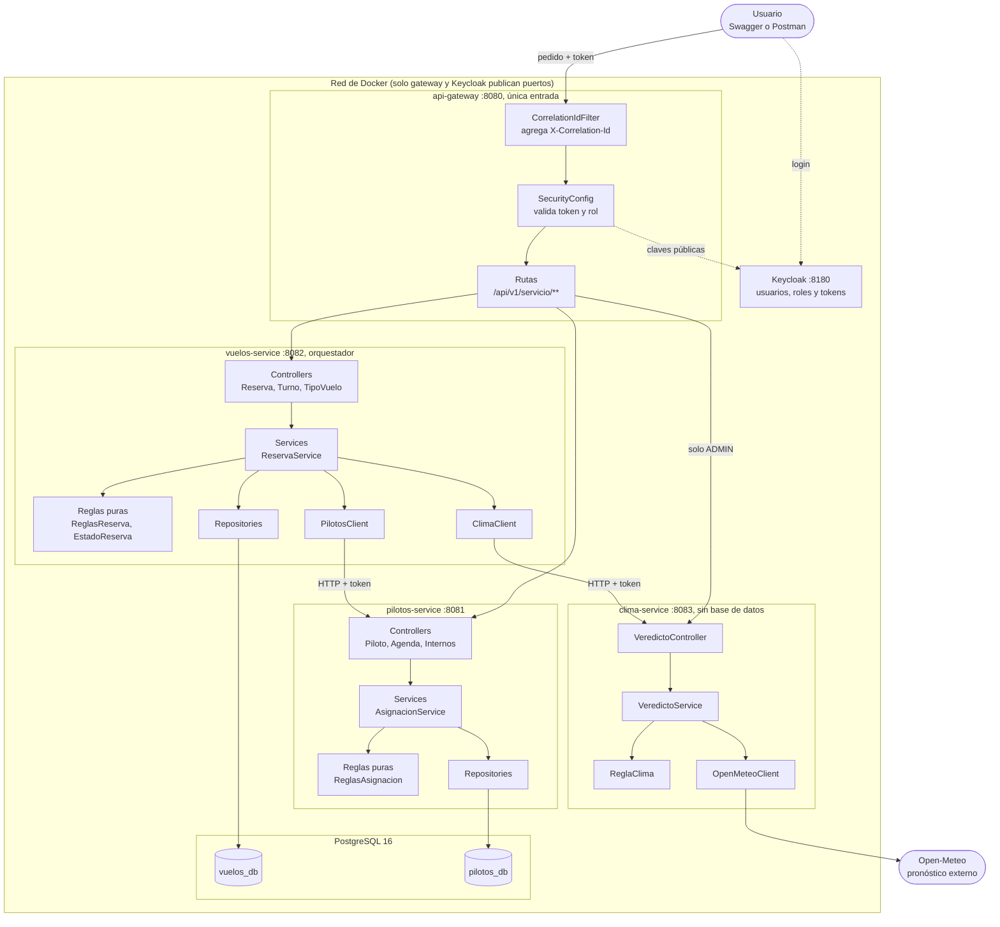

**Imprescindible. Cinco ideas para decir mirando este diagrama:**
1. **Nadie entra directo a un servicio.** Todo pasa por el gateway.
2. **Vuelos manda.** Es el único que llama a los otros dos. Pilotos y Clima no se conocen entre sí.
3. **Cada servicio es dueño de sus datos.** Vuelos tiene `vuelos_db`, Pilotos tiene `pilotos_db`. Si uno quiere algo del otro, se lo pide por la API; nunca mira su base.
4. **Clima es el único que habla con Internet** (Open-Meteo) y no tiene base de datos.
5. **Las rutas `/api/v1/internos/**` de Pilotos son solo para Vuelos.** El gateway no las expone.

## 4. Las piezas y sus puertos

Seis contenedores, un solo `docker compose up`:

| Pieza | Puerto | Qué hace | Se ve desde afuera |
|---|---|---|---|
| `api-gateway` | 8080 | Única entrada. Valida el token y reparte los pedidos | Sí |
| `vuelos-service` | 8082 | Turnos, tipos de vuelo y reservas. **Orquesta** a los otros dos | No |
| `pilotos-service` | 8081 | Pilotos, certificaciones y agenda | No |
| `clima-service` | 8083 | Consulta Open-Meteo y da el veredicto APTO, CONDICIONAL o NO_APTO | No |
| `keycloak` | 8180 | Usuarios, roles y emisión de tokens | Sí |
| `postgres` | 5432 | Las dos bases (`vuelos_db` y `pilotos_db`) | No |

**Extra.** Cada servicio expone un `/actuator/health`: una dirección que responde `{"status":"UP"}` si está sano. Docker la usa para saber cuándo un servicio está listo antes de arrancar el siguiente.

## 5. El molde que se repite en cada servicio

Los cuatro servicios Java se organizan igual: **un paquete por funcionalidad** (`reservas`, `turnos`, `clima`...) y adentro siempre las mismas piezas. Si entendés una, entendés todas.

| Pieza | Qué hace | Ejemplo real |
|---|---|---|
| **Controller** | Recibe el pedido HTTP, valida la forma de los datos y delega. No decide nada | `ReservaController` |
| **Service** | Coordina el caso de uso: llama a las reglas, a la base y a otros servicios | `ReservaService` |
| **Reglas puras** | Las decisiones de negocio, en clases chicas sin Spring ni base de datos | `ReglasReserva`, `ReglaClima` |
| **Repository** | Lee y guarda en PostgreSQL | `ReservaRepository` |
| **Entity** | La clase que representa una fila de la base | `Reserva`, `Turno` |
| **DTO** | El formato JSON que entra y sale por la API | `CrearReservaDTO`, `ReservaDTO` |
| **Client** | Llama por HTTP a otro servicio y traduce sus fallas | `PilotosClient`, `ClimaClient` |
| **seguridad, errores, config** | Token y roles, respuestas de error con formato único, ajustes | `SecurityConfig`, `GlobalExceptionHandler` |

**Por qué se organiza por funcionalidad y no por capa.** Las carpetas dicen qué hace el negocio (`reservas`, `turnos`), no qué tipo de clase hay. Cada cambio toca una sola carpeta.

## 6. La autenticación de punta a punta

Es lo que los profesores pidieron explícitamente. **Todo el grupo tiene que poder contarlo.**

**La analogía.** Es un recital con pulseras. **Keycloak** es la boletería: te pide usuario y contraseña y te da una **pulsera** (el token). La pulsera dice quién sos, qué rol tenés y cuándo vence, y viene **firmada**, así que no se puede falsificar. **El gateway** es el guardia de la puerta: mira que la pulsera sea auténtica y no esté vencida. **Cada servicio** es una sala con su propio guardia, que vuelve a mirar la pulsera.

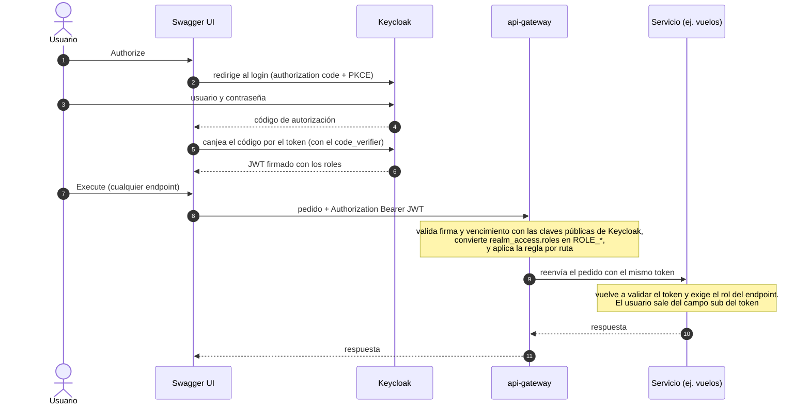

**Imprescindible:**
- **Keycloak** guarda usuarios y contraseñas (hasheadas) y emite el **JWT**: un token firmado que dice quién sos (`sub`), qué roles tenés (`realm_access.roles`) y cuándo vence.
- Hay tres **roles**: CLIENTE, PILOTO y ADMIN. Los usuarios de prueba están en `keycloak/realm-parapente.json`.
- **Swagger** usa el cliente `parapente-swagger` con *authorization code + PKCE*: el navegador nunca maneja un secreto. **Postman** usa el cliente `parapente-postman` y manda usuario y contraseña directo.
- El **gateway no le pregunta a Keycloak en cada pedido**. Valida la **firma** con las claves públicas y el **vencimiento**.
- Los servicios **repiten la validación**: un servicio no debe confiar a ciegas en quien lo llama.
- **401** es no estar autenticado, **403** es estar autenticado pero sin el rol, y **404** en una reserva ajena (para no revelar que existe).

**Extra:**
- No se valida el `issuer` del token porque el host de Keycloak difiere dentro y fuera de Docker (`keycloak:8080` contra `localhost:8180`). Es una simplificación que hay que decir.
- El token de prueba dura 1 hora (`accessTokenLifespan` = 3600 en el realm).

## 7. El recorrido de una reserva

Es el flujo más importante. Si podés contarlo de punta a punta, entendés casi todo.

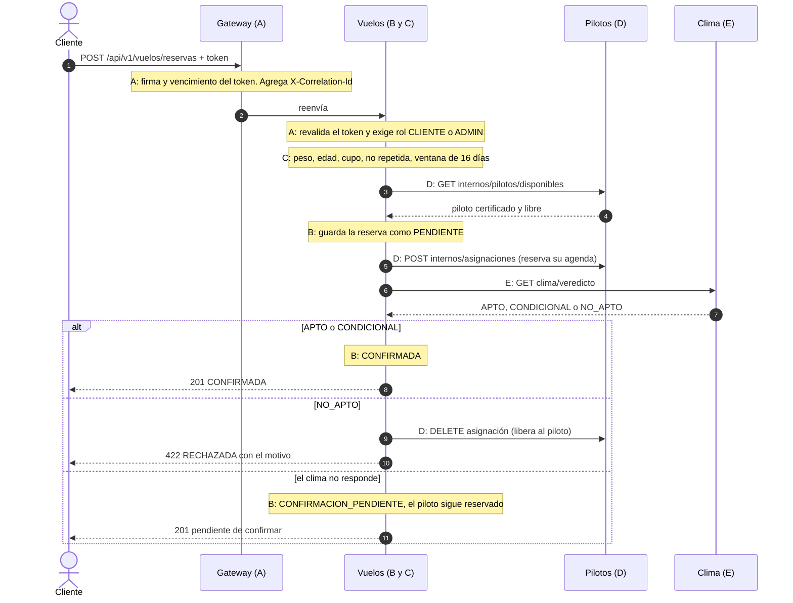

**El orden no es casual:** primero lo barato (las reglas propias, que no necesitan preguntar a nadie), después el piloto, y al final el clima. Así no se gasta una consulta de clima por una reserva que igual iba a rechazarse por el peso.

**Dónde se corta cada caso** (útil para responder "¿qué pasa si...?"):

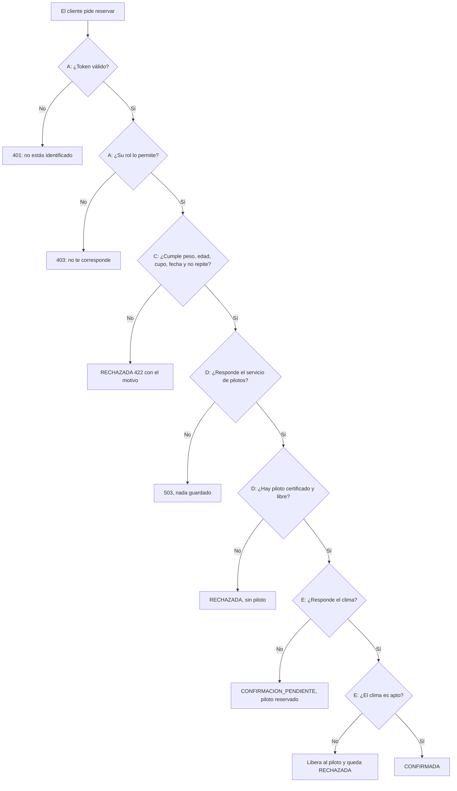

## 8. Los estados de una reserva

Una reserva pasa por estados, y **no se puede saltar de cualquiera a cualquiera**. Esa es una regla del negocio (la llamamos R8 en el código) y vive en un solo lugar: `EstadoReserva`.

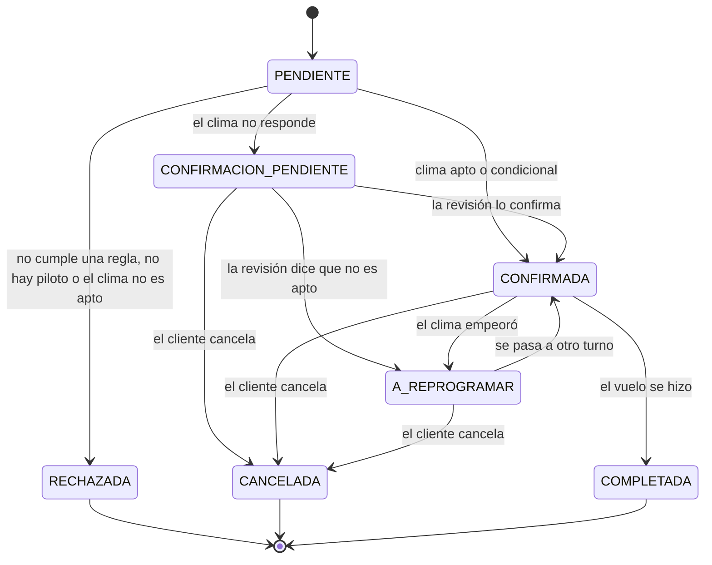

| Estado | Qué significa | ¿Ocupa lugar? |
|---|---|---|
| PENDIENTE | Recién creada, todavía en proceso (dura milisegundos) | Sí |
| CONFIRMADA | Hay piloto y el clima acompaña | Sí |
| CONFIRMACION_PENDIENTE | Hay piloto pero no se pudo consultar el clima | Sí |
| A_REPROGRAMAR | Estaba confirmada, pero el clima empeoró | Sí |
| RECHAZADA | No se pudo reservar (estado final) | No |
| CANCELADA | El cliente o el administrador la canceló (final) | No |
| COMPLETADA | El vuelo se realizó (final) | No |

Los estados que ocupan lugar se llaman **activos** (`EstadoReserva.ACTIVAS`). Cuentan para el cupo y para evitar que un cliente reserve dos veces el mismo turno.

**Imprescindible:** una reserva RECHAZADA, CANCELADA o COMPLETADA **no se puede tocar más**. Si lo intentás, el sistema responde `422 transición no permitida`.

## 9. Códigos de respuesta

En Swagger y en Postman, mirá **el número de "Code"** y el **mensaje del cuerpo**. Todos los errores tienen el mismo formato: `{"timestamp","status","error"}`.

| Código | Qué significa en este proyecto | Ejemplo |
|---|---|---|
| **200 / 201 / 204** | Salió bien | Listar, crear, cancelar |
| **400** | El cuerpo del pedido es inválido (faltan campos) | Mandar `{}` al crear una reserva |
| **401** | No estás identificado, o el token venció | Falta el Authorize |
| **403** | Estás identificado, pero tu rol no puede hacerlo | `cliente1` pidiendo el listado completo |
| **404** | No existe, o es de otro usuario | Una reserva de otro cliente, o un turno inexistente |
| **422** | El pedido es válido, pero una regla de negocio lo rechaza | Peso fuera de rango, turno completo, clima no apto |
| **503** | Cayó un servicio del que depende | Pilotos o clima apagados |

**Un 422 no es una falla del sistema.** Es el sistema funcionando: aplicó una regla y la rechazó. En la exposición se muestra como un caso exitoso.

## 10. Los datos de prueba

Al arrancar por primera vez, la base se llena sola con datos de prueba.

**Usuarios** (los mismos en Swagger, Postman y Keycloak):

| Usuario | Clave | Rol |
|---|---|---|
| `cliente1` | `Cliente123!` | CLIENTE |
| `piloto1` | `Piloto123!` | PILOTO |
| `admin1` | `Admin123!` | ADMIN |

**Turnos.** El sitio es "Villa Carlos Paz". Todos a las 10:00, entre 2 y 8 días después de crear la base:

| Turno | Tipo | Cupo | Para qué sirve |
|---|---|---|---|
| 1 | PRUEBA_APTO | 10 | Reserva feliz: queda CONFIRMADA |
| 2 | PRUEBA_NO_APTO | 10 | El clima lo rechaza siempre |
| 3 | SIN_PILOTO | 10 | Nadie certificado: RECHAZADA "sin piloto certificado" |
| 4 | PRUEBA_APTO | **1** | Probar "turno completo" |
| 5 | PARAPENTE_TANDEM | 5 | Con peso 300 se rechaza por peso |
| 6 | GLOBO | 5 | Otro tipo de vuelo, con otro piloto |
| 7 | PRUEBA_APTO | 10 | Otro día, para reprogramar |

**Tipos de vuelo:**

| Tipo | Peso | Edad mín. | Viento máx. | Margen |
|---|---|---|---|---|
| PARAPENTE_TANDEM | 40 a 110 | 12 | 25 | 10 |
| GLOBO | 30 a 130 | 8 | 20 | 8 |
| PRUEBA_APTO | 40 a 110 | 12 | 500 | 0 |
| PRUEBA_NO_APTO | 40 a 110 | 12 | **0** | 0 |
| SIN_PILOTO | 40 a 110 | 12 | 500 | 0 |

**Pilotos:** Piloto Uno (tándem, PRUEBA_APTO y PRUEBA_NO_APTO), Piloto Dos (globo y PRUEBA_APTO), Piloto Tres (tándem y PRUEBA_APTO). **Nadie** está certificado en SIN_PILOTO.

**Dos cosas que hay que saber:**
- **Las fechas son relativas al día en que se creó la base.** Pasados unos 2 días, los turnos 1 a 3 dejan de ser futuros. La solución es recrear la base (Parte V, sección 3).
- **Los turnos "PRUEBA" dependen del clima real.** PRUEBA_APTO ignora el viento (límite 500), pero **igual se rechaza si la probabilidad de lluvia es del 60% o más**. Si un día de lluvia no da lo esperado, no es un error.

## 11. Decisiones y límites

**Decisiones que tomamos, y por qué** (esto es el "desafío asumido" de la rúbrica):

| Decisión | Elegimos | La alternativa | Por qué |
|---|---|---|---|
| Cantidad de servicios | 3 (Vuelos, Pilotos, Clima) | 2 | Cada uno tiene dueño de datos y regla distintos. Costo: más contenedores |
| Gateway | Rutas fijas en un archivo | Descubrimiento automático (Eureka) | Son 3 rutas que no cambian |
| Token | Se valida en el gateway **y** en cada servicio | Solo en el gateway | Un servicio no debe confiar a ciegas |
| Marcha atrás | Compensación simple (borrar la reserva, liberar al piloto) | Saga o transacción distribuida | Hay un solo paso con efecto externo |
| Revisión del clima | La dispara un administrador | Tarea automática | Más simple de demostrar |
| Validación del token | Firma y vencimiento, sin `issuer` | Validar también el `issuer` | El host de Keycloak cambia dentro y fuera de Docker |
| Librería común | No hay | Una compartida | Lo repetido es poco y compartirlo acopla versiones |
| Transacciones | `crear` sin `@Transactional` | Una transacción global | Para que un rechazo quede guardado |

**Límites que hay que decir con honestidad:**
- El cupo y la doble reserva **no son atómicos**: dos reservas al mismo tiempo para el último lugar podrían pasar. Está marcado en el código con un comentario.
- **No se valida el emisor (`issuer`) del token** (ya explicado).
- Los servicios internos confían en el token que reenvía el gateway; el aislamiento lo da la red de Docker.
- Keycloak corre en **modo desarrollo** (sin TLS) y las claves de prueba son solo para demo.
- La revisión del clima la dispara un administrador; **no hay tarea automática**.
- **No hay pruebas de integración automáticas** con PostgreSQL o Keycloak reales; esas se hicieron a mano (con Postman y Swagger).
- Reprogramar con el clima caído responde **503** en vez de dejar la reserva pendiente. Es una diferencia conocida con el cuestionario.

---
---

# PARTE II. LAS CINCO PARTES DE LA EXPOSICIÓN

Cada parte tiene la misma estructura, para que se pueda estudiar igual:

1. **En una frase**, lo que tenés que poder decir si te dan 10 segundos.
2. **Imprescindible**, lo que tenés que saber sí o sí.
3. **El código: archivos y funciones**, con rutas y líneas, para proyectarlo.
4. **Cómo se cuenta**, un guion hablado de 2 o 3 minutos que podés decir con tus palabras.
5. **Para proyectar**, el orden de pantallas.
6. **Extra**, por si se ponen quisquillosos.
7. **Preguntas y respuestas.**
8. **Con qué se conecta**, para poder pasar la palabra.

**Cómo responder cualquier pregunta (la fórmula del chamuyo).** Cuando te pregunten algo y no tengas la respuesta exacta en la cabeza, armala en cuatro pasos: **qué hace** (en una frase), **por qué está así** (la razón del negocio), **qué pasa si falla** (el caso malo), **dónde está** (el archivo). Con eso casi siempre alcanza. Y si no sabés, decí lo que sí sabés y razoná: "esa parte la preparó un compañero, pero por lo que se ve en el diagrama...". Es mejor que inventar.

---

## PARTE A. Autenticación, roles y gateway

### En una frase
Antes de hacer cualquier cosa tenés que demostrar quién sos, y según tu rol podés hacer unas cosas y otras no. Eso lo resuelven Keycloak (que emite la credencial) y el gateway (que la revisa en la puerta).

### Imprescindible
- **Keycloak** guarda usuarios, contraseñas y roles, y emite el **token JWT**. Nuestro código nunca maneja contraseñas.
- El **JWT** es un token firmado que lleva tres datos que nos importan: quién sos (`sub`), qué roles tenés (`realm_access.roles`) y cuándo vence.
- El **gateway** (puerto 8080) es la única entrada. Revisa la firma y el vencimiento del token, y decide por ruta si pasás. **No le pregunta a Keycloak en cada pedido**: usa las claves públicas.
- **Cada servicio vuelve a validar** el token. No confían a ciegas en quien los llama.
- Hay 3 roles: **CLIENTE, PILOTO y ADMIN**. El gateway aplica una autorización gruesa; el servicio, la fina (por ejemplo, que una reserva sea tuya).
- **401** = no estás identificado, **403** = estás identificado pero tu rol no alcanza, **404** = reserva ajena.

### El código: archivos y funciones

| Archivo | Qué mirar | Qué hace |
|---|---|---|
| `keycloak/realm-parapente.json` | Buscar `"roles"`, `"clients"`, `"users"` | Define los 3 roles, los clientes `parapente-swagger` y `parapente-postman`, y los 3 usuarios |
| `api-gateway/src/main/java/com/parapente/gateway/seguridad/SecurityConfig.java` | `cadenaSeguridad`, líneas 25 a 48 | Qué rutas son públicas (Swagger, health), cuáles solo ADMIN (`/api/v1/clima/**`), cuáles cualquier token válido (`/api/v1/**`), y el resto denegado |
| mismo archivo | `json`, líneas 51 a 58 | Arma el JSON del 401 y del 403 de forma reactiva |
| `api-gateway/.../seguridad/ConversorRoles.java` | `extraerRoles`, líneas 26 a 34 | Lee `realm_access.roles` del token y le antepone `ROLE_` a cada rol |
| `api-gateway/src/main/resources/application.yaml` | Bloque `routes` y `jwk-set-uri` | Las 3 rutas (`/api/v1/vuelos/**`, `/pilotos/**`, `/clima/**`), de dónde saca las claves públicas, y la configuración de Swagger con `prompt: login` |
| `api-gateway/.../correlacion/CorrelationIdFilter.java` | `filter`, líneas 23 a 33 | Si el pedido no trae `X-Correlation-Id`, lo genera; lo reenvía a los servicios y lo devuelve en la respuesta |
| `vuelos-service/.../seguridad/SecurityConfig.java` | `filtros`, líneas 26 a 56 | La tabla de permisos por endpoint de Vuelos (la matriz completa está en la sección de extras) |
| `pilotos-service/.../seguridad/SeguridadConfig.java` | Líneas 29 a 33 | Permisos de Pilotos: `mi-agenda` para PILOTO y ADMIN, el resto de `/pilotos/**` solo ADMIN, `/internos/**` cualquier token válido |

### Cómo se cuenta (guion de 2 a 3 minutos)
"Voy a contar cómo se identifica un usuario. Imaginen un recital con pulseras. Keycloak es la boletería: usuario y contraseña, y te da una pulsera, que es el token. Esa pulsera dice quién sos, qué rol tenés y cuándo vence, y viene firmada, así que no se puede falsificar.

Cuando el usuario usa Swagger, aprieta Authorize y lo mandamos al login de Keycloak. Ahí ingresa sus datos, Keycloak le devuelve un código, y Swagger lo canjea por el token. Usamos PKCE, que es una forma de hacerlo sin guardar ningún secreto en el navegador.

Con el token en mano, cada pedido va al gateway. El gateway es el guardia de la puerta: revisa que la firma sea auténtica, usando las claves públicas de Keycloak, y que no haya vencido. No le pregunta a Keycloak cada vez, porque la firma ya alcanza. Después convierte los roles del token en permisos y decide si esa ruta es para ese rol. Por ejemplo, la ruta de clima solo la ve el administrador.

Si pasa, el gateway reenvía el pedido al servicio, y el servicio **vuelve a revisar** el token. Hicimos eso porque un servicio no debe confiar a ciegas en quien lo llama. Y ahí se aplican los permisos finos: un cliente puede ver sus reservas pero no las de otro. Si pide una ajena, le contestamos 404 y no 403, para no revelar que existe.

Los códigos que más se ven: 401 si no te identificaste, 403 si te identificaste pero tu rol no alcanza."

### Para proyectar (en este orden)
1. **`keycloak/realm-parapente.json`**: mostrar los roles y un usuario con su rol. "Acá se definen quiénes existen y qué rol tienen."
2. **`SecurityConfig.java` del gateway, línea 30 a 39**: leer de arriba hacia abajo. "Primero lo público, después clima solo ADMIN, después todo lo demás con un token válido, y lo que no encaja en nada se deniega."
3. **`ConversorRoles.java`, línea 26 a 34**: "Keycloak guarda los roles adentro de `realm_access`. Acá los convertimos al formato que entiende Spring."
4. **`application.yaml`, bloque `routes`**: "Estas tres rutas son todo el reparto. Fijate que no hay ninguna para `/internos`: por eso desde afuera esa ruta no existe."
5. **`SecurityConfig.java` de Vuelos, línea 34 a 48**: "Acá el segundo guardia: la tabla de permisos por endpoint."
6. **En vivo (Swagger o Postman):** pedir turnos sin token (401); como `cliente1`, listar todas las reservas (403); como `admin1` (200).

### Extra (si se ponen quisquillosos)
- **El gateway usa otro estilo de seguridad que los servicios.** El gateway es reactivo (WebFlux/Netty), por eso usa `SecurityWebFilterChain` y un `ConversorRoles` que devuelve un `Mono`. Los servicios son MVC tradicionales y usan `SecurityFilterChain`. La lógica es la misma.
- **`csrf` deshabilitado y sesión `STATELESS`.** Es una API que usa token en la cabecera, sin cookies ni sesión, así que CSRF no aplica.
- **`anyExchange().denyAll()`**: lo que no está en la lista se rechaza por defecto (lista blanca).
- **`jwk-set-uri`**: es la dirección de donde se bajan las claves públicas de Keycloak. No se valida el `issuer` porque el host de Keycloak cambia entre Docker y afuera.
- **Por qué el gateway limita clima a ADMIN y el servicio no.** Vuelos llama a Clima directo, sin pasar por el gateway, con el token del usuario (que puede ser un cliente). Por eso `clima-service` acepta cualquier token válido; el gateway es el que corta el acceso desde afuera.
- **`CorrelationIdFilter`** solo acepta un identificador entrante con formato seguro (letras, números y guiones, hasta 64 caracteres). Si no cumple, genera uno nuevo. Evita inyectar texto raro en los logs.
- **`prompt: login`** en Swagger: fuerza la pantalla de login de Keycloak en cada Authorize. Sirve para cambiar de usuario y probar roles.
- **Matriz completa de permisos de Vuelos:**

| Endpoint | Quién puede |
|---|---|
| GET `/turnos`, `/turnos/{id}`, `/tipos-vuelo` | Cualquier autenticado |
| POST/PUT `/turnos`, `/tipos-vuelo` | ADMIN |
| POST `/reservas` | CLIENTE, ADMIN |
| GET `/reservas/mias` | CLIENTE, ADMIN |
| GET `/reservas/{id}` | CLIENTE o ADMIN (el cliente solo la suya, si no 404) |
| GET `/reservas` (todas, paginado) | ADMIN |
| PATCH `/reservas/{id}/reprogramacion` | CLIENTE (solo el dueño; ADMIN no) |
| PATCH `/reservas/{id}/cancelacion` | CLIENTE (la suya) o ADMIN |
| PATCH `/reservas/{id}/finalizacion`, POST `/reservas/revalidacion` | ADMIN |

### Preguntas y respuestas
- **¿Por qué Keycloak y no un JWT propio?** Resuelve usuarios, contraseñas, roles y tokens estándar sin que nuestro código maneje contraseñas. Implementarlo nosotros sería más riesgoso y más trabajo.
- **¿Qué es un JWT y qué contiene?** Un token firmado. Lleva quién sos (`sub`), tus roles y cuándo vence. Se valida con la firma, sin consultar a Keycloak cada vez.
- **¿Por qué validan el token en el gateway y también en cada servicio?** Porque un servicio no debe confiar a ciegas en quien lo llama. Si alguien llegara a un servicio sin pasar por el gateway, igual lo frena.
- **¿Qué diferencia hay entre 401 y 403?** 401: no estás autenticado, o el token venció. 403: estás autenticado pero tu rol no alcanza.
- **¿Por qué devuelven 404 y no 403 si una reserva es de otro?** Para no revelar que esa reserva existe.
- **¿Qué es PKCE?** Una forma de hacer el login desde el navegador sin guardar un secreto. Swagger genera un código secreto de un solo uso y lo prueba al canjear el token.
- **¿Qué pasa si el token vence?** El gateway responde 401. Hay que volver a pedir uno (en Swagger, Authorize de nuevo; en Postman, correr la carpeta "0 Auth").
- **¿Qué falta o qué simplificaron?** No se valida el `issuer` del token, Keycloak corre en modo desarrollo sin TLS, y los servicios internos confían en la red de Docker.

### Con qué se conecta
**Todas.** Todo pedido pasa primero por acá. Para pasarle la palabra a la parte B: "ya vimos quién puede entrar y qué rol tiene; ahora veamos qué pasa cuando un cliente autorizado pide una reserva".

---

## PARTE B. El proceso de reserva (Vuelos)

### En una frase
Vuelos recibe el pedido, consulta a los demás en un orden fijo y decide cómo termina la reserva. Si algo falla, no deja nada a medias.

### Imprescindible
- `ReservaService.crear` es el **corazón del sistema**. Casi todo lo que pregunten sale de ahí.
- El orden es fijo: **(1) reglas propias, (2) buscar piloto, (3) guardar y reservar al piloto, (4) clima**.
- Cada falla tiene su tratamiento: una regla que no se cumple **guarda la reserva como RECHAZADA con el motivo** (422); un servicio que no responde da **503**; si el clima no responde, queda **CONFIRMACION_PENDIENTE**.
- **Nunca se confirma sin pronóstico.**
- **"Marcha atrás simple"**: si algo falla después de reservar al piloto, se deshace a mano (borrar la reserva, liberar al piloto), sin sagas ni transacciones distribuidas.
- Los estados de la reserva y sus transiciones válidas viven en `EstadoReserva`.

### El código: archivos y funciones

| Archivo | Qué mirar | Qué hace |
|---|---|---|
| `vuelos-service/src/main/java/com/parapente/vuelos/reservas/ReservaController.java` | `crear`, línea 34 | Recibe el POST, valida la forma del cuerpo con `@Valid`, saca el usuario del token (`auth.getName()` es el `sub`) y delega. **No decide nada** |
| `.../reservas/ReservaService.java` | **`crear`, líneas 66 a 117** | El proceso central |
| mismo método | Paso 1, líneas 70 a 73 | Valida las reglas propias; si falla, `rechazar` |
| mismo método | Paso 2, líneas 76 a 82 | Busca piloto (`pilotos.buscarDisponible`) |
| mismo método | Paso 3, líneas 84 a 93 | Guarda PENDIENTE, reserva al piloto (`pilotos.asignar`); si falla, **borra la reserva** (línea 91) |
| mismo método | Paso 4, líneas 95 a 115 | Consulta el clima y decide: CONFIRMACION_PENDIENTE (línea 101), NO_APTO con liberar piloto (líneas 104 a 113), CONFIRMADA (línea 115) |
| mismo archivo | `rechazar`, línea 299 | Guarda la reserva como RECHAZADA y arma la excepción que se traduce en 422 |
| mismo archivo | `validarRequisitos`, línea 280 | Junta los datos y llama a `ReglasReserva.evaluar` |
| mismo archivo | `reprogramar` (125), `cancelar` (167), `finalizar` (182), `revalidar` (195) | Los otros casos de uso |
| mismo archivo | `visible`, línea 266 | Reserva visible para el usuario: el ADMIN ve todas, el resto solo las suyas, y si no, 404 |
| `.../reservas/EstadoReserva.java` | `destinosValidos` (18 a 26), `puedePasarA` (28), `ACTIVAS` (14) | Las transiciones válidas |
| `.../reservas/Reserva.java` | `cambiarEstado` (76), `asignarPiloto` (89), `liberarPiloto` (94) | La entidad. Todo cambio de estado pasa por `cambiarEstado`, que aplica las transiciones |
| `.../errores/GlobalExceptionHandler.java` | `rechazada` (67), `reglaNegocio` (76), `dependenciaCaida` (81) | Cómo cada excepción se convierte en 422 o 503 con el mismo formato JSON |

### Cómo se cuenta (guion de 2 a 3 minutos)
"Esta es la parte central del sistema. Cuando un cliente pide una reserva, el servicio de Vuelos hace cuatro cosas en un orden fijo.

Primero revisa las reglas propias: el peso, la edad, que haya lugar, que no tenga ya esa reserva y que la fecha sea válida. Esto es lo más barato porque no necesita preguntarle a nadie, así que va primero. Si algo falla, guardamos la reserva como rechazada con el motivo y respondemos 422. Que se guarde es a propósito: queda el registro de por qué se rechazó.

Segundo, busca un piloto. Le pregunta al servicio de Pilotos si hay alguien certificado y libre. Si Pilotos no responde, devolvemos 503 y no guardamos nada, porque sin piloto no podemos prometer el paseo. Si no hay nadie, rechazamos.

Tercero, guarda la reserva como pendiente y le pide a Pilotos que reserve su agenda. Si ese último paso falla, borramos la reserva. Eso es lo que llamamos marcha atrás simple: en vez de una transacción distribuida, que sería excesiva para esto, deshacemos a mano lo único que habíamos hecho afuera.

Cuarto, consulta el clima. Si es apto o condicional, queda confirmada. Si no es apto, liberamos al piloto y la rechazamos. Y si el clima no responde, queda en 'confirmación pendiente', con el piloto reservado: nunca se confirma sin pronóstico, y después una revisión la resuelve.

Un detalle de diseño: este método no es transaccional a propósito. Si lo fuera, cuando lanzamos el error 422, la transacción se desharía y la reserva rechazada no quedaría guardada."

### Para proyectar (en este orden)
1. **`ReservaController.java`, línea 34 a 38**: "El controller es finito: recibe, valida la forma y delega."
2. **`ReservaService.java`, javadoc de la clase (líneas 31 a 38)**: "Esto explica por qué no es transaccional."
3. **`crear`, líneas 66 a 117**: ir bajando por los cuatro comentarios `// 1)`, `// 2)`, `// 3)`, `// 4)`. Señalar la línea 91 (marcha atrás) y la 101 (clima caído).
4. **`EstadoReserva.java`, líneas 18 a 26**: "Estas son las transiciones válidas. Una reserva rechazada no tiene salida."
5. **`GlobalExceptionHandler.java`, líneas 67 a 85**: "Así se transforma cada falla en un código y un JSON."
6. **En vivo:** reserva feliz (201), doble reserva (422), y si hay tiempo, pilotos apagado (503) y clima apagado (CONFIRMACION_PENDIENTE).

### El flujo, para tenerlo a mano

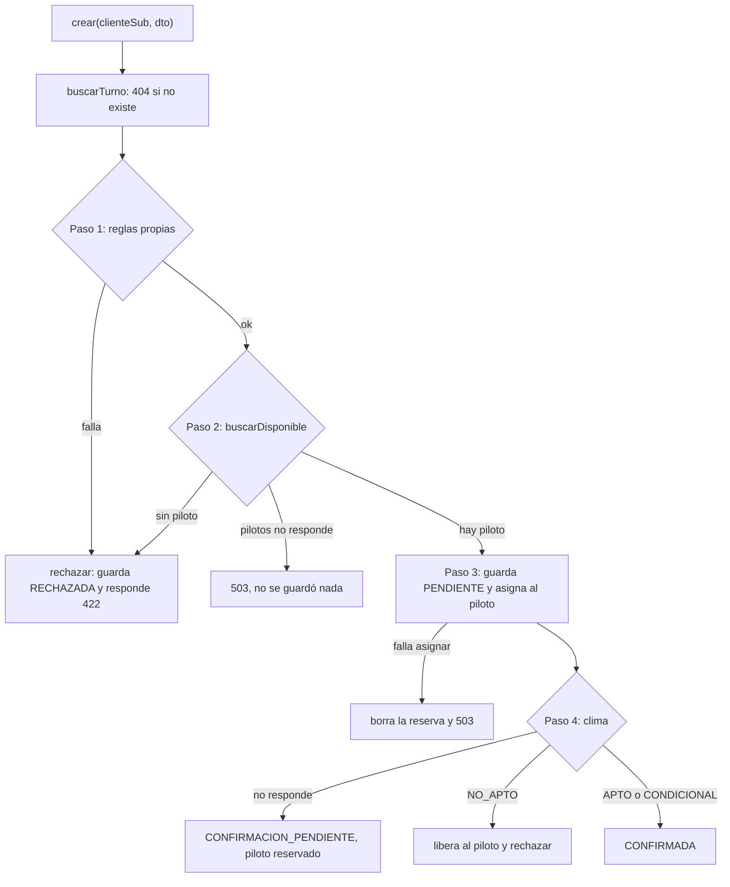

### Extra (si se ponen quisquillosos)
- **`Clock reloj` inyectado.** El servicio recibe un reloj en vez de usar la hora del sistema directamente, así los tests pueden fijar "hoy" y probar los límites de fechas.
- **`finalizar` sí es `@Transactional`**, porque no llama a otros servicios: solo cambia un estado y guarda. Las consultas de lectura también.
- **`reprogramar` solo la hace el dueño** (usa `propia`, que no admite ADMIN) y solo desde A_REPROGRAMAR. Repite los pasos 1 a 4 con el nuevo turno. Si algo falla, la reserva queda A_REPROGRAMAR y se informa el error. Cuando el nuevo turno es el mismo, la propia reserva no cuenta contra el cupo (parámetro `excluyendoPropia`).
- **`cancelar` valida antes de liberar** al piloto (línea 170), para no dejar la reserva a medias si la transición no es válida.
- **Un detalle honesto** (líneas 104 a 113): si hay que liberar al piloto por clima no apto y Pilotos no responde, igual se rechaza la reserva; el piloto puede quedar reservado en su agenda, pero liberar es idempotente y se limpia después. Está comentado en el código.
- **El DTO no es la entidad.** `ReservaDTO` es lo que sale por la API; la entidad `Reserva` nunca se expone directo.
- **El comentario `ponytail:` de la línea 287** deja asentado que el conteo de cupo y el guardado no son atómicos.

### Preguntas y respuestas
- **¿Qué pasa si Pilotos se cae?** Si cae antes de guardar: 503 y no queda nada. Si cae justo al asignar: se borra la reserva y 503.
- **¿Y si cae Clima?** La reserva queda CONFIRMACION_PENDIENTE con el piloto reservado. Nunca se confirma sin pronóstico. Se resuelve cuando un administrador revalida.
- **¿Por qué se guarda una reserva RECHAZADA?** Para dejar registro del motivo. Por eso `crear` no es transaccional: un 422 no debe deshacerlo.
- **¿Qué es la "marcha atrás simple"?** Deshacer a mano lo que se hizo afuera (borrar la reserva, liberar al piloto), en vez de una saga o una transacción distribuida, porque hay un solo paso con efecto externo.
- **¿Por qué ese orden?** Primero lo barato, que no necesita llamar a nadie. Después el piloto, y al final el clima, que es una consulta a Internet.
- **¿Por qué el controller no tiene lógica?** Para que traducir HTTP y decidir negocio estén separados. El controller recibe y responde; el service decide.
- **¿De dónde sale el usuario de la reserva?** Del campo `sub` del token. El cliente no puede mandarlo en el cuerpo, así que no puede reservar a nombre de otro.
- **¿Puede una reserva pasar de RECHAZADA a CONFIRMADA?** No. Es un estado final. Las transiciones están en `EstadoReserva`.

### Con qué se conecta
Con **A** (llega ya identificado), **C** (usa las reglas), **D** (pide y libera pilotos) y **E** (consulta el clima y se revisa después). Para pasarle la palabra a C: "dijimos que Vuelos revisa las reglas del cliente; veamos cuáles son y cómo las probamos".

---

## PARTE C. Reglas de negocio y pruebas

### En una frase
Son las condiciones que tiene que cumplir una reserva, escritas como funciones simples y chicas que se pueden probar solas, sin levantar nada.

### Imprescindible
- Hay **diez reglas** (R1 a R10). Pueden nombrarlas por lo que hacen, sin el número.
- Cada regla es una **función pura**: recibe datos, devuelve sí o no (con el motivo). No usa Spring ni base de datos.
- Viven en tres lugares, cada uno dueño de su dato: **Vuelos** (peso, edad, cupo, no repetir, ventana de fechas, estados), **Pilotos** (certificación y agenda) y **Clima** (viento y lluvia).
- Hay **104 tests automáticos** y pasan todos: gateway 8, pilotos 20, vuelos 56, clima 20.
- Lo que **no** está probado automáticamente: lógica de turnos y tipos de vuelo, el CRUD de pilotos, el contenido de la agenda, y integración con base real o Keycloak real.

### Las reglas, explicadas para poder hablar de ellas

**Cómo usar esta sección.** Para cada regla tenés: qué exige, **por qué existe en el negocio**, un ejemplo concreto, y una **frase para defenderla**. La idea no es recitarlas: es que puedas conversar de cada una con soltura.

#### Peso (R1)
- **Qué exige:** el peso del pasajero tiene que estar entre el mínimo y el máximo del tipo de vuelo. Los límites **sí** valen (40 kg entra en un rango de 40 a 110).
- **Por qué existe:** es una cuestión de seguridad. Cada equipo (el parapente, la canasta del globo) soporta un rango de peso. Fuera de él, el vuelo es inseguro o directamente no despega.
- **Ejemplo:** 200 kg en un tándem (rango 40 a 110) da `RECHAZADA: peso fuera de rango`. Con 110 exactos, pasa.
- **Frase:** "El peso es seguridad pura. Por eso lo validamos primero y con límites inclusivos: si el rango es hasta 110, quien pesa 110 puede volar."
- **Dónde:** `ReglasReserva.peso`, línea 19.

#### Edad (R2)
- **Qué exige:** la edad tiene que ser igual o mayor a la mínima del tipo de vuelo.
- **Por qué existe:** cada actividad tiene una edad mínima (12 años en tándem, 8 en globo). Es un criterio de seguridad y legal.
- **Ejemplo:** 10 años en un vuelo que exige 12 da `RECHAZADA: edad mínima no cumplida`.
- **Frase:** "La edad mínima depende del tipo de vuelo, y por eso viene del tipo y no está escrita en el código: el administrador puede cambiarla."
- **Dónde:** `ReglasReserva.edad`, línea 24.

#### Cupo (R3)
- **Qué exige:** las reservas **activas** de ese turno tienen que ser menos que el cupo.
- **Por qué existe:** cada turno tiene lugares limitados. Si se vende de más, alguien se queda sin vuelo.
- **Ejemplo:** el turno 4 tiene cupo 1. La primera persona entra; la segunda recibe `RECHAZADA: turno completo`.
- **Frase:** "Contamos las reservas activas, no todas: una cancelada o rechazada no ocupa lugar. Por eso cancelar libera el cupo."
- **Dónde:** `ReglasReserva.cupo`, línea 29. Admití el límite: contar y guardar no es atómico, dos reservas simultáneas por el último lugar podrían pasar.

#### No repetir (R7)
- **Qué exige:** el cliente no puede tener otra reserva activa en el mismo turno.
- **Por qué existe:** evita que una persona acapare lugares en un turno limitado, o que reserve dos veces por error.
- **Ejemplo:** `cliente1` reserva el turno 1 y vuelve a intentarlo: `RECHAZADA: ya reservó este turno`.
- **Frase:** "Es una regla antiabuso. Y solo cuentan las activas: si cancelaste, podés volver a reservar."
- **Dónde:** `ReglasReserva.noDuplicada`, línea 34.

#### Ventana de fechas (R10)
- **Qué exige:** el turno tiene que ser futuro y estar a 16 días o menos.
- **Por qué existe:** no se puede reservar algo que ya pasó, y el pronóstico solo existe hasta 16 días adelante. Más allá no podríamos saber si hay buen clima.
- **Ejemplo:** un turno de ayer, o uno a 20 días, da `RECHAZADA: turno fuera de la ventana permitida`.
- **Frase:** "Los 16 días no son arbitrarios: es lo que alcanza el pronóstico de Open-Meteo. Reservar más lejos implicaría confirmar sin conocer el clima."
- **Dónde:** `ReglasReserva.ventana`, línea 39. La constante es `VENTANA_DIAS = 16` (línea 13).

#### Piloto certificado (R4)
- **Qué exige:** tiene que existir un piloto activo certificado para ese tipo de vuelo.
- **Por qué existe:** no cualquier piloto puede llevar un globo o un tándem. Cada uno tiene sus habilitaciones.
- **Ejemplo:** el turno 3 (tipo SIN_PILOTO) no tiene ningún piloto certificado: `RECHAZADA: sin piloto certificado`.
- **Frase:** "Esta regla la decide Pilotos, que es el dueño de las certificaciones. Vuelos solo recibe un 'no hay' y lo convierte en rechazo."
- **Dónde:** `ReglasAsignacion.estaCertificado`, línea 16 (Pilotos).

#### Piloto libre (R5)
- **Qué exige:** el piloto no puede tener otro vuelo a la misma hora, ni más de **4 vuelos en el día**.
- **Por qué existe:** un piloto no puede estar en dos lugares a la vez, y hay un límite de jornada.
- **Ejemplo:** si el piloto tiene un vuelo a las 10:00, no se le asigna otro a las 10:00 **ni a las 10:30** (se compara la hora de reloj, no los minutos).
- **Frase:** "Comparamos por hora de reloj, así un vuelo de las 10:30 choca con uno de las 10:00. Es una decisión conservadora: un vuelo ocupa la hora."
- **Dónde:** `ReglasAsignacion.estaLibre`, líneas 24 a 29. La constante es `MAX_VUELOS_POR_DIA = 4` (línea 11). Se vuelve a validar al asignar, porque entre buscar y asignar otro pudo ocuparlo.

#### Clima (R6)
- **Qué exige:** se toma el peor valor entre viento sostenido y ráfagas. Si es menor o igual al máximo del tipo de vuelo: **APTO**. Si lo supera pero está dentro del margen: **CONDICIONAL**. Si no: **NO_APTO**. Y si la probabilidad de lluvia es del **60% o más**, es NO_APTO sin importar el viento.
- **Por qué existe:** es el corazón del problema original. Volar con viento fuerte o lluvia es peligroso. Y las ráfagas son lo que más preocupa, por eso se usa el peor caso.
- **Ejemplo:** el tándem tiene máximo 25 km/h y margen 10. Con 22: apto. Con 30: condicional ("viento cercano al límite"). Con 40: no apto.
- **Frase:** "Elegimos tres niveles y no dos. El condicional deja pasar casos en el borde con un aviso, en lugar de rechazar de golpe. La lluvia manda sobre todo: por eso se evalúa primero."
- **Dónde:** `ReglaClima.evaluar`, líneas 14 a 28 (Clima). La constante es `LLUVIA_MAX_PCT = 60` (línea 9).

#### Estados válidos (R8)
- **Qué exige:** una reserva solo puede cambiar de estado siguiendo las transiciones permitidas.
- **Por qué existe:** evita estados absurdos (completar un vuelo cancelado, reprogramar uno rechazado) y mantiene el historial coherente.
- **Ejemplo:** cancelar una reserva RECHAZADA da `422: transición no permitida: RECHAZADA -> CANCELADA`.
- **Frase:** "Los estados forman un diagrama. Un vuelo rechazado, cancelado o completado es un final: no hay vuelta."
- **Dónde:** `EstadoReserva.destinosValidos`, líneas 18 a 26. `Reserva.cambiarEstado` (línea 76) es la única puerta para cambiarlo.

#### Revisión por antigüedad (R9)
- **Qué exige:** al revisar el clima, se procesan las reservas de la más antigua a la más nueva.
- **Por qué existe:** es una decisión de equidad: si el clima libera a un piloto, la reserva que esperaba hace más tiempo es la primera en ser atendida.
- **Frase:** "Es una regla de justicia: el que reservó primero es el primero en revisarse."
- **Dónde:** `ReservaService.revalidar`, línea 195. Se ordena en la consulta y de nuevo explícitamente con `sorted`, para que no dependa solo de la base.

#### Cómo encadenarlas
`ReglasReserva.evaluar` (líneas 45 a 52) aplica peso, edad, cupo, no repetir y ventana **en ese orden** y devuelve **el primer motivo que falla**. Usa `Optional.or`, que corta apenas encuentra un rechazo. Por eso si alguien manda 200 kg y 10 años, el motivo que ve es "peso fuera de rango".

### Cómo se cuenta (guion de 2 a 3 minutos)
"Las reglas de negocio son lo que define cuándo una reserva es válida. Son diez, y las organizamos según quién es dueño de cada dato.

Vuelos controla las reglas del pasajero y del turno: que el peso y la edad entren en lo que pide el tipo de vuelo, que haya lugar, que no tenga ya esa reserva y que la fecha esté dentro de los 16 días del pronóstico. Pilotos controla las de los pilotos: que estén certificados y que estén libres, con un máximo de cuatro vuelos por día. Y Clima decide si se puede volar: compara el peor caso entre viento y ráfagas con el límite del tipo de vuelo, con un margen que da el estado condicional, y la lluvia alta rechaza siempre.

Lo importante del diseño es que cada regla es una función pura: recibe datos y dice sí o no, sin base de datos ni framework. Eso hace tres cosas buenas: se prueban en milisegundos, se entienden leyéndolas, y los límites exactos se pueden verificar. Por ejemplo, tenemos un test que prueba la lluvia en 59 y en 60 por ciento.

En las pruebas hay tres capas: tests de cada regla, tests del servicio con las dependencias simuladas, y tests de seguridad de la capa web. Son 104 y pasan todos. Lo que no cubrimos automáticamente es la integración con la base real: eso lo verificamos a mano con Postman y Swagger."

### El código: archivos y funciones

| Archivo | Qué mirar | Qué hace |
|---|---|---|
| `vuelos-service/.../reservas/ReglasReserva.java` | `peso` (19), `edad` (24), `cupo` (29), `noDuplicada` (34), `ventana` (39), `evaluar` (45) | Las reglas de Vuelos, y el encadenado |
| `pilotos-service/.../asignaciones/ReglasAsignacion.java` | `estaCertificado` (16), `estaLibre` (24) | Las reglas de Pilotos |
| `clima-service/.../veredicto/ReglaClima.java` | `evaluar` (14 a 28) | La regla del clima |
| `vuelos-service/.../reservas/EstadoReserva.java` | `destinosValidos` (18) | Las transiciones |
| `docs/reglas.md` | Toda la tabla | Regla, clase, test y mensaje de cada una |

**Los tests** (carpeta `src/test` de cada servicio):

| Test | Qué prueba |
|---|---|
| `ReglasReservaTest` | Cada regla de Vuelos, con caso normal, límite exacto y rechazo; y que `evaluar` devuelva el primer rechazo |
| `ReglasAsignacionTest` | Certificado o no, misma hora, otro día, límite de 3 y 4 vuelos |
| `ReglaClimaTest` | Los tres veredictos y los límites exactos (lluvia 59 y 60) |
| `EstadoReservaTest` | Las transiciones válidas e inválidas |
| `ReservaServiceTest` | El proceso completo con Pilotos y Clima simulados (apto, condicional, no apto, clima caído, sin piloto, pilotos caído, falla al asignar, revalidar, reprogramar, cancelar) |
| `SeguridadReservasWebMvcTest` | Permisos por rol de cada endpoint de reservas (401, 403, 200) |
| `PilotosClientTest`, `ClimaClientTest`, `OpenMeteoClientTest` | Los clientes HTTP: respuesta ok, 404, 500, timeout |
| `GatewayTest` | Las rutas del gateway y que `/internos` no exista |

### Para proyectar (en este orden)
1. **`docs/reglas.md`**: "Esta tabla une cada regla con su código y su test."
2. **`ReglasReserva.java`, líneas 18 a 52**: "Cada regla es una función de una línea. Y acá abajo, `evaluar` las encadena."
3. **`ReglaClima.java`, líneas 14 a 28**: "La lluvia primero, después el peor caso entre viento y ráfagas, y los tres niveles."
4. **`ReglaClimaTest`**: mostrar el test de límites exactos.
5. **En vivo:** `cd vuelos-service && mvn test` (56 tests verdes). O mostrar el resultado en Postman: peso 200 da 422, edad 10 da 422.

### Extra (si se ponen quisquillosos)
- **Tres tipos de test, tres propósitos.** JUnit puro para las reglas (sin nada levantado). Mockito para el servicio (se simulan Pilotos y Clima para forzar cada caso). `@WebMvcTest` para seguridad: levanta solo la capa web con servicios simulados, y prueba permisos y respuestas sin base de datos.
- **Por qué no usamos `@SpringBootTest`.** Necesitaría base y red, y los tests tienen que correr sin Docker.
- **`MockRestServiceServer`** simula la respuesta del otro servicio para probar los clientes HTTP.
- **El mapa regla, código y test** está completo en `docs/reglas.md`.
- **Lo no cubierto,** dicho con honestidad: lógica de `TurnoService`, `TipoVueloService` y `PilotoService`, el contenido de `mi-agenda`, `finalizar` (solo se prueba el permiso), integración con PostgreSQL y Keycloak.

### Preguntas y respuestas
- **¿Cómo sabés que la regla de clima funciona en el límite?** Hay tests con los valores exactos: lluvia 59 % y 60 %, y viento justo en el máximo y en el máximo más el margen.
- **¿Por qué las reglas no usan Spring?** Para probarlas sin levantar nada, y para que el código diga claramente qué exige cada una.
- **¿Qué es `@WebMvcTest`?** Levanta solo la capa web (controller y seguridad) con servicios simulados. Prueba permisos y respuestas HTTP sin base de datos.
- **¿Por qué las reglas están repartidas en tres servicios?** Porque cada servicio es dueño de su dato. Pilotos sabe de certificaciones y agenda; Clima del pronóstico; Vuelos de turnos y reservas.
- **¿Qué pasa si dos reglas fallan a la vez?** Se informa la primera, en el orden: peso, edad, cupo, no repetir, ventana.
- **¿Qué no está probado?** La lógica de turnos y tipos de vuelo, el CRUD de pilotos, el contenido de la agenda y la integración con base y Keycloak reales. Se probó a mano con Postman.
- **¿Por qué un margen y un estado condicional?** Para no rechazar de golpe casos en el borde. Se confirma con un aviso en el motivo ("viento cercano al límite").

### Con qué se conecta
Con **B** (el proceso las usa), **D** (certificación y agenda) y **E** (la regla del clima). Para pasarle la palabra a D: "dos de estas reglas, la certificación y la agenda, las decide otro servicio: el de pilotos. Veamos cómo se habla con él".

---

## PARTE D. Pilotos y la comunicación entre servicios

### En una frase
Pilotos sabe quién puede volar y cuándo; Vuelos le pregunta y le pide cosas por una vía interna que desde afuera no existe.

### Imprescindible
- **Pilotos decide** dos cosas: si un piloto está **certificado** para el tipo de vuelo, y si está **libre** (sin otro vuelo a esa hora y con menos de 4 en el día).
- Vuelos le hace **tres pedidos**: buscar uno disponible, **asignarlo** a una reserva y **liberarlo**.
- Se hablan por **HTTP con JSON**, de forma síncrona (Vuelos espera la respuesta).
- En cada pedido, Vuelos manda **el token del usuario** y el **`X-Correlation-Id`**.
- **Pilotos y Clima no se hablan entre sí.** Solo Vuelos orquesta.
- Las rutas **`/api/v1/internos/**` no están en el gateway**: son solo para llamadas entre servicios.
- **Cada servicio tiene su base**: Pilotos usa `pilotos_db`, que Vuelos nunca toca.

### El código: archivos y funciones

**En Vuelos (quien llama):**

| Archivo | Qué mirar | Qué hace |
|---|---|---|
| `vuelos-service/.../pilotos/PilotosClient.java` | `buscarDisponible` (31), `asignar` (47), `liberar` (60) | Los tres pedidos a Pilotos |
| mismo archivo | `catch NotFound` (línea 39), `catch RestClientException` (41, 54, 63), `caida` (80) | Un 404 es de negocio ("no hay piloto"); cualquier otra falla de red o 5xx se convierte en 503 |
| `.../clima/ClimaClient.java` | `obtenerVeredicto`, línea 22 | Lo mismo para Clima: cualquier falla es "clima no disponible" |
| `.../config/ClientesHttpConfig.java` | `crear`, línea 29 | Arma los clientes HTTP con **timeout de 5 segundos** y el interceptor |
| `.../seguridad/ReenvioCabecerasInterceptor.java` | `intercept`, líneas 23 a 34 | Copia el `Authorization` del usuario y el `X-Correlation-Id` a cada pedido saliente |
| `.../errores/DependenciaNoDisponibleException.java` | Toda la clase | La excepción que el `GlobalExceptionHandler` convierte en 503 |

**En Pilotos (quien responde):**

| Archivo | Qué mirar | Qué hace |
|---|---|---|
| `pilotos-service/.../asignaciones/AsignacionInternaController.java` | Líneas 18 a 31 | Los tres endpoints internos: `GET /pilotos/disponibles`, `POST /asignaciones`, `DELETE /asignaciones/{reservaId}` |
| `.../asignaciones/AsignacionService.java` | `buscarDisponible` (27 a 37) | Filtra los pilotos activos certificados, y de esos el primero libre. Hay **dos** 404 distintos: "sin piloto certificado" y "sin piloto disponible" |
| mismo archivo | `asignar` (40 a 49) | **Revalida** que esté libre antes de guardar; si ya no, responde 422 |
| mismo archivo | `liberar` (52) | Borra la asignación; es **idempotente** (si no había, no pasa nada) |
| mismo archivo | `agendaDe` (56 a 62) | La agenda del piloto, buscándolo por el `sub` del token |
| `.../asignaciones/ReglasAsignacion.java` | `estaCertificado` (16), `estaLibre` (24) | Las reglas puras |
| `.../agenda/AgendaController.java` | `GET /api/v1/pilotos/mi-agenda` | Devuelve la agenda del piloto logueado |
| `.../pilotos/PilotoController.java` | Líneas 17 a 36 | El CRUD de pilotos y de certificaciones, solo para ADMIN |
| `pilotos-service/src/main/resources/db/migration/V2__datos_prueba.sql` | Todo | Los 3 pilotos y sus certificaciones |

### Cómo se cuenta (guion de 2 a 3 minutos)
"Esta parte trata de cómo se hablan los servicios y qué hace el de pilotos.

Pilotos es dueño de dos cosas: quién está certificado para cada tipo de vuelo, y la agenda de cada piloto. Cuando Vuelos necesita un piloto, le hace tres pedidos. El primero es buscar uno disponible: Pilotos filtra los certificados para ese tipo de vuelo y, de esos, devuelve el primero que esté libre a esa hora. Libre significa que no tiene otro vuelo a la misma hora y que tiene menos de cuatro en el día. El segundo pedido es asignarlo: se anota en su agenda. Y el tercero es liberarlo, cuando la reserva se rechaza, se cancela o se reprograma.

Hay un detalle que nos importó. Entre que Vuelos busca y asigna, otra reserva podría haberse quedado con ese piloto. Por eso, al asignar, Pilotos vuelve a verificar que siga libre. Si no, responde un error, y Vuelos lo toma como una falla de la dependencia: borra la reserva y responde 503.

La comunicación es por HTTP y JSON. En cada pedido, Vuelos manda el token del usuario, para que Pilotos también pueda validar permisos, y un identificador de seguimiento, para poder rastrear un mismo pedido por los registros de los tres servicios. Todos los pedidos tienen un límite de cinco segundos.

Estas rutas son internas: el gateway directamente no las enruta. Si alguien intenta llegar desde afuera, obtiene un 404. Y Pilotos y Clima no se llaman entre sí: solo Vuelos coordina. Eso evita dependencias cruzadas."

### Para proyectar (en este orden)
1. **`PilotosClient.java`, líneas 31 a 66**: "Los tres pedidos. Fijate cómo cada falla se convierte en la misma excepción."
2. **`ReenvioCabecerasInterceptor.java`, líneas 23 a 34**: "Acá se copia el token y el identificador de seguimiento a cada pedido."
3. **`AsignacionInternaController.java`, líneas 18 a 31**: "Estos son los tres endpoints que atiende Pilotos."
4. **`AsignacionService.java`, `buscarDisponible` y `asignar` (27 a 49)**: señalar el segundo `estaLibre` en `asignar` (línea 46): "Revalidamos al asignar."
5. **`application.yaml` del gateway, bloque `routes`**: "Acá no hay ruta a `/internos`."
6. **En vivo:** `GET /pilotos/mi-agenda` como `piloto1` antes y después de reservar (aparece el vuelo); y pedir `/api/v1/internos/pilotos/disponibles` desde afuera (404).

### Diagrama de la conversación

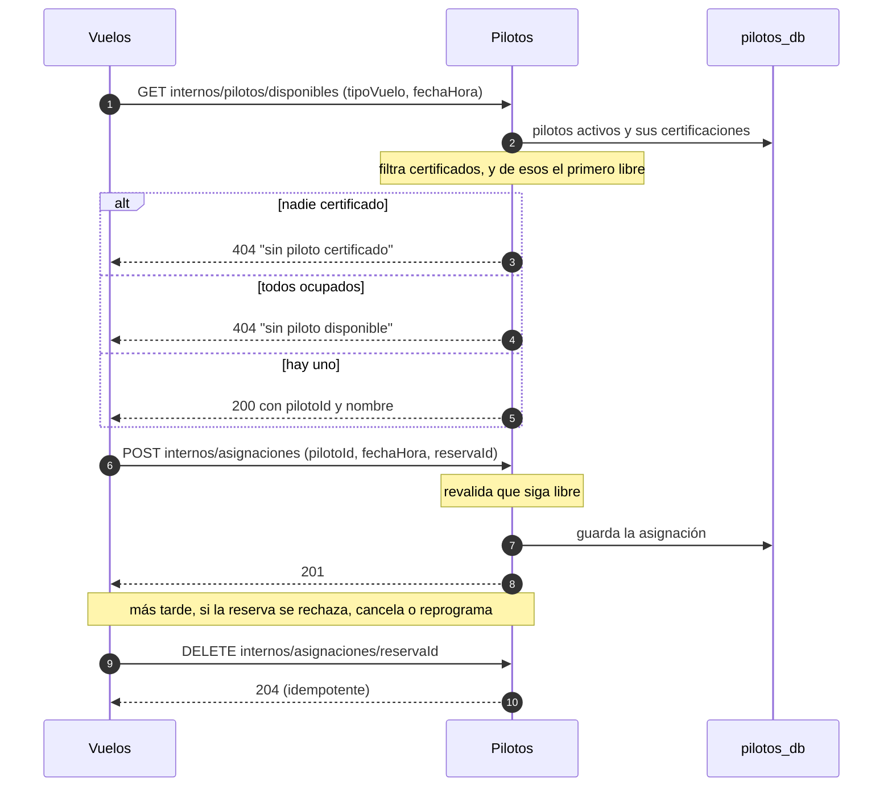

### Extra (si se ponen quisquillosos)
- **Por qué el primero libre y no el "mejor".** `findFirst` toma el de menor id. Es simple y predecible. Un criterio de reparto más equitativo sería una mejora, no un requisito.
- **`asignar` borra primero la asignación anterior de esa reserva** (`deleteByReservaId` y `flush`, líneas 44 y 45). Así, en una reprogramación, la reserva no choca consigo misma.
- **`AsignacionService` es `@Transactional` a nivel de clase**; las búsquedas son `readOnly`. Acá sí tiene sentido: no llama a otros servicios.
- **Los 404 de Pilotos distinguen dos motivos** para que Vuelos pueda explicarle al cliente por qué se rechazó. `PilotosClient.motivoDe` (línea 68) lee el mensaje del cuerpo.
- **Por qué 503 y no 422 cuando asignar falla.** Para Vuelos, no poder reservar al piloto es una falla de una dependencia, no una regla del cliente.
- **El interceptor valida el formato del `X-Correlation-Id`** igual que el gateway (letras, números y guiones, hasta 64 caracteres).
- **Aislamiento.** El gateway no enruta `/internos`, y además esos endpoints exigen token válido. El aislamiento real lo da la red de Docker: Pilotos no publica puerto al exterior.
- **La agenda se asocia al piloto por `keycloakSub`.** El usuario `piloto1` de Keycloak y el "Piloto Uno" de la base comparten el mismo identificador (`2222...`).

### Preguntas y respuestas
- **¿Cómo se comunican los servicios?** Por HTTP con JSON, de forma síncrona, con `RestClient`. Vuelos llama a los otros dos.
- **¿Por qué Pilotos y Clima no se llaman entre sí?** Para que solo Vuelos orqueste y no haya dependencias cruzadas. Es más fácil de entender y de probar.
- **¿Qué pasa si el piloto se ocupa entre que se busca y se asigna?** Al asignar se vuelve a validar. Pilotos responde 422, y Vuelos lo trata como falla de la dependencia: borra la reserva y responde 503.
- **¿Por qué una base por servicio?** Cada uno es dueño de sus datos; solo se intercambian por la API. Así se pueden cambiar de forma independiente.
- **¿Qué se reenvía en cada pedido?** El token del usuario y el `X-Correlation-Id`.
- **¿Por qué existe `/internos` y no se expone?** Son endpoints pensados solo para otros servicios. Exponerlos permitiría que alguien de afuera asigne o libere pilotos.
- **¿Qué pasa si Pilotos tarda mucho?** Hay un timeout de 5 segundos; pasado ese tiempo se trata como servicio caído (503).
- **¿Qué significa "idempotente"?** Que repetir la operación no cambia el resultado. Liberar dos veces es lo mismo que liberar una: si ya no hay asignación, no pasa nada.

### Con qué se conecta
Con **B** (lo llama), **C** (reglas de certificación y agenda) y **A** (el token que se reenvía). Para pasarle la palabra a E: "queda el último eslabón de la cadena: el clima. Y cómo se levanta todo esto".

---

## PARTE E. Clima, revalidación e infraestructura

### En una frase
Clima dice si se puede volar, la revalidación vuelve a preguntarlo más tarde, y Docker levanta todo para que funcione con un solo comando.

### Imprescindible
- **Clima** consulta el pronóstico real en **Open-Meteo** y compara con los límites del tipo de vuelo para dar el veredicto: **APTO, CONDICIONAL o NO_APTO**. No tiene base de datos.
- Si Open-Meteo no responde, Clima responde **503**, y Vuelos lo trata como "clima no disponible".
- La **revalidación** la dispara un administrador. Vuelve a consultar el clima de las reservas confirmadas o pendientes, de la más antigua a la más nueva, y las pasa a **A_REPROGRAMAR** o **CONFIRMADA** según corresponda.
- **Docker Compose** levanta los 6 contenedores con `docker compose up`, en el orden correcto.
- **Flyway** crea las tablas y carga los datos de prueba al arrancar.

### El código: archivos y funciones

**Clima:**

| Archivo | Qué mirar | Qué hace |
|---|---|---|
| `clima-service/.../veredicto/VeredictoController.java` | El `GET /api/v1/clima/veredicto` | Recibe latitud, longitud, fecha y límites |
| `.../veredicto/VeredictoService.java` | `evaluar`, líneas 21 a 31 | Rechaza con 422 si la fecha ya pasó o es a más de 16 días; si no, pide el pronóstico y aplica la regla |
| `.../pronostico/OpenMeteoClient.java` | `obtener` (22 a 40) | Hace el pedido a Open-Meteo: viento, ráfagas y probabilidad de lluvia, en km/h, 16 días, zona horaria automática |
| mismo archivo | `horaMasCercana` (43 a 77) | Elige la hora del pronóstico más cercana a la pedida; si la más cercana está a más de 1 hora, falla (línea 65) |
| `.../veredicto/ReglaClima.java` | `evaluar` (14 a 28) | La regla (ver parte C) |

**Revalidación (en Vuelos):**

| Archivo | Qué mirar | Qué hace |
|---|---|---|
| `vuelos-service/.../reservas/ReservaService.java` | `revalidar`, líneas 195 a 239 | El proceso de revisión |
| mismo archivo | `reprogramar`, línea 125 | Mueve una reserva A_REPROGRAMAR a otro turno |
| `.../reservas/ResumenRevalidacionDTO.java` | Toda la clase | Lo que devuelve: `revisadas`, `confirmadas`, `aReprogramar`, `sinCambios` |

**Infraestructura:**

| Archivo | Qué mirar | Qué hace |
|---|---|---|
| `docker-compose.yml` | Todo el archivo | Define los 6 servicios, sus puertos, `healthcheck` y `depends_on` |
| `<servicio>/Dockerfile` | Etapas `build` y final | Compila con Maven en una etapa y deja una imagen liviana que corre con un usuario sin privilegios |
| `.env.example` | Todo | Plantilla de configuración (usuarios y claves de desarrollo) |
| `infra/postgres/init/01-crear-bases.sh` | Todo | Crea `vuelos_db` y `pilotos_db` la primera vez que arranca Postgres |
| `vuelos-service/src/main/resources/db/migration/V1__esquema.sql`, `V2__datos_prueba.sql` | Todo | Flyway: crea las tablas y carga sitio, tipos de vuelo y los 7 turnos |
| `pilotos-service/src/main/resources/db/migration/V1__esquema.sql`, `V2__datos_prueba.sql` | Todo | Flyway: tablas de pilotos y los 3 pilotos de prueba |

### Cómo se cuenta (guion de 2 a 3 minutos)
"Esta parte tiene tres cosas: el clima, la revisión del clima, y cómo se levanta todo.

El servicio de clima es chico: recibe un lugar, una fecha y los límites de viento del tipo de vuelo, le pide el pronóstico a Open-Meteo, que es una fuente externa gratuita, y aplica la regla. Elige la hora del pronóstico más cercana a la pedida, toma el peor caso entre viento y ráfagas, y devuelve apto, condicional o no apto. Si Open-Meteo no responde, devolvemos un 503 y Vuelos lo toma como clima no disponible. Clima no tiene base de datos: solo consulta y responde.

El clima cambia con los días. Por eso existe la revisión: un administrador puede pedir que se revalide. Para cada reserva confirmada o pendiente, de la más antigua a la más nueva, se vuelve a consultar el clima. Si ahora no es apto, se libera al piloto y la reserva pasa a 'a reprogramar'. Si es apto, se confirma, incluidas las que estaban pendientes. Y si el clima no responde, no se cambia nada. Devuelve un resumen con cuántas revisó, confirmó, pasó a reprogramar y dejó sin cambios. La dispara un administrador y no una tarea automática porque es más simple de demostrar; la automática quedó fuera de alcance. Después, el cliente puede reprogramar la reserva a otro turno.

Por último, la infraestructura. Todo corre en Docker: un archivo, docker-compose, define los seis contenedores. Cada servicio tiene un chequeo de salud, y los que dependen de otros esperan a que estén listos. Solo el gateway y Keycloak se ven desde afuera. Cada servicio se compila en una etapa y corre en una imagen liviana con un usuario sin privilegios. Y las tablas y los datos de prueba los crea Flyway con scripts versionados, mientras que Hibernate solo verifica que coincidan."

### Para proyectar (en este orden)
1. **`ReglaClima.java`, líneas 14 a 28** (ya vista en C): "El veredicto."
2. **`OpenMeteoClient.java`, líneas 22 a 40**: "Así se le pregunta a Open-Meteo: viento, ráfagas y lluvia."
3. **`VeredictoService.java`, líneas 21 a 31**: "Valida la ventana de fechas y aplica la regla."
4. **`ReservaService.java`, `revalidar` (195 a 239)**: "Para cada reserva, consulta, libera si hace falta, y cuenta."
5. **`docker-compose.yml`**: mostrar `depends_on` y `healthcheck` de `vuelos-service`. "Vuelos no arranca hasta que Pilotos, Clima, Postgres y Keycloak estén sanos."
6. **En vivo:** `docker compose ps` (seis contenedores `healthy`); `POST /reservas/revalidacion` como `admin1` y leer el resumen; la tabla de turnos.

### La revisión, en un diagrama

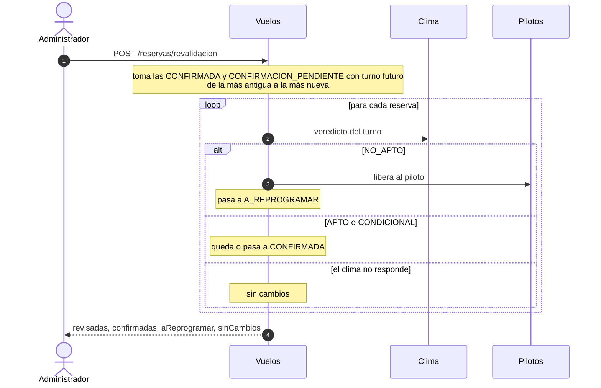

### El arranque, en un diagrama

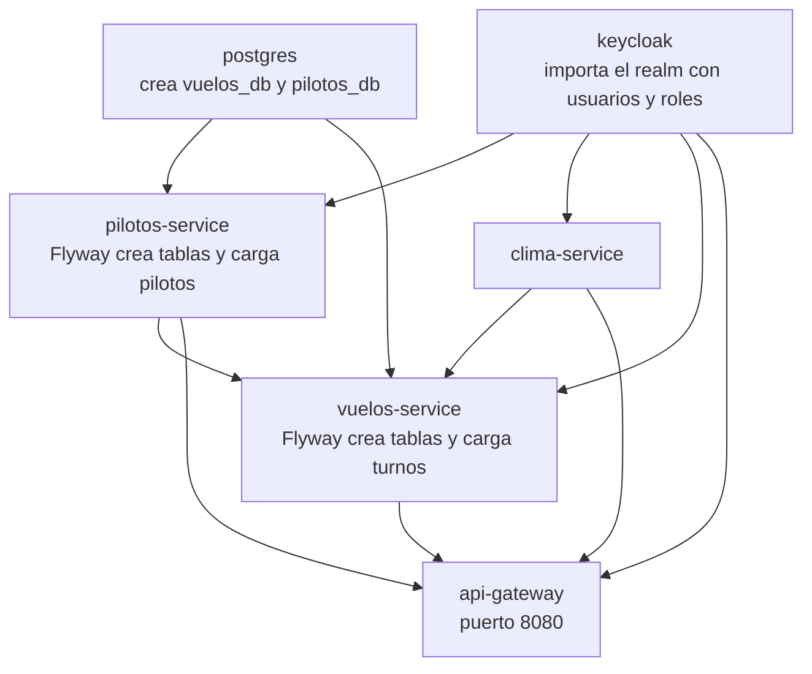

Cada flecha es un `depends_on` con `condition: service_healthy`: el de la derecha **espera** a que el de la izquierda esté sano. Por eso el gateway es el último en arrancar.

### Extra (si se ponen quisquillosos)
- **Zona horaria.** Se pide `timezone=auto`, así las horas del pronóstico son las del lugar y se comparan bien con la hora del turno.
- **Más de una hora de diferencia.** Si el dato más cercano está a más de 1 hora de lo pedido, `OpenMeteoClient` falla en vez de usar un dato de otro momento (línea 65).
- **Respuestas incompletas.** Si falta viento, ráfagas o lluvia, o una hora ilegible, también se convierte en 503, no en un error 500.
- **Revalidación y CONDICIONAL.** Una reserva confirmada que pasa de APTO a CONDICIONAL (o al revés) mantiene el estado, pero se actualiza el motivo (líneas 231 a 234).
- **Revalidación y pilotos caído.** Si hay que liberar al piloto y Pilotos no responde, esa reserva se cuenta como "sin cambios" y se sigue con la siguiente.
- **Anclas y alias de Compose.** `docker-compose.yml` define un bloque común (`x-servicio`, con `&servicio` y `<<: *servicio`) para no repetir la configuración en cada servicio.
- **Variables obligatorias.** El compose usa `${POSTGRES_USER:?Falta .env...}`: si no existe el archivo `.env`, Docker se detiene con ese mensaje.
- **Memoria.** `JAVA_TOOL_OPTIONS=-Xmx256m` limita cada servicio Java a 256 MB.
- **`ddl-auto=validate`.** Flyway crea el esquema; Hibernate solo lo verifica y falla el arranque si no coincide. Es una red de seguridad contra desvíos entre el código y la base.
- **Imagen multi-etapa.** La primera etapa trae Maven y compila; la segunda solo trae el JRE y el jar, y corre con un usuario `app` sin privilegios. La imagen final es más chica y más segura.
- **Keycloak en `start-dev --import-realm`.** Importa el archivo `keycloak/realm-parapente.json` al arrancar. Es el modo de desarrollo: sin TLS y con base interna.

### Preguntas y respuestas
- **¿Qué hace la revalidación?** Para las reservas confirmadas o pendientes con turno futuro, de la más antigua a la más nueva, vuelve a consultar el clima: NO_APTO libera al piloto y pasa a A_REPROGRAMAR; APTO o CONDICIONAL confirma; si el clima no responde, no cambia nada.
- **¿Por qué la dispara un administrador y no una tarea programada?** Es más simple de demostrar. La automática queda fuera del alcance.
- **¿Qué pasa si Open-Meteo no responde?** Clima devuelve 503 y Vuelos lo trata como "clima no disponible": si es una reserva nueva, queda CONFIRMACION_PENDIENTE.
- **¿Qué es Flyway y por qué `ddl-auto=validate`?** Flyway crea el esquema con scripts versionados. Hibernate solo verifica que coincida; no lo modifica.
- **¿Por qué una imagen multi-etapa?** Compila en una etapa y deja una imagen final liviana, con un usuario sin privilegios.
- **¿Por qué solo el gateway y Keycloak publican puertos?** Para que lo único accesible desde afuera sea la puerta de entrada. Los servicios internos solo se hablan dentro de la red de Docker.
- **¿Qué es un healthcheck?** Una prueba que Docker hace cada pocos segundos para saber si el servicio responde. Así los servicios dependientes esperan a que el anterior esté listo.
- **¿De dónde salen los datos de prueba?** De los scripts `V2__datos_prueba.sql` de cada servicio, que Flyway ejecuta al arrancar con la base vacía.

### Con qué se conecta
Con **B** (la reserva consulta el clima y lo vuelve a consultar al revisar), **D** (la revisión libera al piloto) y **todas** (Docker las levanta). Para el cierre: "con esto vimos el camino completo, desde que un usuario se identifica hasta que su reserva se confirma o se revisa. Quedamos a disposición para sus preguntas y para mostrar el sistema en funcionamiento".

---
---

# PARTE III. LA POSTA: CÓMO PASARNOS LA PALABRA

La exposición se arma como una **carrera de postas**: el recorrido de una reserva es el hilo, y cada integrante toma el tramo que le toca. El orden sigue el camino real de un pedido, así cada tramo termina donde empieza el siguiente y los pases salen naturales.

## El orden

```mermaid
flowchart LR
    G["APERTURA<br/>El problema y el mapa<br/>(cualquiera del grupo)"]
    A["A<br/>Quién sos y qué podés hacer<br/>Autenticación y gateway"]
    B["B<br/>Qué pasa al reservar<br/>El proceso de reserva"]
    C["C<br/>Qué se exige y cómo se prueba<br/>Reglas y pruebas"]
    D["D<br/>Quién te lleva<br/>Pilotos y comunicación"]
    E["E<br/>Si se puede volar y cómo se arma todo<br/>Clima, revisión e infraestructura"]
    F["CIERRE Y DEMO<br/>Límites honestos y preguntas"]

    G -->|"Para entrar al sistema hay que identificarse"| A
    A -->|"Ya autorizado, un cliente pide una reserva"| B
    B -->|"Vuelos revisa reglas: veamos cuáles son"| C
    C -->|"Dos de esas reglas las decide otro servicio"| D
    D -->|"Falta el último eslabón: el clima"| E
    E -->|"Con esto vimos el camino completo"| F
```

## Las frases puente

Una frase al terminar tu parte, y una al empezar la siguiente. No hace falta decirlas igual, pero tené una lista para no quedarte en blanco.

| De | A | Lo que dice quien termina | Lo que dice quien sigue |
|---|---|---|---|
| Apertura | A | "...y todo empieza con una pregunta: ¿quién sos? Eso nos lo cuenta [nombre]." | "Gracias. Antes de hacer cualquier cosa, el sistema necesita saber quién sos." |
| A | B | "...así que un cliente ya identificado puede pedir una reserva. Qué pasa después se lo paso a [nombre]." | "Entonces el cliente llega con su token y pide una reserva. Vamos a ver qué hace el servicio de Vuelos." |
| B | C | "...Vuelos revisa varias reglas antes de seguir. [Nombre] nos cuenta cuáles son y cómo las probamos." | "Recién mencionamos que Vuelos revisa reglas. Vamos a ver cuáles son y por qué existen." |
| C | D | "...dos de estas reglas, la certificación y la agenda, no las decide Vuelos sino otro servicio. [Nombre] sigue." | "Entre las reglas había dos que decide el servicio de Pilotos. Veamos cómo se habla con él." |
| D | E | "...ya tenemos piloto. Falta el último eslabón: ¿se puede volar? Eso y cómo se arma todo, con [nombre]." | "Con el piloto reservado, queda confirmar el clima. Y después, cómo funciona todo junto." |
| E | Cierre | "...con eso cerramos el recorrido. Quedan los límites que asumimos y la demo." | "Un cierre breve: qué simplificamos y qué quedó fuera de alcance, y mostramos el sistema funcionando." |

## Quién muestra qué en pantalla

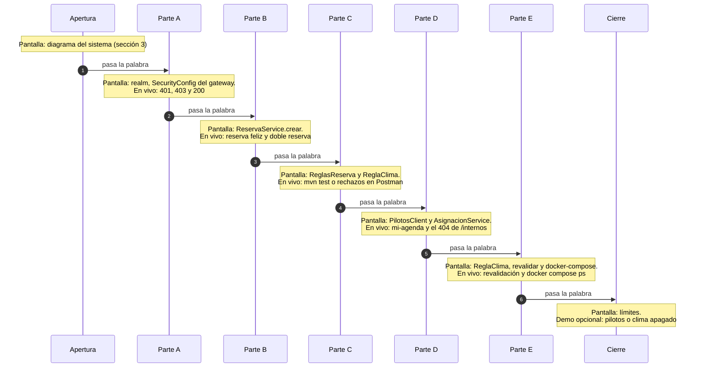

## Tiempos orientativos

No sabemos cuánto dura la exposición real, así que esto es una **propuesta para ensayar**; escalarla a lo que digan los profesores.

| Tramo | Quién | Tiempo |
|---|---|---|
| Apertura: problema y mapa | Cualquiera | 2 min |
| A. Autenticación y gateway | Integrante A | 3 min |
| B. Proceso de reserva | Integrante B | 3 min |
| C. Reglas y pruebas | Integrante C | 3 min |
| D. Pilotos y comunicación | Integrante D | 3 min |
| E. Clima, revisión e infraestructura | Integrante E | 3 min |
| Cierre y demo | Cualquiera | 2 min |
| **Total** | | **19 min** |

## Reglas de la posta

1. **Respetá tu tramo.** Si te pasás, el siguiente se queda sin tiempo. Ensayá con reloj.
2. **Cada uno prepara dos cosas más que su parte:** las frases de entrada y de salida. Con eso la transición no se nota.
3. **Cuando te preguntan algo que es de otro,** no lo ignores y no inventes. Decí lo que sabés y pasá: "en lo que vi, funciona así... y [nombre] lo explicó en su parte con más detalle". Es válido y se ve compañerismo.
4. **Todos conocen la Parte I.** Cualquier integrante puede ser interrumpido con una pregunta general ("¿cómo se autentica un usuario?").
5. **Un solo integrante maneja la pantalla y la demo,** o cada uno maneja la suya mientras habla. Acuerdenlo antes: lo peor es que dos toquen el teclado a la vez.
6. **Si alguien se bloquea,** el siguiente tiene que poder retomar: por eso todos conocen el hilo completo.
7. **Dejen la demo preparada.** Antes de exponer, resetear la base (Parte V) y chequear el pronóstico (Parte IV, sección 5).

## Plan para el día

| Cuándo | Qué hacer |
|---|---|
| Un día antes | Ensayo completo con reloj. Cada uno recibe 2 preguntas de los demás |
| Una hora antes | `docker compose down -v && docker compose up --build` en la PC que se va a usar, y esperar a que los 6 contenedores estén `healthy` |
| Antes de empezar | Chequear que Swagger carga, que Postman tiene el environment elegido, y correr "0 Auth" para tener tokens frescos |
| Si algo falla en vivo | No pelearse con la pantalla: pasar al siguiente tramo y volver con calma, o contar lo que se iba a ver |

---
---

# PARTE IV. POSTMAN: GUÍA COMPLETA

## 1. Qué es y cómo está armado

**Postman** es un programa para mandar pedidos a la API sin escribir código. Cada pedido es una **consulta** (método, dirección, cuerpo y usuario). Nuestras colecciones agrupan las consultas en carpetas y **verifican el resultado automáticamente**: si la respuesta es la esperada, aparece en verde.

Hay tres archivos en `docs/postman/`:

| Archivo | Qué es |
|---|---|
| `Parapente - Flujo completo.postman_collection.json` | El recorrido de una reserva de punta a punta. Se corre **completo y en orden** |
| `Parapente - Seguridad y errores.postman_collection.json` | Pruebas de que el sistema se defiende bien: permisos, reservas ajenas, errores |
| `Parapente - Local.postman_environment.json` | Las **variables** (direcciones, turnos, tokens). **Sin esto, nada funciona** |

**Cada consulta tiene tres partes:**
- **El pedido:** método, dirección y cuerpo. Por ejemplo `POST {{baseUrl}}/api/v1/vuelos/reservas` con `{"turnoId": 1, "pesoKg": 70, "edad": 30}`.
- **El usuario:** la cabecera `Authorization: Bearer {{tokenCliente}}` (o `tokenPiloto`, o `tokenAdmin`).
- **Las verificaciones:** la pestaña **Tests**. Cada línea `pm.test(...)` compara la respuesta con lo esperado. Esas son las marcas verdes y rojas del Runner.

## 2. Cómo instalarlo en Postman (paso a paso)

1. Abrí la app de escritorio de Postman e iniciá sesión (hace falta cuenta, es gratuita).
2. Arriba a la izquierda tocá **Import**.
3. Arrastrá **los tres archivos** desde `docs/postman/` de la carpeta del proyecto. Quedan como dos colecciones nuevas y un environment.
4. **Elegí el environment**: arriba a la derecha, donde dice "No Environment", desplegá y elegí **Parapente - Local**. **Es el paso que más se olvida.** Si te sale "Empty request URL", es esto.
5. Verificá que el sistema esté levantado: `docker compose ps` con los 6 contenedores `healthy`.

**Si reimportás** (por ejemplo después de actualizar el proyecto), borrá antes las colecciones viejas con los tres puntos y **Delete**. Postman no actualiza las que ya importaste.

## 3. Las variables

| Variable | Valor | Para qué |
|---|---|---|
| `baseUrl` | `http://localhost:8080` | El gateway |
| `kcUrl` | `http://localhost:8180` | Keycloak, para pedir el token |
| `realm` | `parapente` | El realm de Keycloak |
| `clientId` | `parapente-postman` | El cliente de Keycloak que usa Postman |
| `turnoApto` ... `turnoReprogramar` | 1 a 7 | Los ids fijos de los turnos de prueba |
| `fechaClima` | `2026-11-15T10:00:00` | La fecha para la consulta de clima. **Debe ser futura y a 16 días o menos**: actualizala si ya pasó |
| `tokenCliente`, `tokenPiloto`, `tokenAdmin` | vacíos | Se llenan solos al correr la carpeta "0 Auth" |
| `reservaId` y similares | vacíos | Se llenan solos con el id de la reserva que se crea |

**Los tokens duran 1 hora.** Cuando vencen, las consultas dan 401. Se renuevan corriendo de nuevo la carpeta **"0 Auth"**.

## 4. Cómo correr una colección

1. Pasá el cursor sobre la colección, tocá los tres puntos y **Run collection** (o el botón **Run**).
2. Dejá todo como está. Marcá o desmarcá carpetas según la tabla de abajo.
3. Tocá **Run Parapente - ...**.
4. Mirá el resultado: **Passed** (verde) y **Failed** (rojo). Para ver el detalle de un fallo, mirá el mensaje debajo del pedido.

| Colección | Qué carpetas correr |
|---|---|
| Flujo completo | Todas, en orden (0 a 4) |
| Seguridad y errores | Carpetas 0 a 3. **Desmarcá la 4** (es manual, requiere apagar servicios) |

**Cómo correr un solo pedido** (para una demo en vivo): abrilo desde la barra lateral, tocá **Send** y mirá la respuesta. Antes, asegurate de tener el token del usuario correcto (corriendo antes "0 Auth").

## 5. Las reglas de oro antes de correr

1. **Resetear la base antes del flujo completo.** El flujo cambia estado (cupos, reservas, el viento de PRUEBA_APTO) y **no se puede repetir sobre la misma base**: la segunda vez, el primer pedido da "ya reservó este turno" y todo lo que depende de él falla en cadena.

   ```bash
   docker compose down -v && docker compose up -d
   ```

   Esperá a que los 6 contenedores estén `healthy` y recién ahí corré.
2. **El pronóstico es real.** Si el día del turno 4 tiene lluvia alta, las pruebas del turno 4 (cupo) fallan por clima y no por cupo. No es un error del código. Chequeá el pronóstico antes de la demo.
3. **El environment tiene que estar elegido.**
4. **Seguí el orden.** Las consultas se pasan datos entre sí (el id de la reserva creada). Si salteás un pedido, los siguientes pueden usar una variable vacía.
5. **Las fechas de los turnos caducan.** Si la base tiene más de 2 días, los turnos 1 a 3 ya pasaron: recreala.

## 6. "Si el profesor me pide...": qué consulta usar

| Si piden... | Usá | Esperás |
|---|---|---|
| "Mostrame cómo se loguea alguien" | **F0.1** (cliente), **F0.2** (piloto) o **F0.3** (admin) | 200 con un `access_token` |
| "Cargá una nueva reserva" | **F1.4** *Reservar turno 1* | 201 CONFIRMADA |
| "Probá con otro turno" | Duplicá F1.4 y cambiá `turnoId` (ver sección 9) | Depende del turno |
| "¿Qué pasa si pesa demasiado?" | **F2.1** | 422 "peso fuera de rango" |
| "¿Y si es menor de edad?" | **F2.2** | 422 "edad mínima no cumplida" |
| "¿Y si reserva dos veces?" | **F2.3** | 422 "ya reservó este turno" |
| "¿Y si el turno está lleno?" | **F2.4** y después **F2.5** | 201 y después 422 "turno completo" |
| "¿Y si no hay piloto?" | **F2.6** | 422 "sin piloto certificado" |
| "¿Y si el clima no da?" | **F3.1** | 422 "clima no apto" |
| "Mostrame la revisión del clima" | **F3.2** y la cadena **F3.3 a F3.6** | 200 con el resumen; pasa a A_REPROGRAMAR |
| "Reprogramá esa reserva" | **F4.1** | 200 CONFIRMADA |
| "Cancelá una reserva" | **F4.2** | 200 CANCELADA |
| "Mostrame la agenda del piloto" | **F1.7** | 200 con la lista |
| "¿Qué pasa sin token?" | **S1.1** | 401 |
| "¿Y con el rol incorrecto?" | **S1.4** o **S1.7** | 403 |
| "¿Puede ver la reserva de otro?" | **S2.2** | 404 |
| "¿Y si se cae el servicio de pilotos?" | **S4.1** (con pilotos apagado) | 503 |
| "¿Y si se cae el clima?" | **S4.3** (con clima apagado) | 201 CONFIRMACION_PENDIENTE |
| "Finalizá un vuelo" | Consulta libre (sección 9) | 200 COMPLETADA |
| "Creá un turno / un piloto" | Consulta libre (sección 9) | 201 |

## 7. Ficha de cada consulta: "Flujo completo"

**Cómo leer los identificadores.** `F` es "Flujo completo". El primer número es la **carpeta** (el mismo que lleva su nombre en Postman: "0 Auth", "1 Turnos y flujo feliz"...) y el segundo es la **posición del pedido** dentro de la carpeta, contando desde arriba. **F1.4** es el cuarto pedido de la carpeta "1 Turnos y flujo feliz". En la barra lateral de Postman los pedidos aparecen en ese mismo orden.

### Carpeta 0. Auth (obtener los tokens)

Los tres son iguales: `POST {{kcUrl}}/realms/{{realm}}/protocol/openid-connect/token`, cuerpo de tipo formulario con `grant_type=password`, `client_id={{clientId}}`, usuario y contraseña. Guardan el token en una variable.

| ID | Pedido | Usuario | Esperás | Si no sale: causa y arreglo |
|---|---|---|---|---|
| F0.1 | Token cliente1 | `cliente1` | 200, guarda `tokenCliente` | **"Could not send request" o error de conexión:** Keycloak apagado o todavía arrancando. Esperá a que esté `healthy`. **"Empty request URL":** falta elegir el environment. **401 "Invalid user credentials":** clave mal escrita. **400:** cuerpo del formulario alterado |
| F0.2 | Token piloto1 | `piloto1` | 200, guarda `tokenPiloto` | Igual que F0.1 |
| F0.3 | Token admin1 | `admin1` | 200, guarda `tokenAdmin` | Igual que F0.1 |

### Carpeta 1. Turnos y flujo feliz

| ID | Pedido y qué hace | Usuario | Esperás | Si no sale: causa y arreglo |
|---|---|---|---|---|
| F1.1 | `GET /api/v1/vuelos/turnos`. Lista los turnos | cliente | 200 con una lista | **401:** token vencido o vacío; corré "0 Auth". **Lista vacía:** la base no tiene los datos de prueba; resetearla |
| F1.2 | `GET /api/v1/vuelos/turnos/{{turnoApto}}`. Detalle del turno 1 | cliente | 200, tipo PRUEBA_APTO | **404:** la base no es la sembrada (ids distintos); resetearla |
| F1.3 | `GET /api/v1/vuelos/tipos-vuelo`. Lista los tipos y guarda el id y el nombre de PRUEBA_APTO | cliente | 200 | Falla el chequeo "t exists": no existe PRUEBA_APTO; la base fue alterada. Resetear |
| F1.4 | **`POST /api/v1/vuelos/reservas`** con `{"turnoId":{{turnoApto}},"pesoKg":70,"edad":30}`. **Crea la reserva** y guarda su id en `reservaId` | cliente | **201 CONFIRMADA** | **422 "ya reservó este turno":** ya había una reserva activa (no reseteaste la base). **422 "turno fuera de la ventana permitida":** la base tiene más de 2 días; recrearla. **422 "clima no apto: Probabilidad de lluvia alta":** lluvia real ese día; probá otro turno o esperá. **201 pero CONFIRMACION_PENDIENTE:** el clima está apagado o Open-Meteo no responde. **503 "Servicio de pilotos no disponible":** pilotos apagado o recién arrancando. **400:** cuerpo mal formado |
| F1.5 | `GET /api/v1/vuelos/reservas/mias`. Lista las reservas del usuario | cliente | 200, incluye la reserva creada | Lista sin la reserva: F1.4 falló |
| F1.6 | `GET /api/v1/vuelos/reservas/{{reservaId}}`. Detalle de la reserva propia | cliente | 200 CONFIRMADA | **404:** `reservaId` vacío (F1.4 falló) o la reserva es de otro usuario |
| F1.7 | `GET /api/v1/pilotos/mi-agenda`. La agenda del piloto | piloto | 200 con una lista | **403:** usaste un token que no es de piloto ni admin. **404 "no hay un piloto asociado a este usuario":** el `sub` del usuario no coincide con un piloto de la base |

### Carpeta 2. Reglas de negocio

| ID | Pedido y qué hace | Usuario | Esperás | Si no sale: causa y arreglo |
|---|---|---|---|---|
| F2.1 | `POST /reservas` con `{"turnoId":1,"pesoKg":200,"edad":30}`. Peso fuera de rango | cliente | **422 RECHAZADA**, "peso fuera de rango" | Si no da 422: revisá que el cuerpo tenga `pesoKg: 200`. Siempre se rechaza por peso antes que por nada |
| F2.2 | `POST /reservas` con `{"turnoId":1,"pesoKg":70,"edad":10}`. Menor de edad | cliente | **422 RECHAZADA**, "edad mínima no cumplida" | Igual |
| F2.3 | `POST /reservas` turno 1, 70 kg, 30 años. Doble reserva | cliente | **422 RECHAZADA**, "ya reservó este turno" | **Si da 201:** F1.4 no dejó una reserva activa (falló o se canceló). Volvé a correr F1.4 |
| F2.4 | `POST /reservas` al turno 4 (cupo 1). `cliente1` **ocupa el único lugar**; guarda `reservaTurno4Id` | cliente | **201 CONFIRMADA** | **422 "clima no apto: lluvia alta":** el pronóstico real de ese día. No es un error del código; probá otro día o dejalo documentado. **422 "ya reservó":** ya lo había hecho |
| F2.5 | `POST /reservas` al turno 4 con **admin1**. Turno ya lleno | admin | **422 RECHAZADA**, "turno completo" | Si el motivo no es "completo": F2.4 no ocupó el lugar (falló por clima) y el admin pasó o se rechazó por otra razón |
| F2.6 | `POST /reservas` al turno 3 (tipo SIN_PILOTO) | cliente | **422 RECHAZADA**, "sin piloto certificado" | Si da 503: pilotos apagado |

### Carpeta 3. Clima y revalidación

| ID | Pedido y qué hace | Usuario | Esperás | Si no sale: causa y arreglo |
|---|---|---|---|---|
| F3.1 | `POST /reservas` al turno 2 (tipo PRUEBA_NO_APTO, viento máx. 0) | cliente | **422 RECHAZADA**, "clima no apto: Viento excede el límite" | Si da 201 CONFIRMACION_PENDIENTE: clima apagado. Si da 201 CONFIRMADA: viento exactamente 0 (muy raro) |
| F3.2 | `POST /reservas/revalidacion`. Revisa el clima de las reservas confirmadas | admin | 200 con `{revisadas, confirmadas, aReprogramar, sinCambios}`; las confirmadas siguen confirmadas | **403:** el token no es de admin. **401:** token vencido |
| F3.3 | `PUT /tipos-vuelo/{{tipoAptoId}}` con PRUEBA_APTO a **viento 0 y margen 0**. Hace que cualquier viento sea "no apto" | admin | 200, viento 0 | **404:** `tipoAptoId` vacío (F1.3 no corrió). **403:** no es admin. **400:** cuerpo inválido |
| F3.4 | `POST /reservas/revalidacion` otra vez | admin | 200, **`aReprogramar` mayor o igual a 1** | `aReprogramar` en 0: la reserva 1 no estaba CONFIRMADA, o el clima está apagado (todo queda en `sinCambios`) |
| F3.5 | `GET /reservas/{{reservaId}}`. Verifica que la reserva 1 pasó a **A_REPROGRAMAR** y se liberó el piloto | admin | 200 A_REPROGRAMAR | Si sigue CONFIRMADA: F3.4 no la tocó |
| F3.6 | `PUT /tipos-vuelo/{{tipoAptoId}}` con viento **500 y margen 0**. **Restaura** el tipo | admin | 200, viento 500 | Igual que F3.3. **Importante:** si no se corre, el tipo queda roto para el resto de las pruebas |

### Carpeta 4. Reprogramación y cancelación

| ID | Pedido y qué hace | Usuario | Esperás | Si no sale: causa y arreglo |
|---|---|---|---|---|
| F4.1 | `PATCH /reservas/{{reservaId}}/reprogramacion` con `{"turnoId":7}`. Pasa la reserva al turno 7 | cliente | **200 CONFIRMADA** | **422 "transición no permitida: sólo se reprograma desde A_REPROGRAMAR":** F3.4 no la dejó en ese estado. **422 "clima no apto":** lluvia el día del turno 7; sigue A_REPROGRAMAR. **422 "ya reservó este turno":** ya tenía una activa en el turno 7. **503 "Servicio de clima no disponible":** clima apagado (límite conocido: reprogramar exige clima). **404:** la reserva no es del usuario |
| F4.2 | `PATCH /reservas/{{reservaId}}/cancelacion`. Cancela la reserva 1 | cliente | **200 CANCELADA** | **422 "transición no permitida":** la reserva estaba RECHAZADA, ya CANCELADA o COMPLETADA |
| F4.3 | `PATCH /reservas/{{reservaTurno4Id}}/cancelacion`. Cancela la del turno 4 y **libera el cupo** | cliente | **200 CANCELADA** | **422 "transición no permitida: RECHAZADA -> CANCELADA":** esa reserva fue rechazada (por lluvia en F2.4) y una rechazada no se cancela |
| F4.4 | `GET /reservas?page=0&size=5`. Listado completo paginado | admin | 200 con una página | **403:** no es admin |

## 8. Ficha de cada consulta: "Seguridad y errores"

**Identificadores:** `S` es "Seguridad y errores", con el mismo criterio (carpeta y posición).

### Carpeta 0. Auth
Igual que en el flujo: **S0.1, S0.2 y S0.3** piden los tokens de cliente, piloto y admin.

### Carpeta 1. Autenticación y roles

| ID | Pedido | Usuario | Esperás | Qué demuestra / si no sale |
|---|---|---|---|---|
| S1.1 | `GET /vuelos/turnos` sin token | ninguno | **401** | Sin credencial no se entra. Si da 200: el gateway no está validando |
| S1.2 | `GET /vuelos/turnos` con token inventado (`abc.def.ghi`) | token falso | **401** | Un token que no es auténtico se rechaza |
| S1.3 | `GET /vuelos/reservas` sin token | ninguno | **401** | Igual |
| S1.4 | `GET /vuelos/reservas` (todas) | cliente | **403** | El cliente está identificado pero no puede ver todas las reservas |
| S1.5 | `POST /vuelos/turnos` con un turno nuevo | cliente | **403** | Solo el admin crea turnos |
| S1.6 | `POST /vuelos/reservas/revalidacion` | cliente | **403** | Solo el admin revalida |
| S1.7 | `GET /pilotos` | cliente | **403** | El listado de pilotos es de admin |
| S1.8 | `GET /pilotos` | piloto | **403** | Ni siquiera un piloto lista pilotos; solo ve su agenda |
| S1.9 | `GET /pilotos` | admin | **200** | El admin sí |
| S1.10 | `GET /pilotos/mi-agenda` | cliente | **403** | La agenda es de piloto o admin |
| S1.11 | `GET /clima/veredicto?...` por el gateway | cliente | **403** | El gateway limita clima a ADMIN |
| S1.12 | `GET /clima/veredicto?...&fechaHora={{fechaClima}}` | admin | **200** (o 503 si Open-Meteo no responde) | **422 "La fecha ya pasó":** la variable `fechaClima` ya está en el pasado; actualizala a una fecha futura de hasta 16 días |

**Si alguno de estos da otro código:** casi siempre es el token equivocado (variable vacía o de otro rol) o el environment sin elegir.

### Carpeta 2. Reserva ajena

| ID | Pedido | Usuario | Esperás | Qué demuestra / si no sale |
|---|---|---|---|---|
| S2.1 | `POST /reservas` turno 1, 80 kg, 35 años. **Crea** una reserva de `admin1` y guarda `reservaAjenaId` | admin | 201 o 422 | Prepara el caso. Si da 422 ("clima no apto" o "ya reservó") puede que `reservaAjenaId` quede de una reserva rechazada, y el pedido siguiente igual da 404 |
| S2.2 | `GET /reservas/{{reservaAjenaId}}` | cliente | **404** | Una reserva ajena responde "no existe": no revela que existe |
| S2.3 | `PATCH /reservas/{{reservaAjenaId}}/cancelacion` | cliente | **404** | Tampoco se puede cancelar lo ajeno |
| S2.4 | `GET /reservas/999999` | cliente | **404** | Una reserva que de verdad no existe |
| S2.5 | `POST /reservas` con cuerpo `{}` | cliente | **400** con el detalle de campos faltantes | Validación del cuerpo |
| S2.6 | `POST /reservas` con `turnoId: 999999` | cliente | **404** | Turno inexistente |
| S2.7 | `PATCH /reservas/{{reservaAjenaId}}/cancelacion` | admin | 200 (o 422 si no corresponde) | Limpieza: el admin cancela la reserva de prueba |

### Carpeta 3. Endpoints internos no expuestos

| ID | Pedido | Usuario | Esperás | Qué demuestra |
|---|---|---|---|---|
| S3.1 | `GET /api/v1/internos/pilotos/disponibles?...` | ninguno | **401 o 404** | Desde afuera no se llega |
| S3.2 | El mismo, con token de admin | admin | **404 o 403** | Ni con el token del administrador: el gateway no tiene ruta para `/internos` |
| S3.3 | `POST /api/v1/internos/asignaciones` | admin | **404 o 403** | Igual |
| S3.4 | `DELETE /api/v1/internos/asignaciones/1` | admin | **404 o 403** | Igual |

### Carpeta 4. Integración (MANUAL)

Requieren **apagar un servicio** a propósito. **No se corren con el Runner junto con el resto.** Se hacen uno por uno. Cómo prender y apagar servicios: Parte V, sección 5.

| ID | Pedido | Con qué apagado | Esperás | Qué demuestra / si no sale |
|---|---|---|---|---|
| S4.1 | `POST /reservas` turno 1 (`{{turnoApto}}`) | `pilotos-service` | **503** "Servicio de pilotos no disponible" | Sin pilotos no se puede prometer un paseo. **Si da 422 "ya reservó este turno":** `cliente1` ya tiene una reserva activa en ese turno, y esa regla salta antes de consultar a pilotos. Resetear la base o cambiar el turno a uno libre (ej. 5) |
| S4.2 | `GET /reservas/mias` | `pilotos-service` | 200, **sin ninguna reserva nueva** | El 503 no dejó nada a medias. Se compara con la lista de antes |
| S4.3 | `POST /reservas` turno 7 (`{{turnoReprogramar}}`) | `clima-service` | **201 CONFIRMACION_PENDIENTE** | Con el clima caído se guarda y el piloto queda reservado, pero no se confirma. **Si da 422 "ya reservó":** igual que arriba; usar un turno libre (ej. 6) |
| S4.4 | `POST /reservas/revalidacion` | `clima-service` | 200 con **`sinCambios` mayor a 0** | La revisión no falla si el clima no responde: no cambia nada |
| S4.5 | `POST /reservas/revalidacion` | clima **encendido** | 200 con **`confirmadas` mayor a 0** | La reserva pendiente se confirma |
| S4.6 | `GET /reservas/{{reservaPendienteId}}` | clima encendido | 200 **CONFIRMADA** | Verificación final |

**Secuencia de la prueba de pilotos:** apagar pilotos, S4.1, S4.2, encender pilotos.
**Secuencia de la prueba de clima:** apagar clima, S4.3, S4.4, encender clima, esperar a que esté `healthy`, S4.5, S4.6.

## 9. Consultas libres: las que no están en las colecciones

Si el profesor pide algo que no está armado, creá una consulta nueva. Mejor en tu colección **"TP backend"** para no tocar las originales.

**Cómo crear una consulta:**
1. En tu colección, tocá los tres puntos y **Add request**.
2. Elegí el **método** y escribí la dirección, por ejemplo `{{baseUrl}}/api/v1/vuelos/reservas`.
3. Pestaña **Authorization**: tipo **Bearer Token**, valor `{{tokenCliente}}` (o `{{tokenAdmin}}`, `{{tokenPiloto}}`).
4. Si lleva cuerpo: pestaña **Body**, opción **raw**, tipo **JSON**, y pegá el cuerpo.
5. Tocá **Send**.

**Atajo:** clic derecho sobre una consulta existente y **Duplicate**. Después cambiás lo que haga falta.

**Consultas útiles:**

| Qué | Método y dirección | Usuario | Cuerpo | Esperás |
|---|---|---|---|---|
| **Nueva reserva en otro turno** | `POST {{baseUrl}}/api/v1/vuelos/reservas` | cliente | `{"turnoId": 6, "pesoKg": 70, "edad": 30}` | 201 CONFIRMADA (globo, otro piloto) |
| **Reserva con peso al límite** | `POST .../reservas` | cliente | `{"turnoId": 5, "pesoKg": 110, "edad": 30}` | 201 (110 es el máximo y entra) |
| **Peso justo fuera** | `POST .../reservas` | cliente | `{"turnoId": 5, "pesoKg": 111, "edad": 30}` | 422 "peso fuera de rango" |
| **Finalizar un vuelo** | `PATCH {{baseUrl}}/api/v1/vuelos/reservas/{id}/finalizacion` | admin | sin cuerpo | 200 COMPLETADA (solo desde CONFIRMADA; si no, 422) |
| **Ver una reserva cualquiera** | `GET .../reservas/{id}` | admin | sin cuerpo | 200 |
| **Listar todas** | `GET .../reservas?page=0&size=10` | admin | sin cuerpo | 200 paginado |
| **Crear un turno** | `POST {{baseUrl}}/api/v1/vuelos/turnos` | admin | `{"sitioId": 1, "tipoVueloId": 1, "fechaHora": "2026-11-20T10:00:00", "cupo": 3}` | 201 |
| **Modificar un turno** | `PUT .../turnos/{id}` | admin | `{"fechaHora": "2026-11-21T10:00:00", "cupo": 5}` | 200 |
| **Crear un tipo de vuelo** | `POST .../tipos-vuelo` | admin | `{"codigo":"NUEVO","nombre":"Nuevo","pesoMin":40,"pesoMax":100,"edadMin":10,"vientoMaxKmh":20,"margenVientoKmh":5}` | 201 |
| **Listar pilotos** | `GET {{baseUrl}}/api/v1/pilotos` | admin | sin cuerpo | 200 |
| **Crear un piloto** | `POST .../pilotos` | admin | `{"nombre":"Piloto Cuatro","keycloakSub":"66666666-6666-6666-6666-666666666666"}` | 201 |
| **Certificar a un piloto** | `POST .../pilotos/{id}/certificaciones` | admin | `{"tipoVuelo":"GLOBO"}` | 201 |
| **Quitar una certificación** | `DELETE .../pilotos/{id}/certificaciones/GLOBO` | admin | sin cuerpo | 204 |
| **Veredicto del clima** | `GET .../clima/veredicto?latitud=-31.4&longitud=-64.5&fechaHora=2026-11-15T10:00:00&vientoMaxKmh=25&margenKmh=10` | admin | sin cuerpo | 200 con veredicto (la fecha debe ser futura y a 16 días o menos) |

**Una trampa a evitar:** cada reserva activa del mismo cliente en el mismo turno da "ya reservó". Para repetir una demo con `cliente1`, usá turnos distintos o cancelá la reserva antes (F4.2).

## 10. Errores típicos de Postman y cómo salir

| Qué ves | Causa | Solución |
|---|---|---|
| **"Empty request URL" / "Request could not be sent"** | No hay environment elegido, o la colección se importó con un formato viejo | Elegí **Parapente - Local** arriba a la derecha. Si persiste, borrá y reimportá las colecciones |
| **"Could not get any response" / ECONNREFUSED** | El sistema no está levantado, o el contenedor todavía arranca | `docker compose ps` y esperá a que estén `healthy` |
| **401 en todo** | Token vencido (dura 1 hora) o vacío | Corré la carpeta "0 Auth" |
| **403 en un pedido que debería andar** | Usaste el token de otro rol | Mirá la pestaña Authorization: tiene que ser el usuario que corresponde |
| **404 en una reserva** | La variable `reservaId` está vacía, o la reserva es de otro usuario | Corré antes el pedido que la crea |
| **`{{variable}}` aparece literal en la URL** | La variable no existe o el environment no está elegido | Elegí el environment; chequeá el nombre de la variable |
| **422 "ya reservó este turno"** | Ya hay una reserva activa del cliente en ese turno | Resetear la base, o usar otro turno, o cancelar la reserva |
| **422 "turno fuera de la ventana permitida"** | La base tiene más de 2 días; los turnos ya pasaron | `docker compose down -v && docker compose up -d` |
| **422 "clima no apto" cuando esperabas apto** | El pronóstico real de ese día es malo (lluvia 60% o más) | Probá otro turno u otro día |
| **503 inesperado** | Algún servicio está apagado o arrancando | `docker compose ps`; `docker compose start <servicio>` |
| **Los tests fallan "en cadena" tras el primero** | El primer pedido falló y dejó variables vacías o reservas rechazadas | Resolvé el primero y reseteá la base |

## 11. Cómo cambiar algo de una consulta (para cuando "toquen" las consultas)

- **Cambiar los datos del pedido:** pestaña **Body**, editás el JSON (otro `turnoId`, otro peso, otra edad) y **Send**.
- **Cambiar de usuario:** pestaña **Authorization**, y cambiás `{{tokenCliente}}` por `{{tokenAdmin}}` o `{{tokenPiloto}}`. El mismo pedido con otro rol da otro código: eso es justo lo que querés mostrar.
- **Ver los datos de la respuesta:** abajo, pestaña **Body**; ahí está el JSON. El **código** aparece arriba a la derecha de esa sección.
- **Ver qué verifica un pedido:** pestaña **Tests** (en algunas versiones **Scripts**).
- **Ver el valor de una variable:** el ojito arriba a la derecha (junto al environment).

---
---

# PARTE V. DOCKER Y COMANDOS: LEVANTAR, REINICIAR Y SALVEDADES

## 1. Instalar y levantar (paso a paso, sin saber Git)

Repositorio: **https://github.com/MuruaSL/tpi-parapente-backend**

1. **Instalar Docker Desktop:** https://www.docker.com/products/docker-desktop/. Abrilo y esperá a que diga **Engine running** (abajo a la izquierda, en verde). En Windows, aceptá WSL 2 si lo pide. Conviene darle 4 GB de memoria o más (Settings, Resources). **Es lo único que hay que instalar:** Java y Maven corren dentro de Docker.
2. **Bajar el proyecto:** en el repositorio, botón verde **Code**, **Download ZIP**, y descomprimí. Si usás Git: `git clone https://github.com/MuruaSL/tpi-parapente-backend.git`.
3. **Abrir una terminal dentro de la carpeta del proyecto:**
   - **Mac:** abrí **Terminal** (Cmd + Espacio, escribí "Terminal"). Escribí `cd ` (con el espacio al final), **arrastrá la carpeta** del proyecto a la ventana y apretá Enter.
   - **Windows:** abrí la carpeta en el Explorador, hacé clic en la barra de direcciones, escribí `cmd` y Enter.
4. **Crear el archivo de configuración** (no viene en el repositorio a propósito):
   - Mac o Linux: `cp .env.example .env`
   - Windows: `copy .env.example .env`
5. **Levantar todo:**

   ```bash
   docker compose up --build
   ```

   La primera vez tarda entre 5 y 15 minutos (descarga y compila). **Dejá esa terminal abierta:** cerrarla apaga todo. Con `Ctrl + C` se detiene. Si no querés que ocupe la terminal, agregá `-d` al final.
6. **Comprobar** que funciona: http://localhost:8080/swagger-ui.html (si carga, el gateway está arriba) y `docker compose ps`.

| Qué | Dónde |
|---|---|
| Swagger (los 3 servicios, con un selector arriba a la derecha) | http://localhost:8080/swagger-ui.html |
| Consola de Keycloak | http://localhost:8180 (usuario y clave en el archivo `.env`) |
| Salud del gateway | http://localhost:8080/actuator/health (debe decir `UP`) |

## 2. Cambiar de usuario en Swagger

Keycloak mantiene la sesión abierta. Para cambiar de usuario, abrí `http://localhost:8180/realms/parapente/protocol/openid-connect/logout`, confirmá "Logout" y volvé a apretar **Authorize**. O usá una ventana de incógnito por cada usuario.

## 3. Reiniciar la base de datos (el comando más importante)

```bash
docker compose down -v && docker compose up -d
```

Se ejecuta en la terminal, **dentro de la carpeta del proyecto**. Tarda 1 o 2 minutos. Esperá a que `docker compose ps` muestre los 6 contenedores `healthy`.

### Qué hace, parte por parte

| Parte | Qué pasa |
|---|---|
| `docker compose down` | Apaga y **elimina los contenedores** y la red |
| `-v` | Además **borra el volumen `pgdata`**: es donde PostgreSQL guarda los datos. **Acá se borran las reservas y todo lo cargado** |
| `&&` | Encadena: el segundo comando corre solo si el primero salió bien |
| `docker compose up -d` | Vuelve a crear y arrancar todo. `-d` lo deja corriendo de fondo |

### Por qué hace falta hacerlo

1. **Para tener datos limpios.** Las pruebas cambian cosas (reservas, cupos, el viento de un tipo de vuelo). El flujo completo de Postman **no se puede repetir** sobre la misma base.
2. **Para que los turnos sean futuros.** Los turnos de prueba se crean con fechas **relativas al día en que se creó la base**. Si pasaron más de 2 días, ya no son futuros y las reservas se rechazan por "ventana".
3. **Para volver al estado inicial** si algo quedó roto (por ejemplo, el tipo PRUEBA_APTO con viento 0).

### Qué se carga solo cada vez que reiniciás

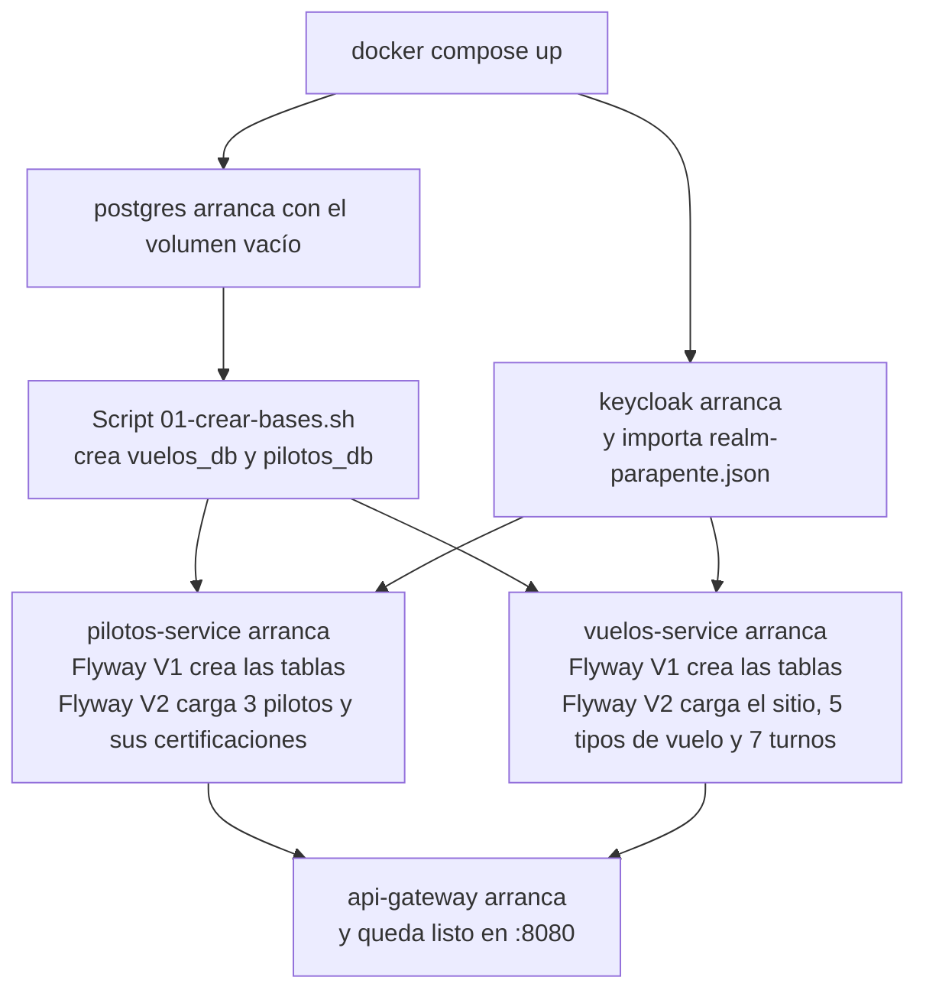

| Qué | Cómo se carga | Qué contiene |
|---|---|---|
| **Las dos bases** | `infra/postgres/init/01-crear-bases.sh`, **solo con el volumen vacío** | `vuelos_db` y `pilotos_db` |
| **Las tablas de Vuelos** | Flyway, `V1__esquema.sql` | sitios, tipos_vuelo, turnos, reservas |
| **Los datos de Vuelos** | Flyway, `V2__datos_prueba.sql` | El sitio Villa Carlos Paz, 5 tipos de vuelo y 7 turnos (con fechas relativas a hoy) |
| **Las tablas de Pilotos** | Flyway, `V1__esquema.sql` | pilotos, certificaciones, asignaciones |
| **Los datos de Pilotos** | Flyway, `V2__datos_prueba.sql` | 3 pilotos y sus certificaciones |
| **Usuarios, roles y clientes** | Keycloak, `--import-realm` con `keycloak/realm-parapente.json` | `cliente1`, `piloto1`, `admin1`, los 3 roles y los clientes de Swagger y Postman |

**Flyway** son scripts SQL numerados (`V1`, `V2`...). Al arrancar, cada servicio ejecuta los que todavía no corrió. Como la base está vacía, corre todos. Hibernate después solo **verifica** (`ddl-auto=validate`) que el esquema coincida con las entidades.

### Variantes del comando (para no borrar de más)

| Para | Comando | Datos |
|---|---|---|
| **Reiniciar todo desde cero** (el de arriba) | `docker compose down -v && docker compose up -d` | Se borran |
| **Reiniciar y recompilar el código** (si alguien lo cambió) | `docker compose down -v && docker compose up --build -d` | Se borran |
| **Apagar sin borrar nada** | `docker compose stop` | Se conservan |
| **Volver a encender lo apagado** | `docker compose start` | Se conservan |
| **Bajar los contenedores pero conservar los datos** | `docker compose down` (sin `-v`) | Se conservan, pero los turnos no se regeneran |
| **Reiniciar un solo servicio** | `docker compose restart vuelos-service` | Se conservan |

**Cuidado con `down` sin `-v`:** conserva la base, así que Flyway **no vuelve a cargar** los datos, y las fechas de los turnos siguen siendo las del día en que se creó.

## 4. Comandos útiles

| Para | Comando |
|---|---|
| Ver qué está encendido y si está sano | `docker compose ps` |
| Ver el registro de un servicio en vivo | `docker compose logs -f vuelos-service` |
| Ver el registro de todos | `docker compose logs -f` |
| Correr los tests (sin Docker) | `cd vuelos-service && mvn test` (igual en los otros 3) |
| Probar que el gateway responde | `curl http://localhost:8080/actuator/health` |

## 5. Apagar y prender servicios (para las pruebas manuales)

**Desde la terminal:**

```bash
docker compose stop pilotos-service
```

```bash
docker compose start pilotos-service
```

Cambiá `pilotos-service` por `clima-service` para la otra prueba. Después de `start`, **esperá unos 20 segundos** a que esté `healthy` (`docker compose ps`).

**Desde Docker Desktop (sin comandos):** en **Containers**, abrí el grupo `tpbackend`, ubicá el servicio y tocá **Stop** (cuadrado) o **Start** (triángulo). **No uses el tacho**: borra el contenedor.

**Reglas:**
- `stop` y `start` **no borran datos**. Solo pausan y reanudan.
- **Apagá solo el servicio de la prueba**, no `postgres` ni `keycloak`.
- Un servicio olvidado apagado se ve como `Exited` en `docker compose ps`.

## 6. Salvedades y problemas conocidos

| Situación | Qué pasa | Qué hacer |
|---|---|---|
| **"failed to connect to the docker API"** (Windows) o "Cannot connect to the Docker daemon" (Mac) | Docker Desktop no está abierto | Abrí Docker Desktop y esperá a "Engine running" |
| **"Falta .env: copiá .env.example a .env"** | No creaste el archivo de configuración | `cp .env.example .env` (Mac) o `copy .env.example .env` (Windows) |
| **Docker Desktop no arranca en Windows** | Falta WSL 2 o la virtualización | En PowerShell como administrador: `wsl --install` y reiniciar. Si pide activar la virtualización en la BIOS, hacerlo |
| **Cerraste Docker Desktop** | Los contenedores se apagan | Abrilo y `docker compose up -d`. Los datos se conservan |
| **Turnos sin fechas futuras** | Pasaron más de 2 días desde que se creó la base | `docker compose down -v && docker compose up -d` |
| **El primer arranque tarda mucho** | Descarga imágenes y compila 4 servicios | Normal: 5 a 15 minutos. Los siguientes son rápidos |
| **Un servicio falla al compilar al construir** | Puede ser un fallo transitorio por compilar en paralelo | Repetir `docker compose up --build` |
| **El puerto 8080 u 8180 está ocupado** | Otro programa lo usa | Cerrar ese programa y volver a levantar |
| **La carpeta está en OneDrive o tiene espacios** | Normalmente funciona, a veces da problemas raros | Mover la carpeta a algo como `C:\tpi-parapente` |
| **Aviso de saltos de línea en `01-crear-bases.sh`** (Windows) | Un archivo con saltos de línea de Windows no se ejecuta en Linux | El repositorio tiene `.gitattributes` para evitarlo; si pasa, volver a descargar el ZIP |
| **El pronóstico real cambia** | Los turnos PRUEBA pueden dar distinto según el clima del día | No es un error; ver Parte IV, sección 5 |
| **Las claves de Keycloak son de prueba** | Sirven solo para la demo | No usar en producción |

**Para la demo del día:** una hora antes, en la PC donde se va a exponer, `docker compose down -v && docker compose up --build`, y esperar a los 6 `healthy`.

---
---

# PARTE VI. ESTADO, PENDIENTES Y PREGUNTAS FINALES

## 1. Estado frente a la consigna

| Criterio | Pts | Estado | Detalle |
|---|---|---|---|
| Proceso de negocio de punta a punta | 15 | **Listo y verificado** | Reserva, rechazos, clima caído, pilotos caído, cancelación y revisión probados contra el sistema real |
| Arquitectura | 12 | **Listo** | Gateway, 3 servicios, una base por servicio, estructura por funcionalidad. Diagramas en `docs/arquitectura/` |
| Integración entre servicios y externa | 12 | **Listo y verificado** | Vuelos a Pilotos, Vuelos a Clima, Clima a Open-Meteo (datos reales) |
| Reglas de negocio | 10 | **Listo** | Diez reglas, cada una con su clase y su test (`docs/reglas.md`) |
| Calidad técnica | 10 | **Listo con huecos** | 104 tests verdes, errores con formato único, Swagger. Hueco: sin tests de lógica para turnos, tipos de vuelo, CRUD de pilotos ni agenda |
| Persistencia y despliegue | 10 | **Listo; verificado en una Mac** | Falta probarlo en Windows y Linux |
| Seguridad | 8 | **Listo y verificado** | Keycloak, tres roles, 401, 403, reserva ajena, login real |
| Alcance comprometido | 8 | **Casi** | Diferencia conocida: reprogramar con el clima caído responde 503. Revisar el cuestionario enviado |
| Desafío asumido | 5 | **Listo** | `docs/desafio.md` y la sección 11 de esta guía |
| Colecciones de Postman | 5 | **Corridas y verificadas** | Flujo completo 46 de 51 (los 5 fallos fueron por lluvia real en el turno 4). Seguridad y errores 36 de 39 más las manuales, verificadas apagando servicios |
| Presentación y defensa | 5 | **Material listo; falta repartir y ensayar** | Esta guía |
| Apreciación docente | 5 | Depende del docente | Prolijidad, que todos entiendan |

## 2. Lo que falta hacer

1. **Probarlo en Windows** y en la PC de cada integrante, desde cero (Parte V, sección 1). Cada uno debería hacerlo una vez.
2. **Probar a mano** lo que no se verificó contra el sistema real: finalizar una reserva, y el CRUD de administración (crear turno, tipo de vuelo, piloto y certificación). Sirve la tabla de consultas libres de la Parte IV, sección 9.
3. **Repartir las cinco partes** entre los integrantes y **ensayar** con reloj.
4. **Releer el cuestionario enviado** contra el estado real (la diferencia de reprogramar con clima caído).
5. **Antes de exponer:** resetear la base, correr `mvn test` en la PC de la demo, y chequear el pronóstico.

Opcional, si sobra tiempo: tests de lógica para turnos, tipos de vuelo y pilotos, y hacer atómico el control de cupo.

## 3. Preguntas generales (las 12 clásicas, para todo el grupo)

1. **¿Por qué esta distribución en tres servicios?** Porque Vuelos, Pilotos y Clima tienen datos y reglas distintos, y cada uno tiene dueño y despliegue propio.
2. **¿Dónde están las reglas de negocio?** En clases puras sin Spring: `ReglasReserva` y `EstadoReserva` (Vuelos), `ReglasAsignacion` (Pilotos), `ReglaClima` (Clima). La tabla completa está en `docs/reglas.md`.
3. **¿Cómo colaboran los servicios?** Vuelos orquesta y llama por HTTP con JSON a Pilotos (buscar, asignar, liberar) y a Clima (veredicto), reenviando el token del usuario.
4. **¿Qué papel cumple Open-Meteo?** Es la fuente externa del pronóstico. Solo Clima la consulta y aplica la regla.
5. **¿Cómo es la seguridad y los roles?** Keycloak emite el token con roles CLIENTE, PILOTO y ADMIN. El gateway y cada servicio lo validan, y además hay reglas por pertenencia: una reserva ajena responde 404.
6. **¿Por qué Keycloak?** Resuelve usuarios, contraseñas, roles y tokens estándar sin que nuestros servicios manejen contraseñas.
7. **¿Por qué no hay una librería común?** Lo compartido es mínimo, y una librería acoplaría versiones y despliegues. Se repite a propósito dentro de cada servicio.
8. **¿Qué pasa si cae Clima?** La reserva queda CONFIRMACION_PENDIENTE con el piloto reservado y se resuelve al revalidar. Nunca se confirma sin pronóstico.
9. **¿Qué pasa si cae Pilotos?** Vuelos responde 503 y no guarda nada. Si cae después de guardar, borra la reserva.
10. **¿Por qué la estructura por funcionalidad?** Para que el código muestre el negocio (`reservas`, `turnos`, `clima`) y cada cambio toque una sola carpeta.
11. **¿Por qué el gateway no enruta `/internos`?** Porque esos endpoints son solo para llamadas entre servicios y no deben ser accesibles desde afuera.
12. **¿Qué falta o qué limitaciones tiene?** Sin pruebas de integración automáticas con base real, el cupo no es atómico bajo concurrencia, y la revisión del clima la dispara un administrador.

## 4. Preguntas "quisquillosas" transversales

- **¿Qué es la arquitectura de microservicios y por qué la usaron acá?** Dividir el sistema en servicios chicos e independientes, cada uno con su responsabilidad y su base. Acá cada servicio tiene un dueño de datos distinto, y cada uno puede cambiarse o escalar por separado.
- **¿Qué desventajas tiene?** Más piezas (6 contenedores), más memoria, y coordinar fallas entre servicios. Lo asumimos con el 503 y la marcha atrás simple.
- **¿Qué es un API Gateway?** Una puerta de entrada única que valida la identidad y reparte los pedidos. Centraliza la seguridad y esconde los servicios internos.
- **¿Qué es Docker y por qué lo usaron?** Empaqueta cada programa con todo lo que necesita para correr. Así el sistema arranca igual en cualquier PC con un solo comando.
- **¿Qué es Flyway?** Una herramienta que aplica scripts SQL numerados para crear y cambiar la base de forma ordenada y repetible.
- **¿Qué es un DTO?** Una clase que define el formato de lo que entra y sale por la API, para no exponer directamente las entidades de la base.
- **¿Qué es una API REST?** Un estilo de API donde cada recurso (reservas, turnos) tiene una dirección y se usan los métodos HTTP: GET para leer, POST para crear, PUT y PATCH para modificar, DELETE para borrar.
- **¿Por qué usaron IA?** Se usó como herramienta de desarrollo. Lo importante es entender qué hace cada pieza y por qué se tomó cada decisión, y eso es lo que preparamos.
- **¿Qué mejorarían?** Pruebas de integración con base real, control de cupo atómico, revisión automática del clima, y un `issuer` validado en producción.

## 5. Ensayo sugerido

| Min | Qué |
|---|---|
| 0 a 10 | Cada uno lee su parte y arma sus 5 puntos |
| 10 a 20 | Alguien cuenta la Parte I completa y los demás lo interrumpen con preguntas |
| 20 a 40 | Cada uno expone su parte (3 minutos) y recibe 2 preguntas del resto |
| 40 a 50 | Ensayo de la posta completa con reloj |
| 50 a 60 | Se anotan las dudas que sobran |

---

## Glosario

| Palabra | Qué decir en simple |
|---|---|
| **Token / JWT** | La pulsera firmada que da Keycloak. Dice quién sos, tu rol y cuándo vence |
| **Keycloak** | El sistema que guarda usuarios y contraseñas y emite los tokens |
| **Gateway** | La puerta de entrada: revisa el token y reparte los pedidos |
| **Rol** | Qué tipo de usuario sos: cliente, piloto o administrador |
| **PKCE** | Una forma de hacer el login desde el navegador sin guardar un secreto |
| **Microservicio** | Un programa chico con un solo trabajo, que se habla con los demás |
| **Orquestar** | Que un servicio (Vuelos) coordine a los demás y decida el resultado |
| **Contenedor** | Una caja que trae un programa listo para correr (Docker) |
| **Healthcheck** | Una prueba que Docker repite para saber si un servicio está listo |
| **Migración (Flyway)** | Un script numerado que arma o cambia las tablas de la base |
| **Idempotente** | Que repetir la operación no cambia el resultado (liberar dos veces es igual que una) |
| **DTO** | El formato JSON que entra y sale por la API |
| **Marcha atrás simple** | Deshacer a mano lo hecho (borrar la reserva, liberar al piloto) |
| **401 / 403 / 404** | No te identificaste / no te corresponde / no existe o no es tuyo |
| **422** | El pedido es válido, pero una regla del negocio lo rechaza |
| **503** | Un servicio del que dependemos no está disponible |
| **Activa (reserva)** | Una reserva que ocupa lugar: pendiente, confirmada, pendiente de confirmar o a reprogramar |
| **Revalidación** | Volver a consultar el clima de las reservas confirmadas |

---

## Mapa de documentos de apoyo (por si hace falta el detalle)

Esta guía unifica el contenido, pero los archivos de `docs/` siguen disponibles:

| Archivo | Para qué |
|---|---|
| `docs/reglas.md` | Tabla de cada regla con su clase y su test |
| `docs/contrato-tecnico.md` | Endpoints, contratos entre servicios y datos de prueba, en detalle técnico |
| `docs/trazabilidad.md` | Qué está cubierto por tests y qué no |
| `docs/desafio.md` | Desafíos y decisiones comparadas |
| `docs/arquitectura/` | Diagramas C4, secuencias y estados |
| `docs/postman/` | Las colecciones y el environment |
