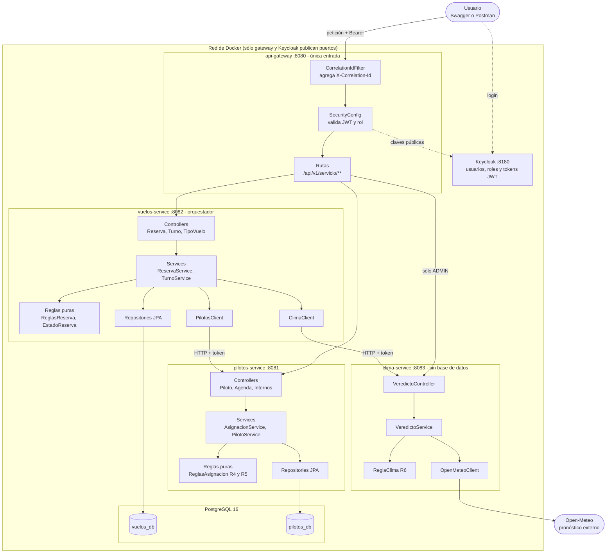
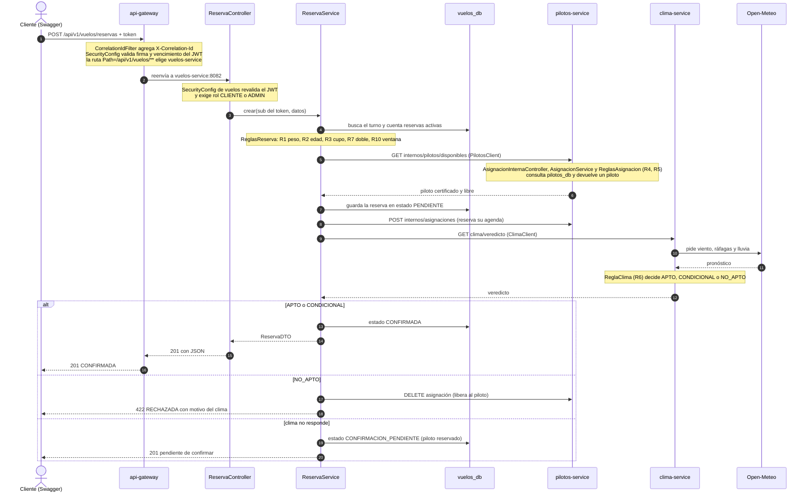

# Guía del equipo: cómo levantar, probar, leer y defender el TPI

Documento de entrada para los cinco integrantes. Si sólo leés una cosa, leé esta. Del detalle se encargan los otros archivos de `docs/`, que se enlazan en cada sección.

## 1. Qué es, en un minuto

Un backend de microservicios para **reservar vuelos en parapente y globo**. Una reserva sólo se confirma si se cumplen tres cosas, y se evalúan en este orden:

1. **El pasajero cumple los requisitos** del tipo de vuelo (peso, edad, cupo del turno, no reservó antes el mismo turno).
2. **Hay un piloto certificado y libre** para ese tipo de vuelo y esa hora.
3. **El pronóstico lo permite** (viento y lluvia, datos reales de Open-Meteo).

Después de confirmada, un administrador puede **revalidar el clima**: lo que dejó de ser viable se libera y queda para reprogramar.

```
                    ┌──────────────┐
 Swagger/Postman ──▶│ api-gateway  │ 8080 (única entrada pública, valida el JWT)
                    └──────┬───────┘
          ┌────────────────┼─────────────────┐
          ▼                ▼                 ▼
   vuelos-service    pilotos-service    clima-service ──▶ Open-Meteo (externo)
   8082 (orquesta)   8081               8083 (sin base)
      │ vuelos_db        │ pilotos_db
      └───────── PostgreSQL ─────────┘          Keycloak 8180: login y roles
```

Vuelos es el **orquestador**: recibe la reserva y llama a Pilotos y a Clima. Pilotos y Clima no se conocen entre sí. Diagramas formales (C4, secuencia, estados): [`docs/arquitectura/`](arquitectura/).

## 2. Cómo levantarlo

Repositorio: **https://github.com/MuruaSL/tpi-parapente-backend**

### Paso a paso desde cero (no hace falta saber Git)

1. **Instalar Docker Desktop**: https://www.docker.com/products/docker-desktop/. Abrirlo y esperar a que diga *Engine running*. En Windows, aceptar WSL2 si lo pide. Conviene darle 4 GB de RAM o más (Settings → Resources). Es lo único que hay que instalar: Java y Maven se usan dentro de Docker.
2. **Bajar el proyecto.** La forma fácil: entrar al repositorio, botón verde **Code** → **Download ZIP** y descomprimir (queda una carpeta `tpi-parapente-backend-main`). Si ya usás Git: `git clone https://github.com/MuruaSL/tpi-parapente-backend.git`.
3. **Abrir una terminal dentro de esa carpeta.**
   - Windows: abrir la carpeta en el Explorador, hacer clic en la barra de direcciones, escribir `cmd` y Enter.
   - Mac: abrir Terminal, escribir `cd ` (con el espacio), arrastrar la carpeta a la ventana y Enter.
4. **Crear el archivo de configuración** (no viene en el repositorio a propósito):
   - Mac o Linux: `cp .env.example .env`
   - Windows: `copy .env.example .env`
5. **Levantar todo:**
   ```bash
   docker compose up --build
   ```
   La primera vez tarda entre 5 y 15 minutos (descarga y compila). Hay que **dejar esa terminal abierta**: cerrarla apaga todo (con Ctrl+C se detiene). Si preferís que no ocupe la terminal, agregá `-d` al final.
6. **Comprobar** que funciona abriendo http://localhost:8080/swagger-ui.html (si Swagger carga, el gateway está arriba) y siguiendo la sección 3.
7. **Para recibir cambios nuevos:** volver a descargar el ZIP y reemplazar la carpeta, o `git pull` si usaron `git clone`. Después `docker compose up --build` otra vez.

Cuando todo está `healthy` (se puede ver con `docker compose ps` en otra terminal), comprobar el gateway:

```bash
curl http://localhost:8080/actuator/health     # {"status":"UP"}
```

| Qué | Dónde |
|---|---|
| Swagger (los 3 servicios, selector arriba a la derecha) | http://localhost:8080/swagger-ui.html |
| Consola de Keycloak | http://localhost:8180 (usuario y clave en `.env`) |

**Usuarios de prueba**

| Usuario | Clave | Rol | Puede |
|---|---|---|---|
| `cliente1` | `Cliente123!` | CLIENTE | ver turnos, reservar, ver y cancelar **sus** reservas |
| `piloto1` | `Piloto123!` | PILOTO | ver su agenda |
| `admin1` | `Admin123!` | ADMIN | todo lo anterior más ver todas las reservas, revalidar, finalizar, administrar turnos/tipos/pilotos |

**Comandos útiles**

| Para | Comando |
|---|---|
| Empezar de cero (borra la base) | `docker compose down -v` y de nuevo `docker compose up --build` |
| Apagar sin borrar nada | `docker compose stop` |
| Volver a encender | `docker compose up -d` |
| Ver logs de un servicio | `docker compose logs -f vuelos-service` |
| Correr los tests (sin Docker) | `cd vuelos-service && mvn test` (igual en los otros 3) |

Cosas que conviene saber antes de la defensa:
- Si cerrás Docker Desktop, los contenedores se apagan. Al abrirlo, `docker compose up -d` los recupera con los datos.
- Los **turnos de prueba se calculan al migrar**: pasados ~2 días hay que hacer `down -v` y levantar de nuevo, o no habrá turnos futuros.
- Los vuelos `PRUEBA_APTO` y `PRUEBA_NO_APTO` dependen del clima real (lluvia ≥ 60 % o viento fuerte los vuelve NO_APTO). Si da distinto de lo esperado, repetir.
- **Cambiar de usuario en Swagger:** Keycloak guarda la sesión. Abrí `http://localhost:8180/realms/parapente/protocol/openid-connect/logout`, confirmá "Logout" y volvé a apretar Authorize. O usá una ventana de incógnito por usuario.

## 3. Cómo probarlo (recorrido para mostrarlo)

Todo desde Swagger, logueado como `cliente1` salvo que se indique otra cosa. Los turnos de prueba están cargados:

| Turno | Tipo | Para qué sirve |
|---|---|---|
| 1, 4, 7 | `PRUEBA_APTO` | reserva feliz: queda CONFIRMADA (el 4 tiene cupo 1, sirve para probar "turno completo") |
| 2 | `PRUEBA_NO_APTO` | clima no apto: queda RECHAZADA con el motivo |
| 3 | `SIN_PILOTO` | nadie certificado: RECHAZADA "sin piloto certificado" |
| 5 | `PARAPENTE_TANDEM` | con peso 300 → RECHAZADA "peso fuera de rango" |
| 6 | `GLOBO` | tipo de vuelo distinto, con otro piloto |

Cuerpo de la reserva: `POST /api/v1/vuelos/reservas` con `{"turnoId":1,"pesoKg":70,"edad":30}`. Una reserva por usuario y turno (R7).

**Lo que ya se probó contra el stack real** (Docker, PostgreSQL, Keycloak y Open-Meteo reales, no mocks):

| Escenario | Resultado verificado |
|---|---|
| Reserva con clima apto | 201 CONFIRMADA, piloto asignado |
| Doble reserva del mismo turno | 422 "ya reservó este turno" |
| Peso fuera de rango | 422 "peso fuera de rango" |
| Sin piloto certificado | 422 "sin piloto certificado" |
| Clima no apto (dato real de viento) | 422 "clima no apto: Viento excede el límite..." |
| Turno completo | 422 "turno completo" |
| **Clima-service detenido** | 201 **CONFIRMACION_PENDIENTE** con el piloto reservado |
| **Pilotos-service detenido** | **503** "Servicio de pilotos no disponible", sin guardar nada |
| Revalidación como admin | 200, resumen `{revisadas, confirmadas, aReprogramar, sinCambios}` |
| Cancelar una reserva | 200 CANCELADA, el piloto queda libre |
| Sin token / rol incorrecto | 401 / 403 |
| Cliente ve todas las reservas | 403 (sólo ADMIN) |
| Ruta interna `/api/v1/internos/**` desde afuera | 404 (el gateway no la enruta) |
| Login de Swagger con Keycloak (PKCE) | funciona |

## 4. Cómo leer el código

### 4.1 Mapa del repositorio

```
tpi-parapente-backend/
├── api-gateway/        ← puerta de entrada (8080): valida el token y reparte las peticiones
├── vuelos-service/     ← el cerebro (8082): turnos, tipos de vuelo y reservas; orquesta a los otros
├── pilotos-service/    ← pilotos, certificaciones y agenda (8081)
├── clima-service/      ← consulta Open-Meteo y decide APTO / CONDICIONAL / NO_APTO (8083)
├── keycloak/           ← realm-parapente.json: usuarios, contraseñas y roles precargados
├── infra/postgres/     ← script que crea las dos bases al primer arranque
├── docs/               ← esta guía, contrato técnico, reglas, diagramas C4 y Postman
├── docker-compose.yml  ← arranca los 6 contenedores
└── .env.example        ← plantilla de configuración (se copia a .env)
```

Los cuatro servicios Java se organizan igual: **un paquete por funcionalidad** y dentro de cada uno siempre las mismas piezas. Si entendés una, entendés todas:

| Pieza | Qué hace | Ejemplo |
|---|---|---|
| **Controller** | Recibe la petición HTTP, valida la forma de los datos y delega. No decide nada. | `ReservaController` |
| **Service** | Coordina el caso de uso: llama a las reglas, a los repositorios y a otros servicios. | `ReservaService` |
| **Reglas puras** | Las decisiones de negocio, en clases chicas sin Spring ni base de datos (fáciles de testear). | `ReglasReserva`, `ReglaClima` |
| **Repository** | Lee y guarda en PostgreSQL (Spring Data JPA). | `ReservaRepository` |
| **Entity** | La clase que representa una fila de la base. | `Reserva`, `Turno` |
| **DTO** | El formato JSON que entra y sale por la API (no se expone la entidad directamente). | `ReservaDTO`, `CrearReservaDTO` |
| **Client** | Llama por HTTP a otro servicio y traduce sus fallas. | `PilotosClient`, `ClimaClient` |
| **seguridad / errores / config** | JWT y roles, respuestas de error con formato único, ajustes. | `SecurityConfig`, `GlobalExceptionHandler` |

### 4.2 El sistema completo

Quién habla con quién. Las líneas punteadas son la parte de seguridad (Keycloak); las continuas, el camino de una petición.



Cómo leerlo:
- **Nadie entra directo a un servicio:** todo pasa por el gateway, que además agrega un identificador (`X-Correlation-Id`) para seguir una petición por los logs de los tres servicios.
- **Vuelos es el único que llama a los otros dos** (`PilotosClient` y `ClimaClient`). Pilotos y Clima no se conocen entre sí.
- **Cada servicio tiene sus propias capas** (controller → service → reglas y repositorio). Es el mismo molde repetido.
- **Cada servicio con base tiene la suya** dentro del mismo PostgreSQL; ninguno lee la base del otro.
- **Clima es el único que habla con Internet** (Open-Meteo).
- Las rutas `/api/v1/internos/**` de Pilotos son sólo para Vuelos y el gateway no las expone.

### 4.3 El camino completo de una reserva

Qué pasa desde que el cliente aprieta Execute en Swagger hasta que recibe la respuesta. Las flechas punteadas son respuestas que vuelven.



Los pasos, en palabras:
1. **Gateway:** pone el identificador de seguimiento, valida el token con las claves públicas de Keycloak (firma y vencimiento) y, según la ruta, lo manda a Vuelos.
2. **Vuelos, seguridad:** vuelve a validar el token y verifica el rol. Saca el usuario del campo `sub` del token; así sabe de quién es la reserva.
3. **Controller → Service:** `ReservaController` sólo traduce HTTP; `ReservaService.crear` hace el trabajo.
4. **Reglas propias** (peso, edad, cupo, doble reserva, ventana de 16 días). Si fallan, se guarda la reserva como RECHAZADA con el motivo y se responde 422. Todavía no se llamó a nadie más.
5. **Pilotos:** se pide un piloto certificado y libre. Si Pilotos está caído → 503 y no se guardó nada. Si no hay ninguno → RECHAZADA.
6. **Se guarda la reserva** y se **reserva la agenda del piloto**. Si esto último falla, se borra la reserva (marcha atrás simple).
7. **Clima:** Vuelos pregunta; Clima consulta Open-Meteo y `ReglaClima` decide. Se confirma, se rechaza liberando al piloto, o, si el clima no responde, queda CONFIRMACION_PENDIENTE (nunca se confirma sin pronóstico).
8. **La respuesta vuelve por el mismo camino:** `ReservaDTO` → JSON → gateway → cliente.

### 4.4 Orden de lectura del código

Estructura **por funcionalidad** ("Screaming Architecture"): las carpetas dicen qué hace el sistema, no qué tipo de clase es. Ejemplo en `vuelos-service/src/main/java/com/parapente/vuelos/`:

```
reservas/    ← el corazón: ReservaService, ReglasReserva, EstadoReserva, Reserva, controller
turnos/      tiposvuelo/      ← catálogo (administrado por ADMIN)
pilotos/     clima/           ← clientes HTTP que llaman a los otros servicios
seguridad/   errores/   config/
```

**Orden de lectura recomendado (de lo más importante a lo accesorio):**

1. [`ReservaService.crear`](../vuelos-service/src/main/java/com/parapente/vuelos/reservas/ReservaService.java): el proceso central. Orden fijo: reglas propias → buscar piloto → guardar y asignar → consultar clima → decidir (y deshacer si algo falla). Casi todo lo que van a preguntar sale de acá.
2. [`ReglasReserva`](../vuelos-service/src/main/java/com/parapente/vuelos/reservas/ReglasReserva.java) y [`EstadoReserva`](../vuelos-service/src/main/java/com/parapente/vuelos/reservas/EstadoReserva.java): reglas R1, R2, R3, R7, R10 y las transiciones válidas (R8). Son clases **puras** (sin Spring ni base), por eso se testean fácil.
3. [`ReglaClima`](../clima-service/src/main/java/com/parapente/clima/veredicto/ReglaClima.java): regla R6 (APTO / CONDICIONAL / NO_APTO).
4. [`ReglasAsignacion`](../pilotos-service/src/main/java/com/parapente/pilotos/asignaciones/ReglasAsignacion.java): certificación (R4) y disponibilidad (R5, máx. 4 vuelos por día).
5. `PilotosClient` y `ClimaClient` (en Vuelos): cómo se llama a otro servicio y cómo se traducen sus fallas.
6. `SecurityConfig` del gateway y de cada servicio, más `ConversorRoles`: de dónde salen los roles del token.
7. `application.yaml` del gateway: las rutas (`/api/v1/<servicio>/**`) y la agregación de Swagger.
8. `docker-compose.yml`, `keycloak/realm-parapente.json` y las migraciones Flyway (`src/main/resources/db/migration`): infraestructura y datos de prueba.

Mapa regla → clase → test: [`docs/reglas.md`](reglas.md). Endpoints, roles y contratos entre servicios: [`docs/contrato-tecnico.md`](contrato-tecnico.md).

**Ideas que hay que poder explicar con tus palabras:**
- *Orquestación:* Vuelos manda; si Pilotos falla antes de guardar → 503 y nada queda a medias; si el clima no responde → CONFIRMACION_PENDIENTE (nunca se confirma sin pronóstico).
- *Marcha atrás simple:* si falla algo después de reservar al piloto, se lo libera (sin sagas ni transacciones distribuidas).
- *Seguridad en dos capas:* el gateway valida el JWT, y cada servicio vuelve a validarlo. El rol sale de `realm_access.roles`; la propiedad de una reserva, del `sub` del token (una reserva ajena responde 404).
- *Por qué Keycloak:* usuarios, contraseñas (hasheadas), roles y tokens estándar sin escribirlo nosotros.

## 5. Estado frente a la consigna

La rúbrica de corrección tiene 12 criterios y 105 puntos (los vimos al armar el plan). Estado hoy, sin maquillar:

| Criterio | Pts | Estado | Qué hay / qué falta |
|---|---|---|---|
| NEG-01 Proceso de negocio de punta a punta | 15 | **Listo y verificado** | Reserva, rechazos, clima caído, pilotos caído, cancelación y revalidación probados contra el stack real. |
| ARQ-01 Arquitectura | 12 | **Listo** | Gateway + 3 servicios, una base por servicio, estructura por funcionalidad, C4 y secuencias en `docs/arquitectura/`. |
| INT-01 Integración entre servicios y externa | 12 | **Listo y verificado** | Vuelos→Pilotos, Vuelos→Clima, Clima→Open-Meteo (datos reales). |
| NEG-02 Reglas de negocio | 10 | **Listo** | R1 a R10, cada una con su clase y test (`docs/reglas.md`). |
| TEC-01 Calidad técnica | 10 | **Listo con huecos** | 104 tests verdes, errores con formato único, Swagger, código comentado. Hueco: no hay tests de lógica para turnos, tipos de vuelo, CRUD de pilotos ni contenido de la agenda. |
| INF-01 Persistencia y despliegue | 10 | **Listo; verificado sólo en una Mac** | PostgreSQL + Flyway + Docker Compose funcionando con un comando. **Falta probarlo en Windows/Linux** de otros integrantes. |
| SEG-01 Seguridad | 8 | **Listo y verificado** | Keycloak con 3 roles, 401/403, propiedad de reservas, login real desde Swagger. |
| ALC-01 Alcance comprometido (cuestionario) | 8 | **Casi** | Todo lo comprometido está implementado. Diferencia conocida: reprogramar con el clima caído responde 503 en vez de dejar CONFIRMACION_PENDIENTE. Revisar el cuestionario enviado contra esto antes de la fecha. |
| DES-01 Desafío asumido | 5 | **Listo** | [`docs/desafio.md`](desafio.md): desafíos, decisiones comparadas y límites. |
| API-01 Colecciones de Postman | 5 | **Armadas, sin ejecutar** | Hay 2 colecciones + environment en `docs/postman/`. **Nunca se corrieron**: puede haber scripts que fallen. |
| PRE-01 Presentación y defensa | 5 | **Material listo, falta repartir y ensayar** | Guión general y cinco partes por integrante en [`docs/guion-exposicion.md`](guion-exposicion.md); 12 preguntas en [`docs/guia-defensa.md`](guia-defensa.md). |
| DOC-01 Apreciación docente | 5 | Depende del docente | Prolijidad, README, que todos sepan explicarlo. |

Extras que **no** están (decisión del grupo): Prometheus y Grafana. Se sacaron "por ahora".

## 6. Pruebas que faltan (en orden de importancia)

**A. Lo que más riesgo tiene: nunca se ejecutó**
1. **Colecciones de Postman** (API-01). Importar las dos colecciones y el environment de `docs/postman/`, correrlas con el Runner y anotar qué falla. Instrucciones en [`docs/postman/README.md`](postman/README.md). **Ojo:** el flujo sólo funciona sobre datos recién sembrados (cambia cupos y reservas, y no se puede repetir sobre la misma base), así que antes de correrlo hay que hacer `docker compose down -v && docker compose up -d`. La base de esta Mac ya tiene reservas de las pruebas manuales.
2. **Levantarlo en Windows** (y en cualquier otra PC del grupo): clonar el repo desde cero, `cp .env.example .env` (o `copy`), `docker compose up --build`. Vigilar el aviso de saltos de línea del script `infra/postgres/init/01-crear-bases.sh`. Cada integrante debería hacerlo una vez.

**B. Funciones que no se probaron a mano contra el stack real**
3. **Roles en Swagger**: entrar como `piloto1` (agenda 200; reservar debe dar 403) y como `admin1` (listar todas las reservas, revalidar).
4. **Finalizar una reserva** (`PATCH /reservas/{id}/finalizacion`, admin): CONFIRMADA → COMPLETADA; y probar una transición inválida (completar una CANCELADA debe dar 422).
5. **Reprogramación** (`PATCH /reservas/{id}/reprogramacion`): hace falta una reserva en A_REPROGRAMAR. Con clima real es difícil provocarla a demanda; está cubierta por tests unitarios. Pensar cómo mostrarla (o decir claramente que se demuestra con el test).
6. **Administración como admin**: crear un turno, un tipo de vuelo, un piloto y una certificación (son las funciones sin tests automáticos).
7. **Ver los estados en el momento**: pasar un turno de `PRUEBA_NO_APTO` y reservar, y detener `clima-service` para ver CONFIRMACION_PENDIENTE (así se hace la demo: `docker compose stop clima-service`).

**C. Antes de la entrega**
8. **Empezar de cero**: `docker compose down -v` + `up --build`, para tener turnos futuros frescos el día de la defensa.
9. **`mvn test` en los 4 módulos** en la PC donde se va a mostrar.
10. **Repartir las cinco partes de [`guion-exposicion.md`](guion-exposicion.md) y ensayar** (el guión general lo sabe todo el grupo; cada uno prepara su parte a fondo).
11. **Releer el cuestionario enviado** contra el estado real (sección 5, ALC-01).

**D. Opcional si sobra tiempo (mejora TEC-01)**
12. Tests de lógica para `TurnoService`, `TipoVueloService`, `PilotoService`, el contenido de `mi-agenda` y `finalizar`.
13. Hacer atómico el control de cupo (hoy dos reservas simultáneas al último lugar podrían pasar; está marcado en el código).

## 7. Límites conocidos (decirlos en la defensa, no esconderlos)

- El cupo y la doble reserva no son atómicos ante concurrencia.
- El `issuer` del token no se valida (el host de Keycloak difiere dentro y fuera de Docker); se valida firma y expiración.
- Los servicios internos confían en el token que reenvía el gateway; el aislamiento lo da la red de Docker.
- Keycloak corre en modo desarrollo (`start-dev`, sin TLS) y las claves de usuarios de prueba son sólo para demo.
- La revalidación la dispara un administrador; no hay tarea programada automática.
- No hay pruebas de integración automáticas contra PostgreSQL o Keycloak; esas se hicieron a mano (sección 3).

## 8. Cómo se reparte la exposición

El docente pidió (audios del 9/11/2026) un **guión general** que todo el grupo sabe y un **guión detallado por integrante**, donde cada uno se centra en **una parte del código**. Las preguntas son sobre el código, sin trampas, y se asume que se usó IA: lo que cuenta es entender qué hace.

Todo está en [`docs/guion-exposicion.md`](guion-exposicion.md): el guión general (incluido el flujo de autenticación) y cinco partes para repartir, cada una con qué explicar, archivos a leer, qué mostrar y preguntas probables.

| Parte | Tema |
|---|---|
| A | Autenticación, roles y gateway |
| B | El proceso de reserva (Vuelos) |
| C | Reglas de negocio y pruebas |
| D | Pilotos y comunicación entre servicios |
| E | Clima, revalidación e infraestructura |

Cada integrante prepara **su** parte a fondo y conoce el resto a grandes rasgos. Quién toma cuál lo decide el grupo.
