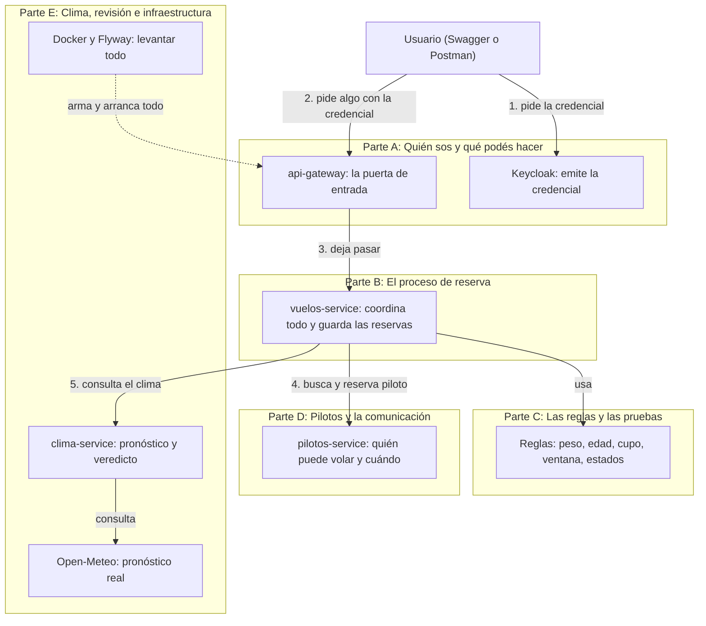
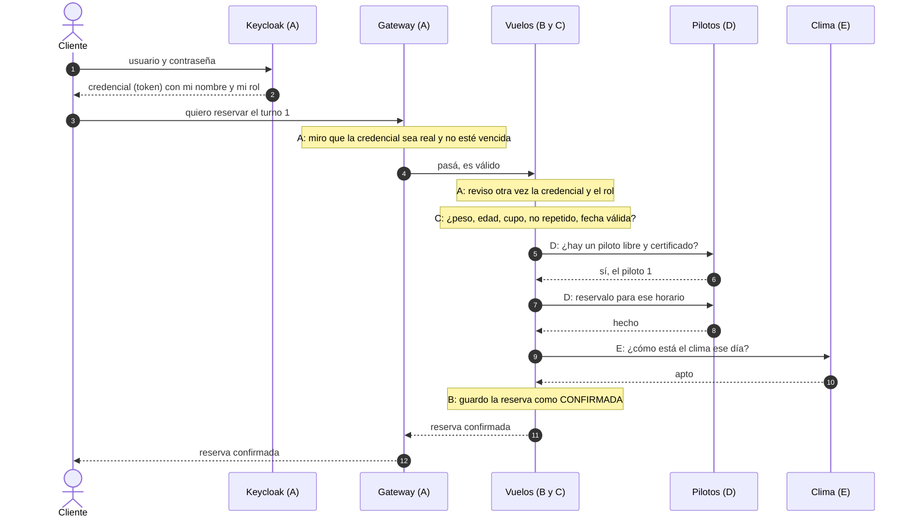
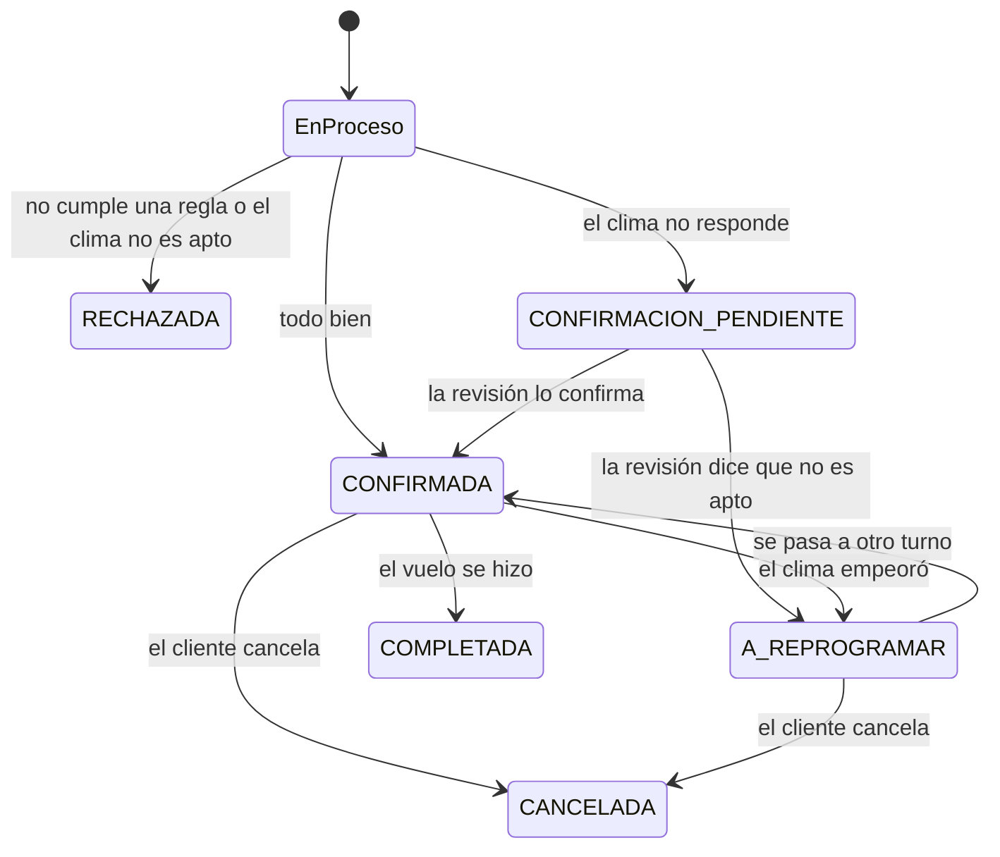
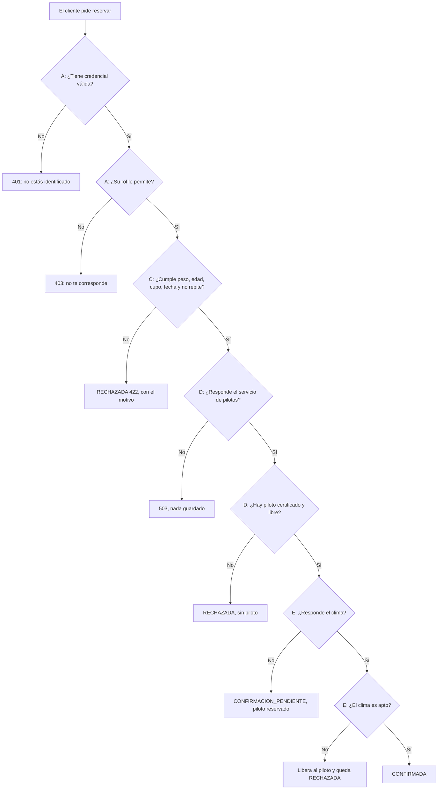
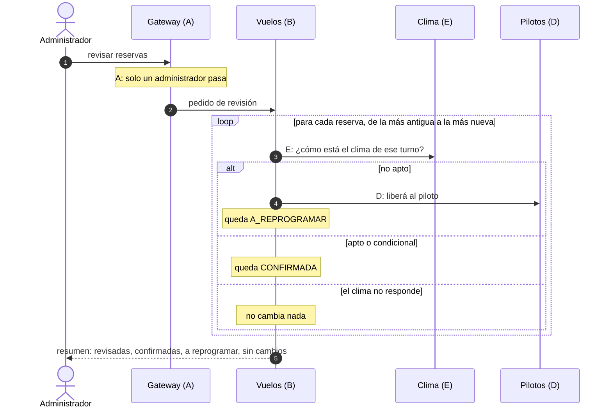

# Guía fácil de las cinco partes

Esta guía acompaña a [`guion-exposicion.md`](guion-exposicion.md). El guion dice **qué archivos leer y qué preguntas pueden hacer**. Esta guía explica **qué hace cada parte, con palabras simples**, y cómo se conecta con las demás.

Cómo usarla:
1. Leé primero la sección 1 (el mapa) y la 2 (el recorrido de una reserva). Sirven para todas las partes.
2. Después leé tu parte a fondo (sección 3) y las otras por arriba.
3. Al final (sección 4) hay otros recorridos que cruzan varias partes, y un glosario.

---

## 1. El mapa: quién es quién

El sistema es un conjunto de piezas chicas, cada una con un trabajo. Las partes A a E de la exposición son grupos de esas piezas.

Dos ideas para quedarse:
- **Vuelos es el que manda.** Pilotos y Clima nunca se hablan entre sí: solo Vuelos les pregunta.
- **Cada servicio es dueño de sus datos.** Vuelos tiene sus reservas, Pilotos tiene sus pilotos. Si Vuelos quiere algo de pilotos, se lo pide; no mira su base.

---

## 2. El recorrido completo de una reserva (conecta las cinco partes)

Es el flujo más importante. Si podés contarlo de principio a fin, entendés casi todo.

En palabras: el cliente se identifica, la puerta de entrada lo deja pasar, Vuelos revisa las reglas, busca un piloto, consulta el clima y recién ahí confirma.

**El orden no es casual.** Primero lo más barato (las reglas propias, que no necesitan preguntar a nadie), después el piloto, y al final el clima. Así no se gasta una consulta de clima por una reserva que igual iba a rechazarse por el peso.

---

## 3. Las cinco partes en simple

### Parte A. Quién sos y qué podés hacer (autenticación, roles, gateway)

**En una frase.** Antes de hacer cualquier cosa tenés que demostrar quién sos, y según tu rol podés hacer unas cosas y otras no.

**La analogía.** Es un recital con pulseras:
- **Keycloak** es la boletería. Te pide usuario y contraseña y te da una **pulsera** (el token). La pulsera dice quién sos, qué rol tenés y cuándo vence. Viene firmada, así que no se puede falsificar.
- **El gateway** es el guardia de la puerta. Mira tu pulsera: ¿es auténtica? ¿venció? Si no pasa, no entra.
- **Cada servicio** es una sala con su propio guardia, que vuelve a mirar la pulsera. No confían solo en el guardia de la puerta.

**Paso a paso (el login con Swagger):**
1. Tocás "Authorize" en Swagger.
2. Swagger te manda a la pantalla de login de Keycloak.
3. Ingresás usuario y contraseña. Keycloak te devuelve la pulsera.
4. Cada pedido que hacés lleva la pulsera.
5. El gateway la revisa con las claves públicas de Keycloak. No le pregunta a Keycloak cada vez: alcanza con la firma y la fecha de vencimiento.
6. Si pasa, reenvía el pedido, y el servicio la revisa de nuevo y comprueba que tu rol alcance.

**Los tres roles:**

| Rol | Qué puede |
|---|---|
| Cliente | Reservar y ver, cancelar o reprogramar solo lo suyo |
| Piloto | Ver su propia agenda |
| Administrador | Todo: turnos, pilotos, tipos de vuelo, revisar el clima |

**Las tres respuestas que más se ven:**
- **401:** no te identificaste, o tu pulsera venció.
- **403:** te identificaste, pero ese lugar no es para tu rol (un cliente pidiendo el listado completo).
- **404:** pedís una reserva ajena. El sistema contesta "no existe", y no "no tenés permiso", para no revelar que existe.

**Se conecta con:** todas. Toda petición pasa primero por acá. Los servicios internos (`/api/v1/internos`) ni siquiera tienen puerta desde afuera: solo se hablan entre ellos.

**Qué mirar en el código:** `keycloak/realm-parapente.json` (usuarios y roles) y `SecurityConfig.java` del gateway (qué ruta exige qué rol).

**Cómo respondés una pregunta típica.** *"¿Por qué validan el token dos veces?"* Porque un servicio no debe confiar a ciegas en quien lo llama. Si alguien llegara a una sala sin pasar por la puerta, el guardia de la sala igual lo frena.

---

### Parte B. El proceso de reserva (Vuelos)

**En una frase.** Vuelos recibe el pedido, consulta a los demás en un orden fijo y decide cómo termina la reserva. Si algo falla, no deja nada a medias.

**La analogía.** Es un organizador de eventos que, antes de confirmarte, comprueba que haya lugar, que haya un guía libre y que el día esté lindo. Si algo no cierra, te dice por qué.

**Los cuatro pasos, en orden:**
1. **Revisa las reglas propias** (parte C). Si falla una, la reserva queda RECHAZADA y se guarda el motivo.
2. **Pide un piloto** (parte D). Si no hay ninguno, queda RECHAZADA. Si el servicio de pilotos no responde, devuelve un 503 y **no guarda nada**.
3. **Guarda la reserva y reserva al piloto.** Si en ese instante falla la reserva del piloto, borra la reserva y devuelve 503.
4. **Consulta el clima** (parte E):
   - Apto o condicional: **CONFIRMADA**.
   - No apto: libera al piloto y queda RECHAZADA.
   - Clima caído: queda **CONFIRMACION_PENDIENTE**, con el piloto ya reservado. Nunca se confirma sin pronóstico.

**Los estados de una reserva:**

**Dos decisiones que te van a preguntar:**
- **¿Por qué se guarda una reserva RECHAZADA?** Para que quede registro del motivo. Por eso el proceso no es "todo o nada": un rechazo no debe deshacerse.
- **¿Qué es la "marcha atrás simple"?** Si algo falla después de reservar al piloto, el sistema lo libera o borra la reserva a mano. No hace falta algo más complejo, porque hay un solo paso con efecto afuera.

**Se conecta con:** A (llega ya identificado), C (usa las reglas), D (pide y libera pilotos), E (consulta el clima y se revisa después).

**Qué mirar en el código:** el método `crear` de `ReservaService.java`. Es el corazón del sistema.

---

### Parte C. Las reglas y las pruebas

**En una frase.** Son las condiciones que tiene que cumplir una reserva, escritas de forma que se puedan probar solas.

**Las reglas, en palabras:**

| Qué se revisa | Cuándo se rechaza |
|---|---|
| Peso | Está fuera del rango del tipo de vuelo (el límite exacto sí sirve) |
| Edad | Es menor a la mínima del tipo de vuelo |
| Cupo | El turno ya no tiene lugares libres |
| No repetir | El cliente ya tiene una reserva activa en ese turno |
| Fecha | El turno ya pasó o está a más de 16 días |
| Piloto certificado | Ningún piloto está certificado para ese tipo de vuelo |
| Piloto libre | El piloto ya tiene otro vuelo a esa hora, o ya hizo 4 ese día |
| Clima | Viento por encima del límite, o lluvia del 60% o más |
| Estados | Se intenta un cambio de estado que no está permitido |
| Revisión | Se revisan primero las reservas más antiguas |

**Por qué viven en clases "puras".** Cada regla es una función simple que recibe datos y dice sí o no, sin base de datos ni servidor. Se prueban en un instante y el código dice claramente qué exige.

**Las pruebas.** Hay 104 automáticas y pasan todas. Hay tres tipos, y conviene saber distinguirlos:

| Tipo de prueba | Qué comprueba | Ejemplo |
|---|---|---|
| De regla | Que la regla acierte en los límites | Peso justo en el mínimo, lluvia en 59% y en 60% |
| De proceso, con piezas simuladas | Que el proceso haga lo correcto cuando otros responden de cierta manera | Si pilotos no tiene a nadie, se rechaza sin tocar el clima |
| De seguridad en la capa web | Que cada rol reciba el código correcto | Cliente en el listado completo da 403 |

**Lo que no está probado** (decilo con honestidad): lógica de turnos y tipos de vuelo, el CRUD de pilotos, la agenda, y pruebas automáticas con base de datos real o Keycloak real. Esas se probaron a mano con Postman.

**Se conecta con:** B (usa las reglas), D y E (cada uno tiene las suyas: pilotos su certificación y agenda, clima su veredicto).

**Qué mirar en el código:** `ReglasReserva.java` y su test, y `docs/reglas.md` (tabla de cada regla con su archivo y su prueba).

---

### Parte D. Pilotos y la comunicación entre servicios

**En una frase.** Pilotos sabe quién puede volar y cuándo. Vuelos le pregunta y le pide cosas por una vía interna.

**La analogía.** Vuelos es el organizador y Pilotos es la agenda de los guías. Vuelos pregunta "¿quién está libre el miércoles a las 10?", y después "reservámelo".

**Qué decide Pilotos:**
- **Certificación:** el piloto tiene que estar certificado para ese tipo de vuelo (tándem, globo).
- **Agenda:** no puede tener otro vuelo a la misma hora, ni más de 4 en el día.

**Las tres cosas que Vuelos le pide:**
1. **Buscar uno disponible** para un tipo de vuelo y una hora.
2. **Asignarlo** a una reserva (queda anotado en su agenda).
3. **Liberarlo**, si la reserva se rechaza, se cancela o se reprograma.

**Cómo se hablan.** Por pedidos web entre servicios, en un lenguaje común (JSON). Vuelos manda dos cosas en cada pedido:
- **La pulsera** (el token) del usuario, para que Pilotos también compruebe permisos.
- **Un número de seguimiento** (`X-Correlation-Id`), para poder seguir un mismo pedido por todos los registros.

**Qué pasa si algo sale mal:**
- Pilotos no tiene a nadie: Vuelos lo toma como un rechazo del negocio.
- Pilotos está caído: Vuelos lo toma como una falla externa y devuelve 503 sin guardar nada.
- El piloto se ocupa entre que se lo busca y se lo asigna: Pilotos lo rechaza, y Vuelos borra la reserva y devuelve 503.

**Por qué las rutas internas no se ven desde afuera.** Son para que Vuelos le hable a Pilotos y nadie más. El gateway no las expone: desde afuera dan 404.

**Por qué hay una base por servicio.** Cada servicio es dueño de sus datos. Si Vuelos quiere saber algo de un piloto, se lo pregunta, no mira su tabla.

**Se conecta con:** B (es el que lo llama) y A (reenvía la pulsera).

**Qué mirar en el código:** `PilotosClient.java` (en Vuelos) y `AsignacionService.java` (en Pilotos).

---

### Parte E. Clima, revisión posterior e infraestructura

**En una frase.** Clima dice si se puede volar, la revisión vuelve a preguntarlo más tarde, y Docker arma todo para que funcione.

**El veredicto del clima.**
Clima consulta el pronóstico real en Open-Meteo y compara con los límites del tipo de vuelo. Toma el mayor entre el viento y las ráfagas:

| Situación | Veredicto | Qué pasa con la reserva |
|---|---|---|
| Viento igual o menor al límite | APTO | Se confirma |
| Viento un poco por encima, dentro del margen | CONDICIONAL | Se confirma con aviso |
| Viento más allá del margen, o lluvia del 60% o más | NO_APTO | Se rechaza |

Clima no tiene base de datos: solo consulta y responde.

**La revisión (revalidación).**
Una reserva confirmada hoy puede dejar de ser viable cuando el pronóstico cambia. El administrador puede pedir que se revisen todas:
- A cada reserva confirmada o pendiente, con turno futuro, se le vuelve a consultar el clima, **empezando por las más antiguas**.
- Si ahora es no apto: se libera al piloto y pasa a A_REPROGRAMAR.
- Si es apto: se confirma (también las que estaban pendientes).
- Si el clima no responde: no cambia nada.
Al final devuelve un resumen con cuántas revisó, cuántas confirmó, cuántas pasaron a reprogramar y cuántas quedaron sin cambios.

La dispara un administrador y no una tarea automática porque es más simple de demostrar.

**La infraestructura.**
- **Docker Compose** es un botón que levanta los 6 programas juntos (con `docker compose up`), cada uno en su caja (contenedor). Solo la puerta de entrada (8080) y Keycloak (8180) se ven desde afuera.
- **Flyway** son recetas numeradas que arman las tablas y cargan los datos de prueba (los 7 turnos). Hibernate después solo verifica que coincida, no cambia nada.
- **PostgreSQL** guarda los datos: una base para Vuelos y otra para Pilotos.
- **Los turnos de prueba** se crean con fechas relativas a hoy. Si pasan más de 2 días desde que se creó la base, hay que recrearla con `docker compose down -v && docker compose up --build`.

**Se conecta con:** B (Vuelos consulta el clima al reservar y lo vuelve a consultar al revisar) y con todas (Docker las levanta a todas).

**Qué mirar en el código:** `ReglaClima.java`, `ReservaService.revalidar` y `docker-compose.yml`.

---

## 4. Otros recorridos que cruzan las partes

### 4.1 Cuando algo se rechaza o falla

Mirá dónde se corta cada caso. Es útil para responder "¿qué pasa si...?".

### 4.2 Cuando el clima cambia después (la revisión)

Después, el cliente puede **reprogramar** su reserva a otro turno (pasa a CONFIRMADA otra vez) o **cancelarla** (libera el lugar y al piloto).

### 4.3 Cómo se prueba cada parte con Postman

| Parte | Qué probás | Dónde |
|---|---|---|
| A | Sin token da 401; cliente en el listado completo da 403; reserva ajena da 404 | Colección "Seguridad y errores", carpetas 1 y 2 |
| B | Reserva feliz, cancelar, reprogramar | "Flujo completo", carpetas 1 y 4 |
| C | Rechazo por peso, edad, cupo, doble reserva | "Flujo completo", carpeta 2 |
| D | Sin piloto; pilotos apagado da 503; rutas internas no expuestas | "Flujo completo" carpeta 2; "Seguridad y errores" carpetas 3 y 4 |
| E | Clima no apto; revisión; clima apagado | "Flujo completo" carpeta 3; "Seguridad y errores" carpeta 4 |

Detalle de cada consulta en [`postman-explicado.md`](postman-explicado.md).

---

## 5. Glosario: lo que pueden preguntar y cómo decirlo en simple

| Palabra | Qué decir |
|---|---|
| **Token / JWT** | La pulsera firmada que te da Keycloak. Dice quién sos, tu rol y cuándo vence |
| **Keycloak** | El sistema que guarda usuarios y contraseñas y emite los tokens |
| **Gateway** | La puerta de entrada: revisa la pulsera y reparte los pedidos |
| **Rol** | Qué tipo de usuario sos: cliente, piloto o administrador |
| **Microservicio** | Un programa chico con un solo trabajo, que se habla con los demás |
| **Orquestar** | Que un servicio (Vuelos) coordine a los demás y decida el resultado |
| **Contenedor** | Una caja que trae un programa listo para correr (Docker) |
| **Migración (Flyway)** | Una receta numerada que arma o cambia las tablas de la base |
| **401 / 403 / 404** | No te identificaste / no te corresponde / no existe o no es tuyo |
| **422** | El pedido es válido, pero una regla del negocio lo rechaza |
| **503** | Un servicio del que dependemos no está disponible |
| **Marcha atrás simple** | Deshacer a mano lo hecho (borrar la reserva, liberar al piloto) |

---

## 6. Cómo defenderlo

1. **Todos cuentan la sección 2.** Si podés narrar el recorrido de una reserva de punta a punta, ya tenés la base.
2. **Cada uno profundiza una parte** y conoce las otras por el mapa de la sección 1.
3. **Si no sabés algo, razonalo con el mapa.** Por ejemplo: "esa parte es de pilotos, pero por lo que vi, Vuelos le pregunta y no mira su base".
4. **Los límites se dicen con honestidad:** el cupo no es atómico si dos reservas llegan a la vez, no hay pruebas automáticas con base real, y Keycloak corre en modo desarrollo.
