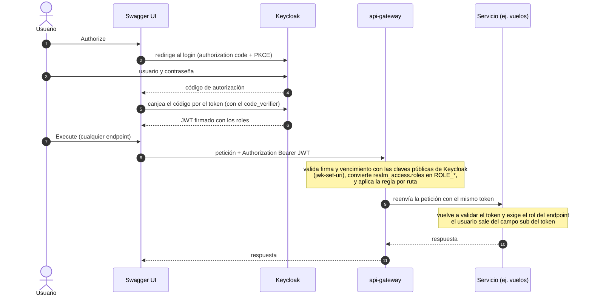

# Guion de la exposición

Formato indicado por el docente (audios del 9/11/2026):

- Hay que armar **un guión general** del código (cómo funciona cada microservicio y cada pieza, incluido el **flujo de autenticación**) y **un guión detallado por integrante**: cada uno se centra en **una parte del código**.
- Las preguntas son **sobre el código que hicimos**; no son preguntas trampa. Es una exposición como cualquier otra: hablar y explicar.
- El docente sabe que se usó IA. Lo que se evalúa es que **entendamos qué hace el código**, no quién lo escribió.
- Es el mismo tipo de pregunta que una consulta sobre el TP en un parcial: explicar con las propias palabras.

Cómo usar este documento: la parte 1 la sabe **todo el grupo**; la parte 2 se reparte (cada integrante prepara **una** parte a fondo y conoce el resto a grandes rasgos). Complementa a [`guia-equipo.md`](guia-equipo.md) (cómo levantar, probar y leer) y a [`guia-defensa.md`](guia-defensa.md) (12 preguntas probables).

---

## Parte 1. Guion general (lo cuenta cualquiera del grupo, ~5 minutos)

**1. El problema (30 s).** Una empresa de vuelos en parapente y globo confirmaba reservas sin saber si había piloto ni si el viento permitía volar. Hacemos un backend que **sólo confirma si hay un piloto certificado libre y el pronóstico lo permite**, y que revalida el clima antes del vuelo.

**2. Las piezas (1 min).** Seis contenedores, un solo `docker compose up`:

| Pieza | Puerto | Para qué |
|---|---|---|
| `api-gateway` | 8080 | única entrada pública; valida el token y reparte las peticiones |
| `vuelos-service` | 8082 | turnos, tipos de vuelo y reservas; **orquesta** a los otros dos |
| `pilotos-service` | 8081 | pilotos, certificaciones y agenda |
| `clima-service` | 8083 | consulta Open-Meteo y devuelve APTO / CONDICIONAL / NO_APTO |
| `keycloak` | 8180 | usuarios, roles y emisión de tokens |
| `postgres` | interno | `vuelos_db` y `pilotos_db` (una base por servicio) |

Mostrar los diagramas de [`guia-equipo.md`](guia-equipo.md) sección 4.2 (sistema completo) y 4.3 (camino de una reserva).

**3. El flujo de autenticación (1,5 min).** Es lo que el docente pidió explícitamente.

Para explicarlo con palabras:
- **Keycloak** guarda usuarios y contraseñas (hasheadas) y emite el **JWT**: un token firmado que dice quién sos (`sub`), qué roles tenés (`realm_access.roles`) y cuándo vence.
- Hay tres **roles**: CLIENTE, PILOTO y ADMIN. Los usuarios de prueba y sus roles están en `keycloak/realm-parapente.json`.
- **Swagger** usa el cliente `parapente-swagger` con authorization code + **PKCE** (no lleva secreto en el navegador). **Postman** usa el cliente `parapente-postman` con usuario y contraseña directos.
- El **gateway** no consulta a Keycloak en cada petición: valida la **firma** con las claves públicas y el **vencimiento**. Los servicios **repiten la validación** (no confían ciegamente en quien los llama).
- Sin token → **401**. Token válido pero rol que no corresponde → **403**. Reserva ajena → **404**.
- Simplificación asumida y que hay que decir: no se valida el `issuer` del token porque el host de Keycloak difiere dentro y fuera de Docker.

**4. El proceso central (1,5 min).** Contar `ReservaService.crear` con el diagrama 4.3: reglas propias → piloto → guardar y asignar → clima → decidir. Dos ideas para destacar: *nunca se confirma sin pronóstico* (clima caído → CONFIRMACION_PENDIENTE) y *marcha atrás simple* (si falla algo después de reservar al piloto, se lo libera).

**5. Demo corta (30 s).** Reserva feliz con `cliente1` en el turno 1; y una rechazada (peso fuera de rango en el turno 5). Después `GET /reservas` como `cliente1` para mostrar el 403.

**6. Límites honestos (30 s).** Cupo no atómico bajo concurrencia, sin pruebas de integración automáticas, Keycloak en modo desarrollo. Ver [`guia-equipo.md`](guia-equipo.md) sección 7.

---

## Parte 2. Guiones detallados por integrante

Cada integrante toma **una** parte. Para cada una: qué explicar, qué archivos leer, qué mostrar y qué preguntas pueden hacerle. Todos los archivos están enlazados.

### Parte A. Autenticación, roles y gateway

**Explicar:** el flujo de autenticación completo (Parte 1, punto 3); cómo el gateway decide quién pasa; qué hace cada `SecurityConfig`; cómo se convierten los roles; qué rutas están abiertas y cuáles no; por qué `/api/v1/internos/**` no se enruta; cómo se agrega Swagger de los tres servicios.

**Leer:**
1. [`keycloak/realm-parapente.json`](../keycloak/realm-parapente.json): roles, usuarios y los dos clientes.
2. [`api-gateway/.../seguridad/SecurityConfig.java`](../api-gateway/src/main/java/com/parapente/gateway/seguridad/SecurityConfig.java) y [`ConversorRoles.java`](../api-gateway/src/main/java/com/parapente/gateway/seguridad/ConversorRoles.java).
3. [`api-gateway/src/main/resources/application.yaml`](../api-gateway/src/main/resources/application.yaml): rutas y Swagger agregado.
4. [`CorrelationIdFilter.java`](../api-gateway/src/main/java/com/parapente/gateway/correlacion/CorrelationIdFilter.java): el identificador de seguimiento.
5. `SecurityConfig` de [vuelos](../vuelos-service/src/main/java/com/parapente/vuelos/seguridad/SecurityConfig.java): la tabla de permisos por endpoint (matriz en [`contrato-tecnico.md`](contrato-tecnico.md)).

**Mostrar en vivo:** pedir un endpoint sin token (401); con `cliente1` en `GET /reservas` (403); con `admin1` (200); el candado de Swagger y el login.

**Preguntas probables:**
- *¿Por qué Keycloak y no un JWT propio?* Resuelve usuarios, contraseñas, roles y tokens estándar sin que nuestro código maneje contraseñas.
- *¿Qué es un JWT y qué contiene?* Un token firmado con `sub`, roles y vencimiento; se valida con la firma, sin consultar a Keycloak cada vez.
- *¿Por qué validan el token en el gateway y también en cada servicio?* Un servicio no debe confiar ciegamente en quien lo llama.
- *¿Qué diferencia hay entre 401 y 403?* 401: no estás autenticado; 403: estás autenticado pero tu rol no alcanza.
- *¿Por qué el gateway usa otro tipo de seguridad (reactivo) que los servicios?* Spring Cloud Gateway es reactivo (WebFlux); los servicios son MVC.

### Parte B. El proceso de reserva (Vuelos)

**Explicar:** el orden de `ReservaService.crear` y por qué ese orden; los estados de una reserva y sus transiciones; qué pasa en cada falla; por qué `crear` no es `@Transactional`.

**Leer:**
1. [`ReservaController.java`](../vuelos-service/src/main/java/com/parapente/vuelos/reservas/ReservaController.java): sólo traduce HTTP.
2. [`ReservaService.java`](../vuelos-service/src/main/java/com/parapente/vuelos/reservas/ReservaService.java), método `crear` (y después `cancelar`, `reprogramar`, `finalizar`).
3. [`EstadoReserva.java`](../vuelos-service/src/main/java/com/parapente/vuelos/reservas/EstadoReserva.java) y [`Reserva.java`](../vuelos-service/src/main/java/com/parapente/vuelos/reservas/Reserva.java).
4. [`GlobalExceptionHandler.java`](../vuelos-service/src/main/java/com/parapente/vuelos/errores/GlobalExceptionHandler.java): cómo cada falla se convierte en 422 o 503 con el mismo formato JSON.
5. Diagrama de estados: [`docs/arquitectura/estados-reserva.md`](arquitectura/estados-reserva.md).

**Mostrar en vivo:** reserva feliz, doble reserva (422), pilotos detenido (503, nada guardado), clima detenido (CONFIRMACION_PENDIENTE): `docker compose stop pilotos-service` / `clima-service`.

**Preguntas probables:**
- *¿Qué pasa si Pilotos se cae?* Antes de guardar → 503 y no queda nada; después de guardar → se borra la reserva.
- *¿Y si cae Clima?* La reserva queda CONFIRMACION_PENDIENTE con el piloto reservado; nunca se confirma sin pronóstico.
- *¿Por qué se guarda una reserva RECHAZADA?* Para dejar registro del motivo; por eso `crear` no es transaccional (un 422 no debe revertirlo).
- *¿Qué es la marcha atrás simple?* Compensar a mano (borrar la reserva, liberar al piloto) en lugar de una saga o transacción distribuida, porque hay un solo paso con efecto externo.

### Parte C. Reglas de negocio y pruebas

**Explicar:** las diez reglas R1 a R10; por qué viven en clases puras; qué cubre cada tipo de test (`@WebMvcTest` para seguridad, Mockito para el servicio, JUnit para las reglas); qué falta probar.

**Leer:**
1. [`docs/reglas.md`](reglas.md): tabla regla → código → test.
2. [`ReglasReserva.java`](../vuelos-service/src/main/java/com/parapente/vuelos/reservas/ReglasReserva.java), [`ReglasAsignacion.java`](../pilotos-service/src/main/java/com/parapente/pilotos/asignaciones/ReglasAsignacion.java) y [`ReglaClima.java`](../clima-service/src/main/java/com/parapente/clima/veredicto/ReglaClima.java).
3. Los tests: `ReglasReservaTest`, `ReglasAsignacionTest`, `ReglaClimaTest`, `ReservaServiceTest` y `SeguridadReservasWebMvcTest`.
4. [`docs/trazabilidad.md`](trazabilidad.md): qué está cubierto y qué no.

**Mostrar en vivo:** `cd vuelos-service && mvn test` (56 tests), y un test de límites exactos (por ejemplo R1 con el peso justo en el mínimo).

**Preguntas probables:**
- *¿Cómo sabés que R6 funciona en el límite?* `ReglaClimaTest` prueba los valores exactos, lluvia 59 % y 60 %.
- *¿Por qué las reglas no usan Spring?* Para testearlas sin levantar nada y que el código "grite" la regla.
- *¿Qué es `@WebMvcTest`?* Levanta sólo la capa web (controller + seguridad) con servicios simulados; prueba permisos y respuestas HTTP sin base de datos.
- *¿Qué no está probado?* Tests de lógica de turnos, tipos de vuelo, CRUD de pilotos y la agenda; no hay pruebas de integración automáticas con PostgreSQL.

### Parte D. Pilotos y la comunicación entre servicios

**Explicar:** cómo Pilotos decide quién puede volar (certificación R4, agenda R5); cómo Vuelos lo llama (`PilotosClient`, `ClimaClient`); qué se reenvía (token y `X-Correlation-Id`); cómo se traducen las fallas; por qué `/internos` existe y no se expone.

**Leer:**
1. [`AsignacionService.java`](../pilotos-service/src/main/java/com/parapente/pilotos/asignaciones/AsignacionService.java) y [`ReglasAsignacion.java`](../pilotos-service/src/main/java/com/parapente/pilotos/asignaciones/ReglasAsignacion.java).
2. [`AsignacionInternaController.java`](../pilotos-service/src/main/java/com/parapente/pilotos/asignaciones/AsignacionInternaController.java): los tres endpoints internos.
3. [`PilotosClient.java`](../vuelos-service/src/main/java/com/parapente/vuelos/pilotos/PilotosClient.java), [`ClimaClient.java`](../vuelos-service/src/main/java/com/parapente/vuelos/clima/ClimaClient.java) y [`ReenvioCabecerasInterceptor.java`](../vuelos-service/src/main/java/com/parapente/vuelos/seguridad/ReenvioCabecerasInterceptor.java).
4. Contrato entre servicios: [`contrato-tecnico.md`](contrato-tecnico.md).
5. Migraciones de datos: `pilotos-service/src/main/resources/db/migration`.

**Mostrar en vivo:** la agenda de `piloto1` (`GET /pilotos/mi-agenda`) antes y después de reservar; el log de Vuelos mostrando la llamada a Pilotos; el 404 al pedir `/api/v1/internos/...` desde afuera.

**Preguntas probables:**
- *¿Cómo se comunican los servicios?* HTTP/JSON síncrono, con `RestClient`; Vuelos llama a los otros dos.
- *¿Por qué Pilotos y Clima no se llaman entre sí?* Para que sólo Vuelos orqueste y no haya dependencias cruzadas.
- *¿Qué pasa si el piloto se ocupa entre que se busca y se asigna?* Al asignar se vuelve a validar R5 y Pilotos responde 422; Vuelos lo trata como falla de la dependencia: borra la reserva y responde 503.
- *¿Por qué una base por servicio?* Cada uno es dueño de sus datos; sólo se intercambian por la API.

### Parte E. Clima, revalidación e infraestructura

**Explicar:** cómo se consulta Open-Meteo y cómo se decide el veredicto; la revalidación (qué cambia de estado y en qué orden); cómo arranca todo con Docker Compose, qué hace Flyway y de dónde salen los datos de prueba.

**Leer:**
1. [`VeredictoService.java`](../clima-service/src/main/java/com/parapente/clima/veredicto/VeredictoService.java), [`OpenMeteoClient.java`](../clima-service/src/main/java/com/parapente/clima/pronostico/OpenMeteoClient.java) y [`ReglaClima.java`](../clima-service/src/main/java/com/parapente/clima/veredicto/ReglaClima.java).
2. `ReservaService.revalidar` y `reprogramar` en [`ReservaService.java`](../vuelos-service/src/main/java/com/parapente/vuelos/reservas/ReservaService.java).
3. [`docker-compose.yml`](../docker-compose.yml), los `Dockerfile` de cada servicio y [`.env.example`](../.env.example).
4. Migraciones Flyway: `vuelos-service/src/main/resources/db/migration` (esquema y datos de prueba).

**Mostrar en vivo:** `POST /reservas/revalidacion` como `admin1` y leer el resumen; `docker compose ps` con los seis contenedores *healthy*; la tabla de turnos de prueba.

**Preguntas probables:**
- *¿Qué hace la revalidación?* Para las reservas confirmadas o pendientes con turno futuro, en orden de antigüedad, vuelve a consultar el clima: NO_APTO libera al piloto y pasa a A_REPROGRAMAR; APTO o CONDICIONAL confirma; si el clima no responde, no cambia nada.
- *¿Por qué la dispara un administrador y no una tarea programada?* Es más simple de demostrar; la automática queda fuera del alcance.
- *¿Qué pasa si Open-Meteo no responde?* Clima devuelve 503 y Vuelos lo trata como "clima no disponible".
- *¿Qué es Flyway y por qué `ddl-auto=validate`?* Flyway crea el esquema con scripts versionados; Hibernate sólo verifica que coincida, no lo modifica.
- *¿Por qué una imagen multi-etapa?* Compila con Maven en una etapa y deja una imagen final liviana, que corre con un usuario sin privilegios.

---

## Reglas para la exposición

1. **Explicá con tus palabras.** Nadie espera que recites código: sí que cuentes qué hace y por qué, como en una respuesta de parcial.
2. **Todos conocen la Parte 1.** Cualquiera puede ser interrumpido con una pregunta general (por ejemplo "¿cómo se autentica un usuario?").
3. **Si no sabés algo, decilo y razoná.** Ejemplo: "esa parte la preparó otro compañero, pero por lo que veo en el diagrama...". Es mejor que inventar.
4. **Que el código funcione en la demo.** Antes de exponer: `docker compose down -v && docker compose up --build`, para tener turnos futuros y una base limpia.
5. **El uso de IA no se esconde.** El docente ya lo asume: lo importante es poder explicar cada decisión y por qué se tomó (ver [`desafio.md`](desafio.md)).

## Ensayo sugerido (45 minutos)

| Min | Qué |
|---|---|
| 0-10 | Cada uno lee su parte y arma sus 5 puntos |
| 10-20 | Alguien del grupo cuenta la Parte 1 completa, los demás lo interrumpen con preguntas |
| 20-40 | Cada uno expone su parte (3 minutos) y recibe 2 preguntas del resto |
| 40-45 | Se anotan las dudas que sobran |
